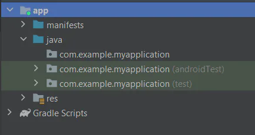
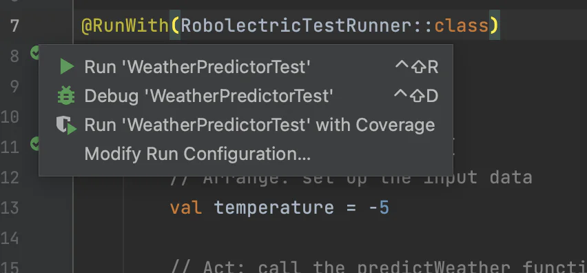
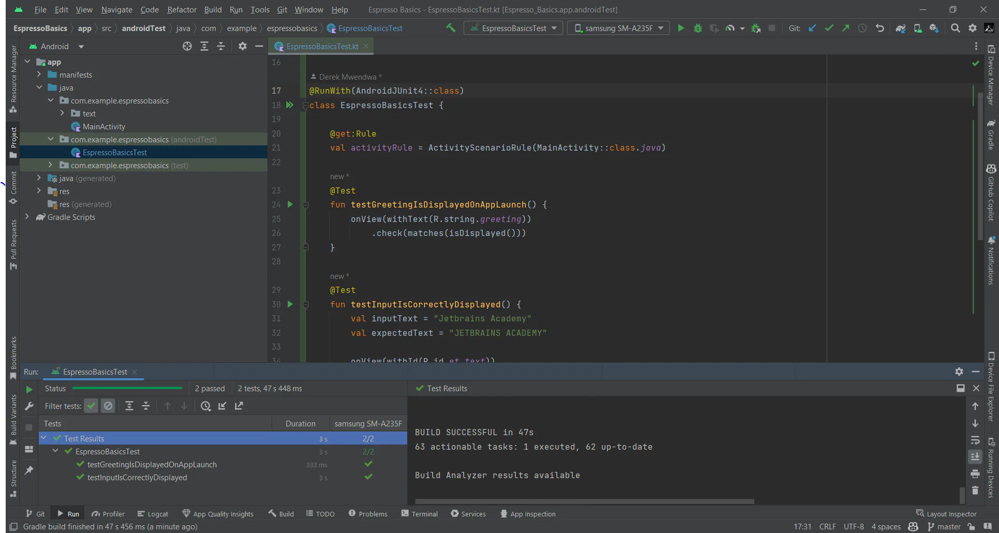

# Testing Android Applications

Testing is an important step in app development, because it improves the app's quality.
Well-tested code is easier to maintain and extend as the app evolves.

Also, testing provides developers and stakeholders with confidence that the app works as intended.

Additionally, as testing allows us to catch and address issues early in the development cycle, it reduces the cost of fixing them later.

## Types of tests in Android

There are various types of tests, each serving a unique purpose in the development process.

- **Unit tests** are written to verify that specific pieces of code work correctly.
These focus on testing individual units or functions of the code in isolation. Android Studio supports the use of JUnit for writing unit tests.

- **Integration tests** check how different parts of the app work together. We would use integration testing to ensure that components (e.g., activities, fragments, services) interact correctly. Tools like Robolectric are commonly used for integration testing.

- **UI tests** verify that the UI elements and workflows behave as expected. UI tests simulate user interactions with the app's graphical user interface (GUI). Espresso is a popular framework for creating UI tests in Android Studio.

## Setting up the testing environment

To get started with testing in Android Studio, we'll need to configure our project for testing.

Android Studio groups different code into directories called **source sets**

By default, there is the `main` source set, which contains the app code. There are also the source sets `test` for local tests and `androidTest` for instrumented tests.

Local tests and instrumented tests differ in how they are executed:
- **Local tests** (e.g., unit tests) run on the local development machine or server.
- **Instrumented tests** (e.g., UI tests) run on a physical device or an emulator.


We'll also need to ensure that our project's `build.gradle` file includes the necessary dependencies for testing frameworks like JUnit, Robolectric, Espresso, or any other testing library we plan to use

There are two types of dependencies:
`testImplementation` and `androidTestImplementation`.
The former is a dependency for tests in the test source set and the latter is a dependency for tests in the androidTest source set.



To create a test class, we need to right-click on the directory where we want to create our test (e.g., `com.example.myapplication` (test) for unit tests).

Select `New` -> `Kotlin Class/File`. Let's give our class a meaningful name.
For example, if we're testing our Calculator class, we can name our unit test class as `CalculatorUnitTest`.

## Writing unit tests

We can use frameworks like **JUnit**, **Mockito** to help with writing unit tests.

In this example, we'll create a test for a "WeatherPredictor" class that is responsible for predicting the weather based on the temperature.

```kotlin
class WeatherPredictor {
    companion object {
        fun predictWeather(temperature: Int): String {
            return when {
                temperature < 0 -> "Cold"
                temperature in 0..25 -> "Moderate"
                else -> "Hot"
            }
        }
    }
}
```

The following is an example of how to write a test class with unit tests. Let's create three test methods to test the logic of the "WeatherPredictor" class.

```kotlin
package com.example.hyperskilltesting

import org.junit.Test
import org.junit.Assert.*;

class WeatherPredictorTest {

    @Test
    fun testPredictColdWeather() {
        // Arrange: set up the input data
        val temperature = -5

        // Act: call the predictWeather function of the WeatherPredictor class
        val result = WeatherPredictor.predictWeather(temperature)

        // Assert: assert that the result matches the expected weather prediction
        assertEquals(result,"Cold")
    }

    @Test
    fun testPredictModerateWeather() {
        // Arrange
        val temperature = 20

        // Act
        val result = WeatherPredictor.predictWeather(temperature)

        // Assert
        assertEquals(result,"Moderate")
    }

    @Test
    fun testPredictHotWeather() {
        // Arrange
        val temperature = 30

        // Act
        val result = WeatherPredictor.predictWeather(temperature)

        // Assert
        assertEquals(result,"Hot")
    }
}
```

We're using the "Arrange, Act, Assert" pattern to organize our test case.

## Writing UI tests

For instrumented tests (UI tests), we will create test classes in the `com.example.myapplication` (androidTest) directory.
We can use frameworks like **Espresso** or UI Automator for UI testing to simulate user interactions and verify the behavior of our app's user interface.

Let's see an example of an Espresso UI test for a screen that contains a button. We will try to verify that the button makes the text "Button clicked" appear when clicked.

```kotlin
import androidx.test.espresso.Espresso
import androidx.test.espresso.action.ViewActions
import androidx.test.espresso.matcher.ViewMatchers
import androidx.test.ext.junit.runners.AndroidJUnit4
import androidx.test.rule.ActivityTestRule
import org.junit.Rule
import org.junit.Test
import org.junit.runner.RunWith

@RunWith(AndroidJUnit4::class)
class ButtonScreenTestKt {

    @get:Rule
    val activityRule = ActivityTestRule(ButtonActivity::class.java)

    @Test
    fun clickButton_displaysText() {
        // Click the button
        onView(ViewMatchers.withId(R.id.button)).perform(ViewActions.click())

        // Verify that the text "Button clicked" is displayed
        onView(ViewMatchers.withText("Button clicked")).check(ViewAssertions.matches(ViewMatchers.isDisplayed()))
    }
}
```

1. We use the `@RunWith(AndroidJUnit4::class)` annotation to specify that we're using AndroidJUnit4 as the test runner.

2. The `@Rule` annotation sets up an `ActivityTestRule` for the `ButtonActivity`, which helps launch the activity for testing.

3. We use Espresso's `onView` method along with `ViewMatchers` to locate and interact with UI elements (e.g., `R.id.button`, `R.id.newScreenTextView`).

4. We perform an action by clicking the button using `ViewActions`.

5. Finally, we use `ViewAssertions` to check that the text "Button clicked" is displayed.

6. Again, don't worry if you don't understand all the code. For now, know that we're using Espresso to test the functionality of a button.

## Running tests and analyzing the results

To run the tests, we can right-click on the test class or the test directory in the project explorer.

Select "Run (Test Class Name)". Android Studio will execute the test and display the results in the "Run" or "Debug" window

For instrumented tests, Android Studio will execute the test on an emulator or physical device and report the test results.



Android Studio will provide feedback on whether the tests have passed or failed.
If a test fails, the framework will provide information about which assertion failed and the expected vs.
actual values, helping us pinpoint the issue. When we encounter a failed test, we can:

- Diagnose the failure by checking the code we're testing, the test input, dependencies, and assertions.

- Identify and fix the root cause of the failure.

- Rerun the test to verify that it passes after the fix.


Espresso has a structure similar to JUnit tests because it is based on JUnit, but it includes additional methods that allow us to interact with the user interface.
Here is an example Espresso test for our app:

```kotlin
@RunWith(AndroidJUnit4::class)
class EspressoBasicsTest {

    @get:Rule
    val activityRule = ActivityScenarioRule(MainActivity::class.java)

    @Test
    fun testGreetingIsDisplayedOnAppLaunch() {
        onView(withText(R.string.greeting))
            .check(matches(isDisplayed()))
    }

    @Test
    fun testInputIsCorrectlyDisplayed() {
        val inputText = "Jetbrains Academy"
        val expectedText = "JETBRAINS ACADEMY"

        onView(withId(R.id.et_text))
            .perform(typeText(inputText), closeSoftKeyboard())

        onView(withId(R.id.rb_uppercase))
            .perform(click())

        onView(withId(R.id.bt_display))
            .perform(click())

        onView(withId(R.id.tv_display))
            .check(matches(withText(expectedText)))
    }
}
```

- The `@RunWith` annotation from `org.junit.runner.RunWith` is used to specify the test runner. 

> [!NOTE]
> The test runner is in charge of executing the test cases on a physical device or emulator.

- The `EspressoBasicsTest` class holds our test cases. 
- Before we execute the test cases, we first need to launch our app. You can do it by specifying a JUnit rule. 
The `@get:Rule` annotation is used to declare a JUnit rule.  The JUnit's rule annotation is imported from `org.junit.Rule`.
We are using the `ActivityScenarioRule`, a JUnit rule that launches an activity before a test starts and finishes it after the test ends.
- we specified two test methods using the `@Test` annotation from `org.junit.Test`, Here is where Espresso comes in.
- Espresso provides the `onView()` method from `androidx.test.espresso.Espresso.onView`, which is our entry point to interact with views. 
`onView()` takes in a ViewMatcher, a [hamcrest matcher](https://www.slideshare.net/shaiyallin/hamcrest-matchers) used to locate views in the current view hierarchy.
- It then returns a `ViewInteraction` object with which we can use the method `perform()` to perform actions on the matched view or `check()` to make assertions
The `perform()` method takes in **ViewActions**, whereas the `check()` method takes in a **ViewAssertion**.

## ViewMatchers

**ViewMatchers**, as the name suggests, are basically matcher objects for matching views that implement the `Matcher<View>` interface from the Hamcrest library.
They are used to specify criteria or conditions for finding views within the current view hierarchy.
A view must meet the specified conditions in order to be matched
You can pass one or more `ViewMatchers` to the `onView()` method which returns a `ViewInteraction` object that you can use to perform actions or check assertions on the matched view.

There are many built-in methods that return `ViewMatchers` in Espresso 

## View Matchers in Espresso

| Matcher                   | Description |
|---------------------------|-------------|
| **`withId()`**            | Matches a view with the provided ID. |
| **`withText()`**          | Matches a view with the provided text. |
| **`withContentDescription()`** | Matches a view with the provided content description. |
| **`isEnabled()`**         | Matches a view that is enabled. |
| **`isChecked()`**         | Matches a view that is checked (e.g., when using a checkbox). |
| **`isDisplayed()`**       | Matches a view that is partially or completely displayed in the current view hierarchy. |
| **`isCompletelyDisplayed()`** | Matches a view that is completely displayed in the current view hierarchy. |

You can also combine multiple matchers using combination matchers such as `allOf()` or `anyOf()` and inverse a matcher using `not()`. For example, you can write:

```kotlin
onView(allOf(withId(R.id.button), not(withText("OK")), isDisplayed()))
```

## ViewActions

ViewActions are objects that can be passed to the `ViewInteraction.perform()` method to perform an action on a view, such as clicking, typing, scrolling, and so on.


| Action             | Description |
|--------------------|-------------|
| **`click()`**      | Performs a single click on the view. |
| **`doubleClick()`** | Performs a double click on the view. |
| **`longClick()`**  | Performs a long click on the view. |
| **`typeText()`**   | Types the provided text into an `EditText` view. |
| **`clearText()`**  | Clears any text from an `EditText` view. |
| **`swipeLeft()`**  | Performs a swipe left gesture on the view. |
| **`swipeRight()`** | Performs a swipe right gesture on the view. |


You can also chain multiple `ViewActions` together by using commas. For example:

```kotlin
onView(withId(R.id.edit_text))
    .perform(clearText(), typeText("Hello World!"))
```

Sometimes, you may need to perform an action that is not provided by Espresso or customize an existing one.
In that case, you can create your own custom `ViewAction` by implementing the `ViewAction` interface or extending one of its subclasses (such as `GeneralClickAction`)

## ViewAssertions

We can use ViewAssertions on the `ViewInteraction.check()` method to perform assertions on views, such as checking a view's visibility, text, color, and so on.


The `matches()` method from `androidx.test.espresso.assertion.ViewAssertions` is the most basic method that returns a `ViewAssertion` object that can be used to make assertions. 
The `matches()` method is a helper method that wraps a `ViewMatcher` object into a `ViewAssertion` object. 


`matches()` assertion is used to assert the state of the currently selected view. 
If the matcher provided inside the `matches()` method matches the conditions of the view returned when the `onView()` method was called, then the test passes. Otherwise, it fails.

## Running Espresso tests

Running Espresso tests in Android Studio is simple. Just click the green icon beside the test class then **Run 'NameOfTestClass'** to run the entire test methods in your class or click on the green icon beside a specific test method and then **Run 'NameOfTestMethod'** to run it:



## Tips and extras

Espresso provides the `closeSoftkeyboard()` method, a top-level action that can be used to close the soft keyboard.


> [!WARNING]
>  When using closeSoftKeyboard() or scrollTo(), if the keyboard is already closed or the view is already visible on screen, the methods have no effect.

It's recommended that you close the keyboard when it is not needed. You can also use the `scrollTo()` method to scroll to a view that is loaded but off the screen:


Other top level actions include `pressBack()` and `openActionBarOverflowOrOptionsMenu(context: Context)` (covered in other Espresso topics).

Note that top-level actions are not tied to any particular view, for example, you don't need an `EditText` to press the back button but you need it to perform a typing action. With that being said, you can use these methods wherever you need them in your test method or inside `perform()`:

```kotlin
fun test() {
    // You can use it inside perform maybe after clicking a button
    onView(...)
        .perform(click(), pressBack())

    // Or as a standalone
    pressBack()
}
```


For adapter views, such as `ListView` or `GridView`, the `onView()` method may not be sufficient, and the `onData()` method should be used instead.

This does not apply to `RecyclerView`, a more complex adapter view requiring special handling. The `onData()` method in Espresso takes an **ObjectMatcher** as an argument and returns a `DataInteraction` object.

The `DataInteraction` object allows you to perform actions using the `perform()` method and assertions using the `check()` method similar to how you would do it when using `onView()` with some added functionalities. 


