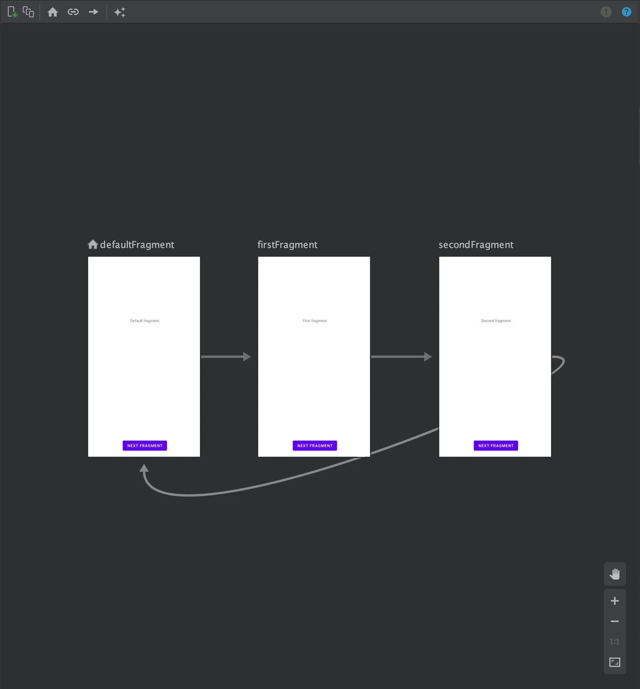

# Navigation graph

There are many ways to implement navigation in Android. Here, we will use **Jetpack's Navigation component**.

The Navigation graph can be used to navigate between fragments and activities (also known as "destinations" in the context of navigation). The Navigation graph is an XML file that contains navigation information. The Navigation Editor can be used to visualize this information. 



The arrows represent actions and the screens represent destinations. The actions represent how to get from one point to another; to perform the actual navigation, the correct action needs to be called at runtime.

Your finished navigation XML file will look something like this:

```xml
<?xml version="1.0" encoding="utf-8"?>
<navigation xmlns:android="http://schemas.android.com/apk/res/android"
    xmlns:app="http://schemas.android.com/apk/res-auto"
    xmlns:tools="http://schemas.android.com/tools"
    android:id="@+id/navigation"
    app:startDestination="@id/defaultFragment">

    <fragment
        android:id="@+id/defaultFragment"
        android:name="com.example.hyperskill_navigation.FragmentDefault"
        android:label="fragment_default"
        tools:layout="@layout/fragment_default">
        <action
            android:id="@+id/action_defaultFragment_to_firstFragment"
            app:destination="@id/firstFragment" />
    </fragment>
    <fragment
        android:id="@+id/firstFragment"
        android:name="com.example.hyperskill_navigation.FragmentFirst"
        android:label="fragment_first"
        tools:layout="@layout/fragment_first" >
        <action
            android:id="@+id/action_firstFragment_to_secondfragment"
            app:destination="@id/secondFragment" />
    </fragment>
    <fragment
        android:id="@+id/secondFragment"
        android:name="com.example.hyperskill_navigation.FragmentSecond"
        android:label="fragment_second"
        tools:layout="@layout/fragment_second" >
        <action
            android:id="@+id/action_secondFragment_to_defaultFragment"
            app:destination="@id/defaultFragment" />
    </fragment>
</navigation>
```
## NavHostFragment

After you have finished working with the graph, you'll need to add `NavHostFragment` to your layout for fragment navigation.
Let's add this to the app's main activity. The `NavHostFragment` can be thought of as the window that swaps between different fragment destinations in the navigation graph. To add the `NavHostFragment`, you'll need to add `FragmentContainerView` to your activity.
This container is where your entire graph will be displayed.


```xml
<androidx.fragment.app.FragmentContainerView
    android:id="@+id/fragmentContainerView"
    android:name="androidx.navigation.fragment.NavHostFragment"
    android:layout_width="match_parent"
    android:layout_height="match_parent"
    app:defaultNavHost="true"
    app:navGraph="@navigation/navigation" />
```

We're using the `android:name` attribute to specify that we want to instantiate the `NavHostFragment` class. The line `app:defaultNavHost="true"` allows them `NavHost` to intercept system Back button presses.

Each `NavHostFragment` has a `NavController` that you’ll use inyou'llJava/Kotlin code. The `NavController` instructs navigation to occur. You find the relevant `NavController` through the `findNavController()` function. Its `navigate()` function takes in a fragment or action id as an argument, as shown below. This must be located in your button's `OnClickListener`.

```kotlin
override fun onViewCreated(view: View, savedInstanceState: Bundle?) {
    view.findViewById<Button>(R.id.go_forward)
        .setOnClickListener {
            findNavController().navigate(R.id.your_fragment_id)
        }
}
```

## reference

- [Navigation graph](https://hyperskill.org/learn/step/34928)


