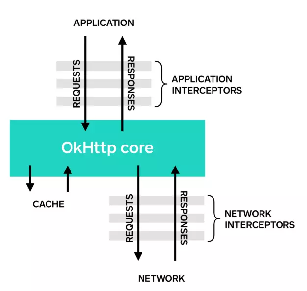

# OkHttp Interceptor

An **Interceptor** in Android is a component that allows you to **intercept and modify** HTTP **requests** and **responses**.
It is commonly used to observe, modify, or even block requests and responses, enabling actions like adding, removing, or transforming headers and other data.

## Types of Interceptors

Interceptors are categorized into two main types:

1. **Application Interceptor**:  
   - **Purpose**: Intercepts and processes requests and responses at the application level.
   - **Characteristics**:
     - Called once per request, even when the response is retrieved from the cache.
     - Commonly used for rewriting headers or queries for both requests and responses.
     - Not affected by HTTP caching.

2. **Network Interceptor**:  
   - **Purpose**: Intercepts and processes requests and responses at the network level.
   - **Characteristics**:
     - Called only for actual network requests, not when responses are served from cache.
     - Useful for monitoring redirects, retries, and accessing low-level request and response details.
     - Can modify headers such as Content-Encoding and Content-Length.

    

## Using Interceptor with OkHttp

**OkHttp** is a powerful HTTP client library in Android that supports Interceptors for managing and processing requests and responses.

### **Adding an Interceptor to OkHttpClient**

```kotlin
val client = OkHttpClient.Builder()
    .addInterceptor { chain ->
        val originalRequest = chain.request()
        val modifiedRequest = originalRequest.newBuilder()
            .header("Authorization", "Bearer your_token")
            .build()
        chain.proceed(modifiedRequest)
    }
    .build()
```
### Adding a Network Interceptor

```kotlin
val client = OkHttpClient.Builder()
    .addNetworkInterceptor { chain ->
        val request = chain.request()
        val response = chain.proceed(request)

        // Modify the response if necessary
        response
    }
    .build()
```


### Using a Logging Interceptor

OkHttp provides a built-in `HttpLoggingInterceptor` for logging HTTP requests and responses.

```kotlin
val loggingInterceptor = HttpLoggingInterceptor().apply {
    level = HttpLoggingInterceptor.Level.BODY // Log request & response body
}

val client = OkHttpClient.Builder()
    .addInterceptor(loggingInterceptor)
    .build()
```


# Refresh Token Use Case in Android

The **Refresh Token** mechanism ensures that users remain authenticated without requiring them to log in frequently.
When an **access token** expires, a **refresh token** is used to obtain a new one without user intervention.

## **Flow of Refresh Token Mechanism**
1. User logs in and receives an **access token** and a **refresh token**.
2. The **access token** is used for API requests.
3. If the access token expires, the client sends a request to get a new one using the **refresh token**.
4. If the refresh token is valid, the server returns a **new access token** (and sometimes a new refresh token).
5. If the refresh token is invalid, the user must log in again.

### **Implementing Refresh Token in Android (Kotlin + Retrofit + OkHttp)**

```kotlin
class AutoRefreshTokenInterceptor : Interceptor {

    companion object {
        val refTokenJWT get() = "${Configs.baseUrl}device/req/jwt"
    }

    private val logger = ApiLogger()

    private val requestIdList = mutableListOf<String>()

    private var jsonReq: String = JsonObject()
        .put("reqId", UUID.randomUUID().toString())
        .put("langCode", Lang.currentLang())
        .put("cid", androidId)
        .toString()

    override fun intercept(chain: Interceptor.Chain): Response {
        val newRequest: Request = chain.request()
        val requestId = newRequest.url.toString()
        val logger = ApiLogger()
        try {
            if (requestIdList.contains(requestId)) {
                //throw ApiProcessExistException()
            }
            logger.logRequest(newRequest)
            requestIdList.add(requestId)

            val newResponse = chain.proceed(newRequest)
            logger.logResponse(newResponse)

            return if (newResponse.code == 401) {
                /**
                 * nếu 401 gọi refresh token rồi lưu token rồi gọi lại [newRequest] bằng token mới
                 */
                requestIdList.remove(requestId)
                chain.refreshTokenAndIntercept(newRequest, newResponse)
                newResponse.close()
            } else {
                requestIdList.remove(requestId)
                newResponse
            }
        } catch (e: Throwable) {
            requestIdList.remove(requestId)
            val className = e::class.java.simpleName
            when (e) {
                is SocketException, is UnknownHostException, is SocketTimeoutException -> {
                    throw e
                }
                is HttpException -> {
                    logger.d("$className: ${e.code()} - ${e.message}")
                    logger.d("$className: ${e.errorBody()}")
                    if (e.code() == 401) {
                        val newResponse = chain.proceed(newRequest)
                        return chain.refreshTokenAndIntercept(newRequest, newResponse)
                    } else {
                        throw e
                    }
                }
                else -> {
                    logger.d("$className: ${e.message}")
                    throw e
                }
            }
        }
    }

    private fun Interceptor.Chain.refreshTokenAndIntercept(
        oldRequest: Request,
        oldResponse: Response
    ): Response {
        try {
            val request = modifiedRefreshTokenReq(oldResponse) ?: return oldResponse
            val refreshResponse = OkHttpClient().newCall(request).execute()
            if (refreshResponse.code != 200) {
                throw IllegalAccessException()
            }
            val source = refreshResponse.body?.source()
            source?.request(Long.MAX_VALUE)
            val responseBodyString = source?.buffer?.clone()?.readUtf8()
            val json = responseBodyString.toJsonObject()

            val modifiedRequest: Request.Builder = oldRequest.newBuilder()
            val dataObj = json.obj("data")
            val token: String? = dataObj.str("userToken", null)?.also { Pref.userToken = it }
            if (token.isNullOrEmpty()) {
                return oldResponse
            }
            logger.d("new call ${Pref.trusted} refreshToken $token")
            modifiedRequest.header("token", token)
            val newModifiedRequest: Request = modifiedRequest.build()
            logger.logRequest(newModifiedRequest)
            val response = this.proceed(newModifiedRequest).newBuilder().build()
            logger.logResponse(response)
            return response
        } catch (e: Exception) {
            //logger.d("new call Exception  refreshToken ${oldResponse.toJsonObject()}")
            return oldResponse
        }
    }

    private fun modifiedRefreshTokenReq(oldResponse: Response): Request? {
        val refTokenUrl = refTokenJWT
        val oldResponseBody = oldResponse.body
        val contentType = oldResponseBody?.contentType()
        val body = jsonReq.toRequestBody(contentType)
        val request = Request.Builder()
            .header("accept", "application/json")

       val refreshUserToken = Pref.refreshUserToken ?: return null
       request.addHeader("refreshUserToken", refreshUserToken)
       logger.d("old call userRefreshToken: '${refreshUserToken}'")

        return request
            .url(refTokenUrl)
            .post(body)
            .build()
    }

    private fun HttpException.errorBody(): String {
        val errorBody = response()?.errorBody()?.string() ?: return this.toString()
        return try {
            JSONObject(errorBody).toString(2)
        } catch (e: JSONException) {
            this.toString()
        }
    }


}
```