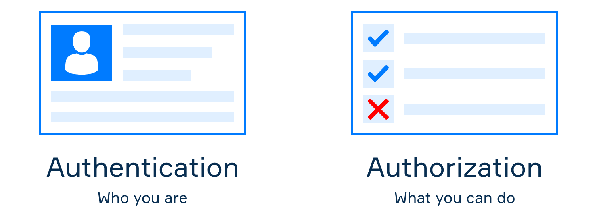

# Authentication and Authorization

**Authentication is about verifying who a user is**. It involves confirming the user's identity using various methods like passwords, biometrics, or tokens.
This process ensures that users are who they claim to be before granting them access to a system.

Once a user is authenticated, authorization comes into play. **Authorization is the process of determining what an authenticated user is allowed to do**. It involves granting or denying permissions to access different resources within a system. For example, a user might have the authentication to log into a network but may only be authorized to view certain files or applications, not the entire system.

