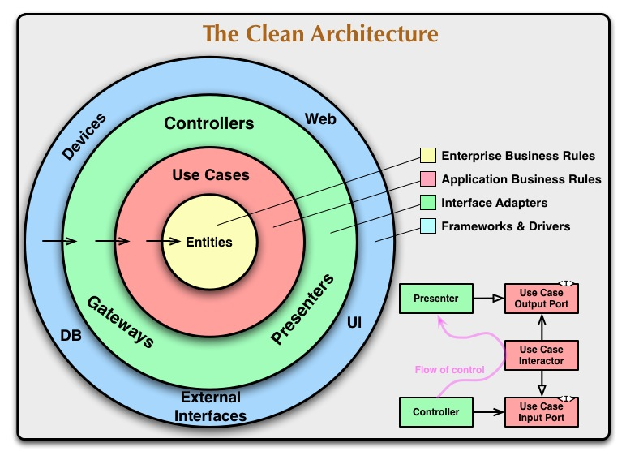

# Architecture

## MVC - Model View Controller:

Model: Các lớp dữ liệu của bạn. Trong Kotlin, chúng ta sử dụng các Data classes, trong khi trong Java chúng được gọi là POJOs (Plain Old Java Object).

View: Các class trực quan. Mọi thứ người dùng nhìn thấy đều thuộc mục này. Trong Android thì nó chủ yếu là XML, mặc dù bạn cũng có thể tạo các chế độ xem bằng code và với sự ra đời của Jetpack Compose thì việc tạo UI sẽ thực hiện ở bằng code động.

Controller: Chất keo kết dính giữa hai thứ. Nó cập nhật view, nhận thông tin đầu vào của người dùng và thực hiện các thay đổi đối với model.

### **Ưu điểm MVC**

* Nhẹ, tiết kiệm tài nguyên.
* Kết cấu đơn giản.
* Dễ dàng kiểm tra và phát hiện lỗi.
* Dễ dàng phân tách các phần Model và View.

### **Nhược điểm MVC**

* Chỉ phù hợp với các dự án lớn. Đối với các dự án nhỏ mô hình sẽ trở nên cồng kềnh và tốn nhiều thời gian để trung chuyển dữ liệu.
* Controller sẽ trở nên phức tạp theo thời gian.
* Controller liên quan với View, vì thế View thay đổi Controller phải thay đổi theo.

## MVP - Model View Presenter

MVP architecture pattern provides an easy way to structure the project codes. The reason why MVP is widely accepted is that it provides modularity, testability, and a more clean and maintainable codebase. It is composed of the following three components:

* **Model:** Layer for storing data. It is responsible for handling the domain logic(real-world business rules) and communication with the database and network layers.
* **View:** UI(User Interface) layer. It provides the visualization of the data and keep a track of the user’s action in order to notify the Presenter.
* **Presenter:** Fetch the data from the model and applies the UI logic to decide what to display. It manages the state of the View and takes actions according to the user’s input notification from the View.
  
  

### **Ưu điểm MVP**

* Cấu trúc rõ ràng và trực quan hơn MVC.
* Dễ dàng để viết unit test cho Presenter vì MVP hoạt động độc lập với View và không gắn với bất cứ API nào của Android.

### **Nhược điểm MVP**

* Mô hình sẽ to dần theo thời gian.
* Presenter sẽ lớn thêm khi thêm các logic nghiệp vụ. Người dùng sẽ khó kiểm soát và chia nhỏ đoạn code khi Presenter đã quá lớn.
  
  

Dưới đây là một số sự khác biệt giữa MVC và MVP:

* Liên kết – Layer View và Model trong MVC liên kết chặt chẽ hơn trong MVP
* Giao tiếp – Giao tiếp giữa View-Presenter và Presenter-Model diễn ra thông qua một Interface, Presenter chịu trách nhiệm xử lý logic hiển thị cho tầng View. Còn Layer controller trong MVC chỉ là cầu nối cho View và Model, nó không chịu trách nhiệm xử lý logic cho tầng View.
* Xử lý hành vi người dùng – Trong MVC hành vi người dùng được xử lý bởi Controller nó hướng dẫn Model thực hiện các hành động cần thiết để cập nhật dữ liệu. Nhưng trong MVP, hành vi người dùng được xử lý bởi View và nó hướng dẫn cho Presenter thực thi các hàm cần thiết.
* Mối quan hệ **many-to-one** là mối quan hệ giữa View và Controller trong MVC, nhưng trong MVP thì Presenter và View có mối quan hệ **one-to-one**.
* Thành phần chính – Trong MVC, layer Controller là thành phần chính, nó quản lý View và tương tác với Model để phục vụ các yêu cầu của người dùng. Còn trong MVP View là thành phần chính, nó trực tiếp nắm bắt các hành vi người dùng và gọi đến các method trong Presenter tương ứng để thực hiện yêu cầu của người dùng.

## MVVM:

        MVVM pattern has some similarities with the MVP(Model — View — Presenter) design pattern as the **Presenter** role is played by the **ViewModel**. However, the drawbacks of the MVP pattern have been solved by MVVM. It suggests separating the data presentation logic(Views or UI) from the core business logic part of the application. The separate code layers of MVVM are:

* **Model:** This layer is responsible for the abstraction of the data sources. Model and ViewModel work together to get and save the data.
* **View:** The purpose of this layer is to inform the ViewModel about the user’s action. This layer observes the ViewModel and does not contain any kind of application logic.
* **ViewModel:** It exposes those data streams which are relevant to the View. Moreover, it serves as a link between the Model and the View.

### **Ưu điểm MVVM**

* Người dùng có thể thực hiện unit testing mà không phụ thuộc vào View.
* Khi test không cần phải tạo mockup như MVP chỉ cần xác nhận biến observable thích hợp.
* Sử dụng XAML cho View, vì vậy có thể chỉnh sửa giao diện, không gây ảnh hưởng đến code.
* Phân rất rõ ràng ba phần, vì vậy sẽ rất dễ dàng lập trình và kiểm tra sửa lỗi code.

### **Nhược điểm MVVM**

* Khi gán nhiều biến vào View các logic sẽ rải rác tăng dần theo thời gian gây khó khăn cho việc kiểm soát code.
* Data binding hai chiều gây hao tốn tài nguyên bộ nhớ.

## Sự khác nhau giữa MVVM và MVP

| MVP(Model View Presenter)                                                                                                                | MVVM(Model View ViewModel)                                                                                                                      |
| ---------------------------------------------------------------------------------------------------------------------------------------- | ----------------------------------------------------------------------------------------------------------------------------------------------- |
| It resolves the problem of having a dependent **View** by using **Presenter** as a communication channel between **Model** and **View.** | This architecture pattern is more event-driven as it uses data binding and thus makes easy separation of core business logic from the **View.** |
| The one-to-one relationship exists between the **Presenter** and the **View**.                                                           | Multiple **View** can be mapped with single **ViewModel**.                                                                                      |
| In this, observables are not needed as a **Presenter** layer.                                                                            | In this, observables are needed due to the absence of **Presenter** layer.                                                                      |
| User interface is used more in MVP.                                                                                                      | There is no user interface in MVVM.                                                                                                             |
| The architecture is heavyweight.                                                                                                         | The architecture is leightweight as compared to MVP.                                                                                            |
| Testing is done easily as business logic and UI are separate.                                                                            | Testing is difficult as Business logic and UI are not separate.                                                                                 |
| In this case, debugging is easy.                                                                                                         | In this case, debugging is not easy.                                                                                                            |
| The **Presenter** has knowledge about the **View.**                                                                                      | **ViewModel** has no reference to the **View**.                                                                                                 |
| **Model** layer returns the response of the user’s input to the **Presenter** which forwards it to **View**.                             | After performing operations according to the user’s input, the **Model** layer returns the response to the **View**.                            |
| **Presenter** handles the application flow and the **View** is the actual application.                                                   | **ViewModel** is the actual application and **View** is the interface for the user in order to interact with the app.                           |
| The project file will contain more classes as well as code.                                                                              | The Project file will contain more classes but less code per class.                                                                             |
| Maintenance is not ensured in the architecture.                                                                                          | Maintenance of the layers is very good.                                                                                                         |
| Ideal for simple and complex applications.                                                                                               | Not ideal for small-scale projects.                                                                                                             |
| Easy to carry out Unit testing but a tight bond of **View** and **Presenter** can make it slightly difficult.                            | Unit testability is highest in this architecture.                                                                                               |
| It does not work well with android applications or software.                                                                             | It works extremely well with android applications or software.                                                                                  |

## Clean Achitecture

## The Dependency Rule

    Quy tắc phụ thuộc là quy tắc giúp kiến trúc này hoạt động. Quy tắc này cho rằng sự phụ thuộc trong mã nguồn chỉ có thể đi vào hướng bên trong. Các thành phần trong vòng tròn bên trong không được biết bất cứ điều gì về những thứ thuộc về vòng tròn bên ngoài. Điều này bao gồm cả các hàm, lớp, biến hoặc bất kỳ thực thể phần mềm nào có tên.

* Mô hình sẽ chia thành nhiều vòng tròn, mỗi vòng tròn tương ứng với 1 layer.
* Vị trí của vòng tròn nói lên cấp (level) của chúng, vòng tròn càng xa tâm thì có cấp càng cao.
* Dependency rule là quy tắc quy định rằng:
  * Layer trong (level thấp hơn) không được chứa source code của layer ngoài (có level cao) hơn.
  * Bất cứ thay đổi ở layer ngoài không làm ảnh hưởng tới layer trong, có nghĩa là sự phụ thuộc hướng vào trong.
* Clean architecture thông thường chia thành 4 layer: entities, use cases, interface adapters và Frameworks and drivers. Nhưng tuỳ theo hệ thống, chúng ta có thể chia thành nhiều layer hơn nhưng phải tuyệt đối tuân thủ vào dependency rule.
* Khi chúng ta đi vào trong từ layer level cao xuống các layer thấp hơn, mức độ trừu tượng hoá sẽ được tăng lên (mức độ phụ thuộc giảm đi).

## Entities

        An entity can be an object with methods, or it can be a set of data structures and functions. It doesn’t matter so long as the entities could be used by many different applications in the enterprise.

If you don’t have an enterprise, and are just writing a single application, then these entities are the business objects of the application. They encapsulate the most general and high-level rules. They are the least likely to change when something external changes. For example, you would not expect these objects to be affected by a change to page navigation, or security. No operational change to any particular application should affect the entity layer.

VN :

* Entities chứa business logic của cả hệ thống (tập các app) chứ không bị bó buộc trong 1 app nào cả. Nói một cách dễ hiểu Entities sẽ đảm nhận nhiệm vụ định nghĩa các POJO chứa các thông tin liên quan đến business của ứng dụng.
* Do entities có phạm vị hệ thống nên sự thay đổi hoạt động (không phải business logic) của một ứng dụng không làm ảnh hưởng tới entities. Do đó, entities có thể chạy độc lập mà không sợ bị lỗi.

Ví dụ: Chúng ta xây dựng app tin tức. Ta tạo ra 1 class News, thì News chính là một entity của hệ thống

## Use Cases

     It encapsulates and implements all of the use cases of the system.

    These use cases orchestrate the flow of data to and from the entities, and direct those entities to use their _enterprise wide_ business rules to achieve the goals of the use case.

- We do not expect changes in this layer to affect the entities

- We also do not expect this layer to be affected by changes to externalities such as the database, the UI, or any of the common frameworks

This layer is isolated from such concerns.

VN :

* Use cases chứa application specific business rules, thực hiện các use case của 1 ứng dụng dựa trên các entity object của entities.
* Use cases không chứa source code của interface adapters và frameworks and drivers.
* Use cases cũng không bị ảnh hưởng bởi sự thay đổi interface adapters và frameworks and drivers.
* Use cases thể hiện business logic của ứng dụng. Do đó khi requirement của ứng dụng thay đổi, code trong layer này cũng sẽ bị thay đổi.

Ví dụ: Use Cases thêm, sửa, xóa bài viết.

## Interface adapters

    The software in this layer is a set of adapters that convert data from the format most convenient for the use cases and entities, to the format most convenient for some external agency such as the Database or the Web.

VN:

* Interface adapters là layer dùng để chuyển đổi dữ liệu của ở entites và use cases thành định dang thuận tiện nhất để làm việc với các tác vụ như database, web service… Do đó, interface adapters cũng có thể chứa các framwork có sẵn để làm việc.
* Use cases, entities và các framework được sử dụng để chuyển đổi dữ liệu.

Ví dụ: Ứng dụng sử dụng Room Database

* Entities và use cases không thể chứa source code về Room Database.
* Interface adapter tạo ra các đối tượng như table, SQL query… để làm việc thuận tiện nhất với yêu cầu của ứng dụng.
* Ngoài interface adapters, không thành phần nào của clean architecture làm việc với Room Database.

## Frameworks and drivers

    This layer is where all the details go. The Web is a detail. The database is a detail. We keep these things on the outside where they can do little harm.

VN :

* Đây là layer ngoài cùng, nó là nơi chúng ta đi vào chi tiết hoá yêu cầu của ứng dụng như UI, application behavior, interaction… và cũng có thể bao gồm các Framework được xây dựng để phục vụ việc chi tiết hoá như UI framework…
* Chúng ta chỉ viết code liên quan đến việc chi tiết hoá như UI design…

Ví dụ 4: Với Android, trong frameworks and drivers:

* Chúng ta sẽ import những UI dependency như material… và sử dụng code trong interface adapter để tạo ra UI.
* Ngoài ra, chúng ta cũng sẽ thực hiện các tác vụ như điều hướng giữa các screen, thực hiện tương tác với user, chỉnh setting cho app…

## Ưu điểm của Clean Architecture

* Giúp business logic trở nên rõ ràng.
* Với việc tách biệt thành các layer và tuân theo dependecy rule, hệ thống của chúng ta sẽ dễ dàng test, maintain và thay đổi.
* Khi một thành phần như giao diện, database work…bị lỗi thời, chúng ta có thể dễ dàng thay thế nó với effort bỏ ra là ít nhất.

Nhược điểm của Clean Architecture
=================================

* Clean architecture do phân tách cấu trúc thành nhiều tầng nên dẫn đến việc số lượng code sinh ra là rất lớn, không phù hợp cho các dự án nhỏ.
* Khó hiểu, khó áp dụng với những người mới bắt đầu.
