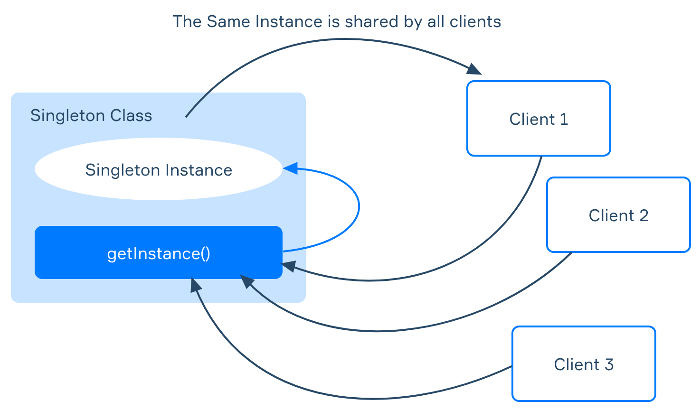

# Singleton Pattern

Singleton is a creational design pattern that allows you to keep only one instance of an object and provide global access to it. 

it solves two problems:

- **Keeping only one instance of an object** is useful when you want to control access to some shared resources. When you create one object of a class, if you use a singleton pattern, you will always have that same object. In case you'll try to create another one, the code will return the first initiated object each time.

- **Providing a global access point** to allow all clients to use the initiated instances. When you address this problem, you also should squeeze all the code regarding the first problem in one class, to avoid it being scattered all over your code.

## Implementation

to implement this pattern, we create a `Singleton` class that is connected to other parts of our application. It consists of Object `constructor` and `getInstance()` method. Through our `constructor`, we create instances when an application first needs it. Then we check the presence of this instance with our method `getInstance()` and pass it to our application. This helps us to avoid creating other instances.

> [!NOTE]
> Instead of trying to maintain one instance of a class, you can maintain a few instances. All it takes is a bit of change to the getInstance() method and keeping more than one instance. But by doing this, you'll now work with a different design pattern called multiton.

