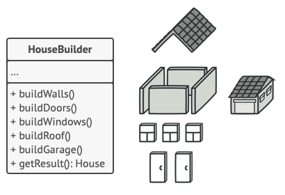

# Builder Pattern

Builder pattern is a creational design pattern that allows you to create objects step by step.

This approach allows creating fundamentally the same objects using one constructor, but they can be modified to depict different types of objects. 

## Problem

Imagine a complex object that requires laborious, step-by-step initialization of many fields and nested objects.
Such initialization code is usually buried inside a monstrous constructor with lots of parameters. 

## Builder pattern goal

The main goal of this pattern is to separate the construction of a complex object from its representation so that the same construction process can create different representations.

## Example

For example, let’s think about how to create a `House` object.

To build a simple house, you need to construct four walls and a floor, install a door, fit a pair of windows, and build a roof.

But what if you want a bigger, brighter house, with a backyard and other goodies (like a heating system, plumbing, and electrical wiring)?

The simplest solution is to extend the base `House` class and create a set of subclasses to cover all combinations of the parameters.

But eventually you’ll end up with a considerable number of subclasses.
Any new parameter, such as the porch style, will require growing this hierarchy even more.

There’s another approach that doesn’t involve breeding subclasses.
You can create a giant constructor right in the base `House` class with all possible parameters that control the house object.

While this approach indeed eliminates the need for subclasses, it creates another problem.

## Solution

**The Builder pattern** suggests that you extract the object construction code out of its own class and move it to separate objects called builders.

The pattern organizes object construction into a set of steps (`buildWalls`, `buildDoor`, etc.).
To create an object, you execute a series of these steps on a builder object.

The important part is that you don’t need to call all of the steps.

## Director

The director class defines the order in which to execute the building steps,
while the builder provides the implementation for those steps.

Having a director class in your program isn’t strictly necessary.

You can always call the building steps in a specific order directly from the client code.
However, the director class might be a good place to put various construction routines so you can reuse them across your program.

reference:

[builder-design-pattern](https://refactoring.guru/design-patterns/builder)

