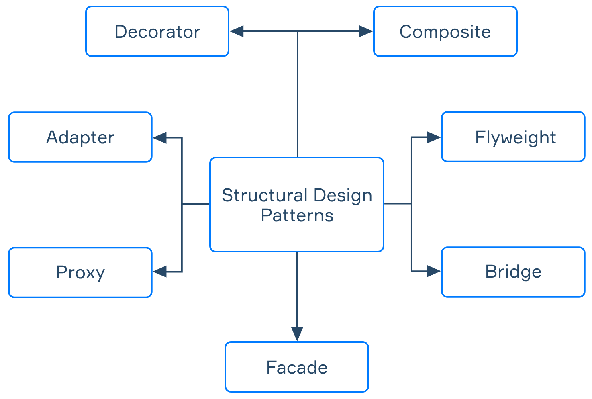

# Structural design patterns

While working with a large application, you will usually encounter problems related to the complexity of a code.

This may disorient and complicate your work. So, to minimize these problems, you should define the proper class structure and their connections to each other.

One useful way to maintain a good object structure is by using a structural design pattern.

## Definition

**Structural design patterns simplify the structure by defining the relationships between objects**.
Using these patterns, you will have a better understanding of whether we need to inherit, compose, or make and maintain any other relationships between system components.

Various design patterns help build a larger structure by defining how each component should be organized.
They ensure that the modules connect flexibly and work smoothly together within a bigger system.

## Types of structural patterns
There are 7 types of structural design patterns:

> [!CAUTION]
> So you should keep in mind their limitations and goals to avoid overdoing it.

