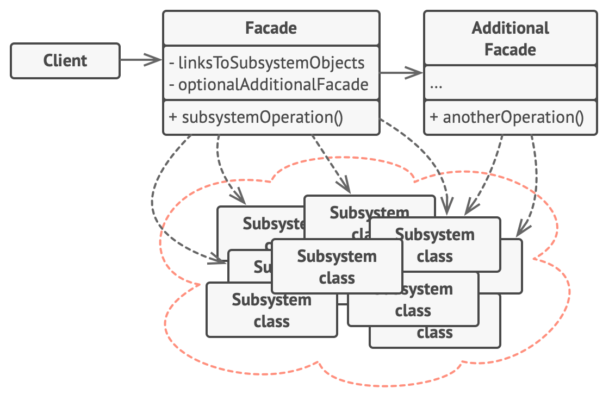
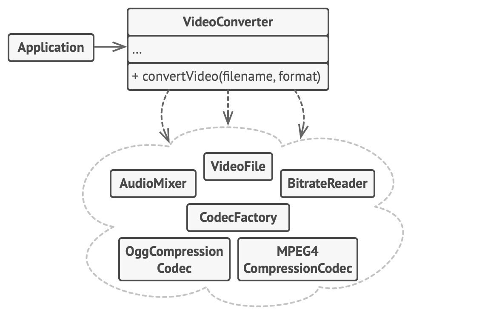

# Facade

## Problem

Imagine that you must make your code work with a broad set of objects that belong to a sophisticated library or framework.
Ordinarily, you’d need to initialize all of those objects, keep track of dependencies, execute methods in the correct order, and so on.

As a result, the business logic of your classes would become tightly coupled to the implementation details of 3rd-party classes, making it hard to comprehend and maintain.

## Solution

A Facade is a class that provides a simplified interface to a complex system. It hides unnecessary details and only exposes the essential functionality that the client needs.

## Structure

- **The Facade** provides convenient access to a particular part of the subsystem’s functionality.
It knows where to direct the client’s request and how to operate all the moving parts.

- **An Additional Facade** class can be created to prevent polluting a single facade with unrelated features that might make it yet another complex structure. Additional facades can be used by both clients and other facades.

- **The Client** uses the facade instead of calling the subsystem objects directly.

## Pseudocode

## Prospects

You can isolate your code from the complexity of a subsystem.

## Consequences

A facade can become a god object coupled to all classes of an app.

## Reference

- https://refactoring.guru/design-patterns/facade

