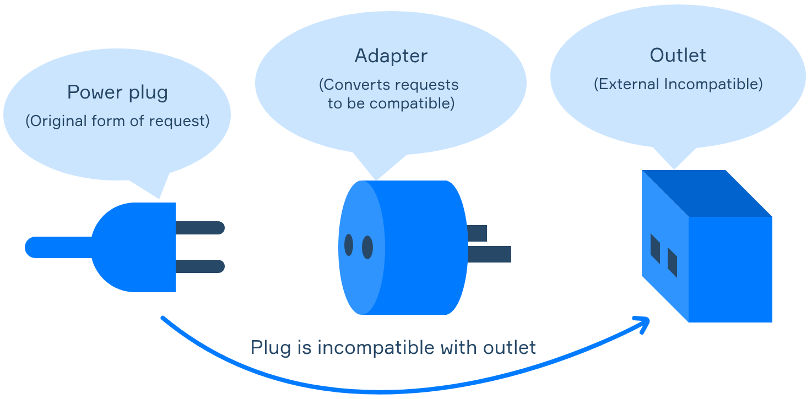

# Adapter pattern

**The adapter pattern** is a structural design pattern that connects different objects with incompatible interfaces.
This pattern consists of a single class whose main purpose is to adapt the interface of one object so that another object can interact with it.


## Example




```kotlin
// USoutlet class
class USOutlet {
    fun getSocket(): String {
        return "US"
    }
    
    fun fits(powerPlug: PowerPlug): Boolean {
        return this.getSocket() == powerPlug.getSocket()
    }
}
```


```kotlin
// PowerPlug interface
interface PowerPlug {
    fun getSocket(): String
}

// EUplug class
class EUPlug : PowerPlug {
    override fun getSocket(): String {
        return "EU"
    }
}

// USplug class
class USPlug : PowerPlug {
    override fun getSocket(): String {
        return "US"
    }
}

```

Adapter

```kotlin
// Adapter class
class Adapter(private val plug: EUPlug) : PowerPlug {
    override fun getSocket(): String {
        return "US" // Convert EU plug to US socket
    }
}
```

Application

```kotlin

// Main function to test the adapter pattern
fun main() {
    val powerPlug = EUPlug()
    val powerOutlet = USOutlet()
    
    if (powerOutlet.fits(powerPlug)) {
        println("Plug fits!")
    } else {
        println("Error: Plug does not fit!")
    }
    
    val plugAdapter = Adapter(powerPlug)
    
    if (powerOutlet.fits(plugAdapter)) {
        println("Plug fits with adapter!")
    } else {
        println("Error: Plug still does not fit!")
    }
}

```

## Conslusion

This is just an abstract example of how this pattern can be utilized.
Mostly you can use it when you don't want to rewrite large chunks of existing code to connect it to your newly written objects which are incompatible with it.
But it can also increase the complexity of code sometimes. So if you're working on a relatively small project, it is better just to rewrite some of the code so that the necessary objects are compatible.


