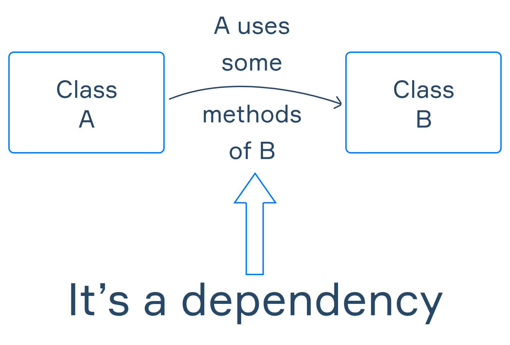

# Dependency Injection

When working with OOP, you may have noticed certain relations between objects. Often, these relations need to be structured, described, and properly utilized. One way to do this is by using dependency injection.

## Dependency and dependency injection

what is a **dependency**? It's a relation between two classes in which one class uses the functionality of the other class, i.e. one class is dependent on the other.

Hiện nay, các lập trình viên hay lẫn lộn giữa các khái niệm Dependency Inversion, Inversion of Control (IoC), Dependency Injection (DI). Ba khái niệm này tương tự nhau nhưng không hoàn toàn giống nhau.

Sự khác biệt giữa 3 khái niệm trên:

* **Dependency Inversion**: Đây là một nguyên lý để thiết kế và viết code.
* **Inversion of Control**: Đây là một Desgin Pattern được tạo ra để code có thể tuân thủ nguyên lý Dependency Inversion. Có nhiều cách hiện thực pattern này: ServiceLocator, Event, Delegate, … Dependency Injection là một trong các cách đó.
* **Dependency Injection**: Đây là một cách để hiện thực Inversion of Control Pattern (Có thể coi nó là một design pattern riêng cũng được). Các **module phụ thuộc (dependency) sẽ được inject** vào module cấp cao.
* 

Có thể hiểu Dependency Injection một cách đơn giản như sau:

1. **Các module không giao tiếp trực tiếp với nhau, mà thông qua interface**. Module cấp thấp sẽ implement interface, module cấp cao sẽ gọi module cấp thấp thông qua interface.
    Ví dụ: Để giao tiếp với database, ta có interface _IDatabase_, các module cấp thấp là _XMLDatabase_, _SQLDatabase_. Module cấp cao là _CustomerBusiness_ sẽ chỉ sử dụng interface _IDatabase_.
2. **Việc khởi tạo các module cấp thấp sẽ do DI Container thực hiện**. Ví dụ: Trong module _CustomerBusiness_, ta sẽ không khởi tạo IDatabase db = new XMLDatabase(), việc này sẽ do DI Container thực hiện. Module CustomerBusiness sẽ không biết gì về module XMLDatabase hay SQLDatabase.
3. **Việc Module nào gắn với interface nào sẽ được config trong code hoặc trong file XML**.
4. **DI được dùng để làm giảm sự phụ thuộc giữa các module**, dễ dàng hơn trong việc thay đổi module, bảo trì code và testing.

### **Các dạng DI**

There are three main types of DI:

1. **Method(Interface) Injection** — dependencies are passed through methods that the class can access via interface or another class.
2. **Property(Setter) Injection** — dependencies are passed through a separate setter method. Implementation of this injector varies depending on the language.
3. **Constructor Injection — dependencies** are provided through the class constructor.
   
   

| ƯU ĐIỂM                                                                                                                                                                         | KHUYẾT ĐIỂM                                                                                                                                                                                                                                                                             |
| ----------------------------------------------------------------------------------------------------------------------------------------------------------------------------------------------------------- | --------------------------------------------------------------------------------------------------------------------------------------------------------------------------------------------------------------------------------------------------------------------------------------- |
| * Giảm sự kết dính giữa các module * Code dễ bảo trì, dễ thay thế module * Rất dễ test và viết Unit Test * Dễ dàng thấy quan hệ giữa các module (Vì các dependecy đều được inject vào constructor) | * Khái niệm DI khá “khó tiêu”, các developer mới sẽ gặp khó khăn khi học * Sử dụng interface nên đôi khi sẽ khó debug, do không biết chính xác module nào được gọi * Các object được khởi tạo toàn bộ ngay từ đầu, có thể làm giảm performance * Làm tăng độ phức tạp của code |
