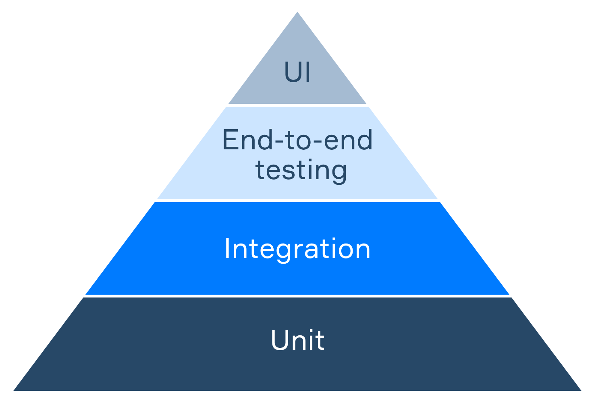

# Avoid bugs

It is almost impossible to avoid all bugs in a large program, but it is possible to reduce their number. 

1. **Make sure you know what to do**. As a programmer, you need to understand the requirements of a program that you are going to work on. If you have doubts, you can always find some help on the Internet or among fellow developers.

2. **Decompose a program** into small units that are easy to look through and understand. A good architecture reduces software complexity, and, as a consequence, the number of errors.

3. **Write easy-to-read-code** and follow all the standards of the language. It will also allow you to make fewer errors.

4. **Write automated tests** that will check the program at the build time.

## Functional testing

Functional testing checks if the output satisfies some specific requirements or not. Its main task is to confirm that the functionality of an application or system behaves as expected.

There should be something that defines what is acceptable and what is not. Usually, it's written in a specification. It is a document that describes the expected behavior of a program.

## Test pyramid

The key concept that represents different kinds of tests is the test pyramid. This is a great visual aid that shows different test levels. It also shows the extent of the tests at each level.

At the lower levels, there are more tests and they go faster, as they are small and aimed at testing individual functions or features.

## Unit testing

The goal of unit testing is to isolate individual parts of a program and show that each of these parts work.

## Integration testing

They take the already tested units as input, group them into larger sets, run the tests defined in the test plan for these sets, and present them as outputs and inputs for subsequent system testing. **The goal is to check the integration of the application with all the outside components.**

## End-to-end testing

**End-to-end testing** is a software testing methodology to entirely test an application flow. **The purpose of end-to-end testing is to simulate the real user scenario and validate the system that is being tested, as well as its components, for integration and data integrity.**

It is performed under real-world scenarios like communication of the application with hardware, network, database, and other applications.

## UI testing

UI testing stands for User Interface testing. The idea is that the QA engineers simulate user actions. clicks on buttons and links, and other actions of a similar type. The point is to check the interactions between the components.

UI testing can be performed not only by the developers but also by the users. This functional testing type is called **Beta testing**.

**Beta** or **Acceptance testing** is carried out at the very end when the raw or beta version of the product is ready. 

## Smoke and Regression

**Smoke testing** is a testing technique that is inspired by hardware testing, which checks for the smoke from the hardware components once the hardware's power is switched on.

Smoke Testing means a minimal set of tests to find some obvious errors.

It makes no sense to send a program that has not passed this test for deeper testing.

**Regression testing** is often done after a smoke test and some code changes. Its goal is to confirm that these changes have not negatively impacted the existing functionality/feature set

