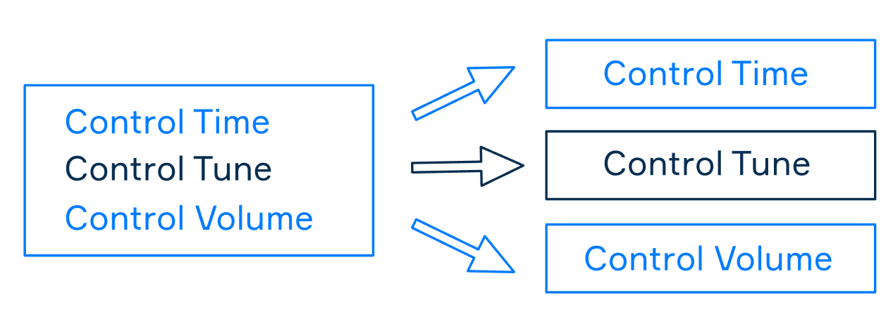

# Single responsibility principle

The program consists of some programming units like modules, classes, and functions. The Single Responsibility Principle requires your programming unit to have only one reason to change (i.e. a single responsibility). If you, as a developer, change the menu of a program, it should not affect the way other parts of the program work.

Then how can we set the boundaries of what different parts are responsible for in other cases?

Imagine we're working on a new application for smartphones. It has such functions as an alarm clock, reminders, and stopwatch. Because they are all related to time, they can be united in one class. In trying to gather similar functions together we instead create a God object.

- **A God object** is an object that knows too much or does too much.

In our case, it's better to isolate these three functions from each other, so we can update them independently without polluting the code with unnecessary details.

Each part will be responsible for a specific thing and won't know about what the others are doing. This design is more likely to keep the code clean and clear.

- **Responsibility boundaries**

We decided to add an option for users to choose a ringtone for the alarm. We add methods `listTune`, `setTune`, and `playTune` to the `AlarmClock` class.

After launching the app, users start downloading it and leave reviews suggesting that it would be great if the ringtone could get louder when the alarm rings. To address this, we add a new method `setEnhancingMode`. However, as we do this, we realize that we're mixing up different responsibilities within the same class—setting the tune and controlling the volume. This time our class has at least three reasons to change:

- time methods

- volume methods

- tune methods

The problem is, if we update the volume methods, it could interfere with the time methods. So, to keep things organized and avoid confusion, we decide to split the class into smaller parts, each responsible for only one task, and delegate the responsibilities accordingly. You can ask, what will the AlarmClock do then? The answer is simple: **it will call other classes and orchestrate their work depending on a user request.** So We can also reuse `Tune` and `Volume` classes for the `Reminder`.

To draw boundaries for responsibilities, ask yourself: **are these the same responsibilities for a user or not? If they are the same, bind the methods together. If they are not, divide them to create classes that have only one reason to change.**

> [!CAUTION]
> The core of the principle is not about breaking the code into small isolated pieces. You gather what belongs to the same responsibility in one place, and then separate units with different responsibilities from each other.

