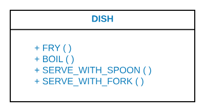
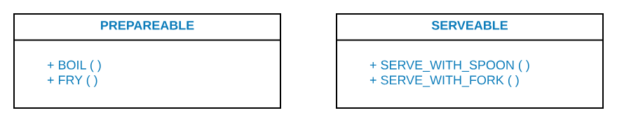
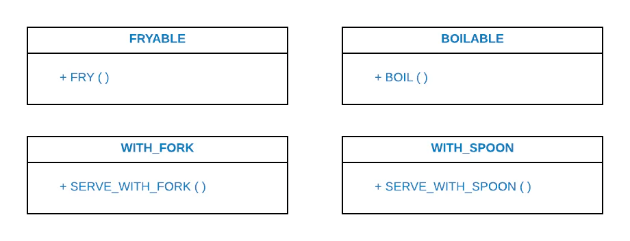

# Interface Segregation Principle

When starting a new application, the first idea that comes to mind is to define functions, classes, and interfaces we would use throughout the project. Working further with the code, we may miss the point when our interfaces start taking on more than they can handle, making it hard to work with them. This is where the Interface Segregation Principle comes into play.

The Interface Segregation Principle (ISP) is based on two key points: 

- objects should not be forced to implement parts of the interfaces they don't use;
- many specific interfaces are better than one general-purpose interface.

In other words, to make our interfaces accurate, we should make them specific, so we won't have to implement needless methods in the future.

## Segregating responsibilities

To illustrate this principle, let's take a look at the decomposition of the interface for making meals in a fictional robot cafe.

The main feature of the "La Cuisine Avec Des Robots" cafe is that all the waiters and cooks are robots. This interface shows what they can do with a meal:

The problem is that making a new meal requires programming a lot of actions. Even if we don't know whether we'll serve the dish in the cafe or only develop a new one in the kitchen, we should implement all the methods for cooks and waiters.

It seems that we're tying together two different responsibilities in one interface, so we need to divide it.

Now we can implement the interface `SERVEABLE` only for the dishes that we want to add to the menu and experiment with `PREPAREABLE` meals independently.

## Segregating specializations

We have good interfaces now, so let's try to implement all the methods for making the "Le velouté" soup.

We can boil ingredients of a soup and then serve the dish with a spoon, so another challenge comes up right away: what should we do with the `FRY` and `SERVE_WITH_FORK` methods? As you know, to implement an interface, we should define all the methods in it.

Should we define methods with an empty body? Or maybe we need to return an error? Raise an exception? The best solution is not to have all these methods in the first place! First, we match our interfaces with the responsibilities of cooks and waiters, and then we specialize them for different kinds of meals:

Though this decomposition works fine for this specific task, defining interfaces with just one method is not going to magically solve all the other cases. **Try to find those methods that are integral to your interfaces, and keep your eye on degenerate methods in the implementations.**