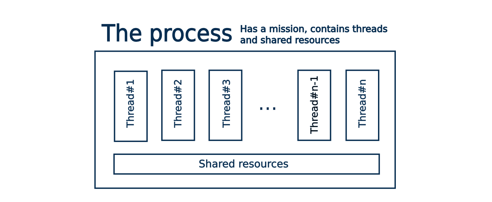

# Processes and threads

## Process

A **process** is a self-contained unit of execution that includes everything necessary to complete its tasks. 

**In short, a process is the container for its threads, encompassing all necessities for their operation and their shared resources**. 

It's cheaper to arrange access to shared resources once than to do so each time a new thread is spawned. Every process must have at least one thread, as they perform all the work. There is no such thing as a thread without its process or a process without at least one thread.

## Thread

In computer science, a **thread** of execution is a sequence of instructions within a process that can be scheduled and run independently.

Each thread has its own executor, which can manage only one thread at a time.

Multiple threads within the same process can operate concurrently (switching between tasks) or in parallel (simultaneously, if multiple executors are available), depending on how they are scheduled and the resources available.

## Concurrency and parallelism

**Concurrency** and **parallelism** are key concepts in computing that describe different methods for handling multiple tasks efficiently.

- **Concurrency**:
Concurrency is the ability to manage multiple tasks by switching between them, making progress on each task over time. It doesn't necessarily involve doing tasks at the same time, but rather efficiently alternating between tasks to maximize overall productivity. It's like a chef working on two dishes by switching between tasks, not completing one before starting the other.

- **Parallelism**: Parallelism involves performing multiple tasks simultaneously using separate resources. It is like having two chefs, one preparing a salad and the other grilling chicken, with both tasks happening at the same time. Parallelism focuses on running tasks in parallel, improving speed by utilizing multiple processing units.

Key Difference:
- Concurrency switches between tasks to give the illusion of simultaneous progress.
- Parallelism executes tasks at the same time, using multiple resources to enhance performance.

## Internal or lightweight concurrency

In some cases, workers (threads) can perform multiple roles within the same pizza shop (process). For instance, a worker might serve as both a cashier and a cook at different times. This kind of concurrency isn't about multiple workers doing tasks simultaneously, but about a single worker switching between roles efficiently. These roles typically involve tasks that are quick and do not demand significant time or shared resources, classifying them as **lightweight**.

When tasks are lightweight and require minimal shared resources, it is more efficient to execute them within a single thread using time-slicing. In this approach, the executor quickly switches between tasks, creating the illusion that they are happening simultaneously. This form of concurrency is known as **internal** or lightweight concurrency, as it involves minimal task demands and does not require multiple threads.