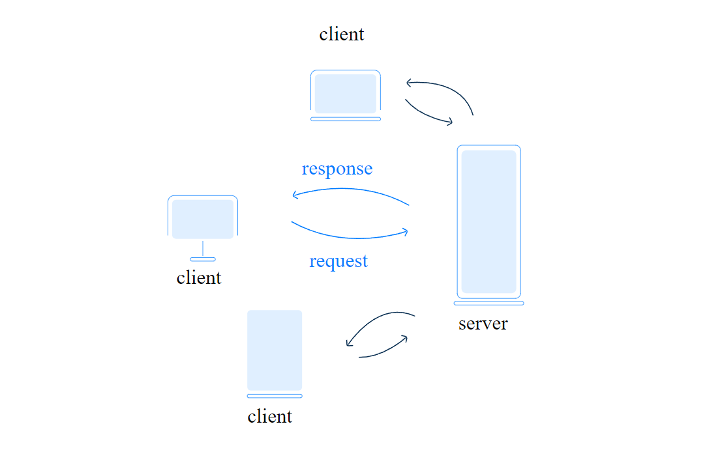

# HTTP: HyperText Transfer Protocol

## What is HTTP

A **client** is a customer of a service, and a **server** is a computer that serves users or other computers. It can be located remotely, tens of thousands of kilometers away from you. The technology in which the network load is distributed between servers and service customers is called **Client-Server Architecture**.

Data exchange between the client and the server takes place due to the **HTTP**. HTTP stands for **HyperText Transfer Protocol**. A **protocol** is a set of rules and conventions that define a uniform way to exchange data between different programs and handle errors. Like a waiter in a restaurant, it accepts your requests, takes them to the server for processing, and then comes back to you with a response.

## What is HTTPS

To make the Internet space safer, the programmers decided to develop an add-on over HTTP, which helps to avoid data interception by encryption. The HTTP extension is called **HTTPS** and stands for **HyperText Transfer Protocol Secure**.
