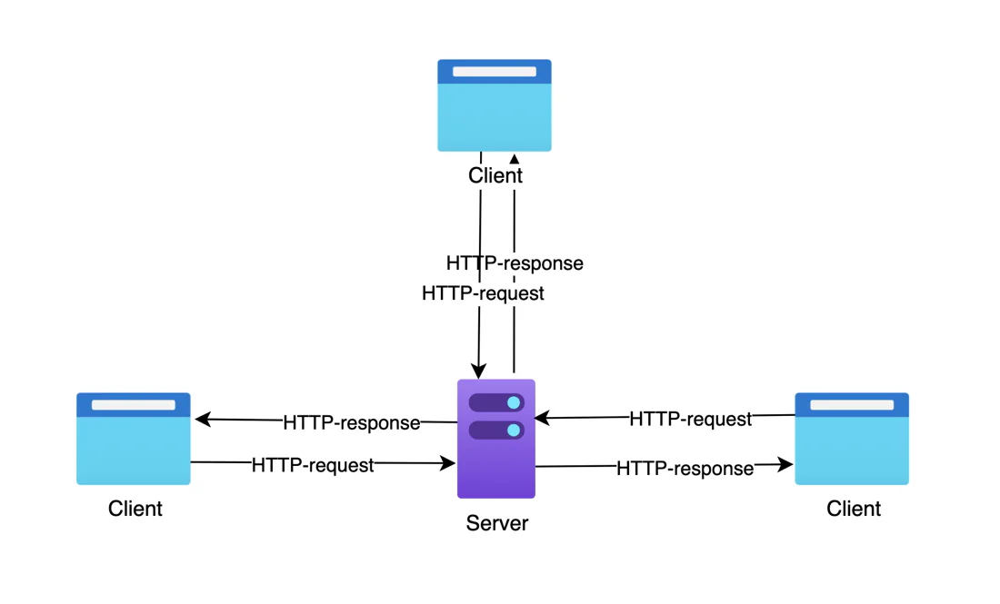
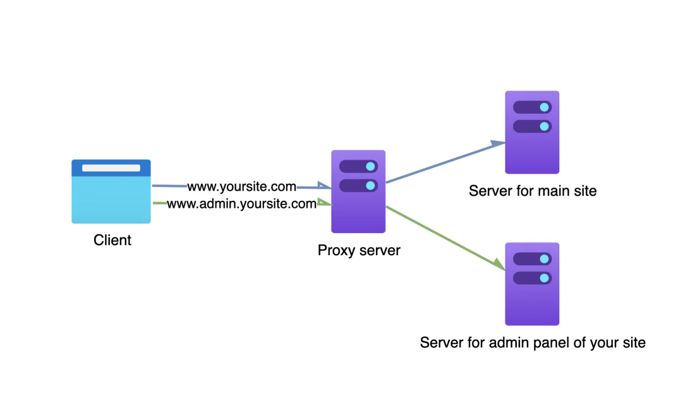

# HTTP Server

## Definition
A web server or an HTTP server is a program on a computer that can process client requests and send an answer back to the client. 

When a server starts, it always waits for requests and answers each request by sending back the requested information.

The HTTP server is a part of the client-server model.

## Client-server architecture.

A server stores **static**, **dynamic**, or **hybrid** web pages.
- Static pages are prebuilt. When a client requests a page, the server returns a pre-built document that is fully complete.
- Dynamic pages have a prebuilt part that the server can send to the client.

Then, JavaScript on the client side generates other parts of the webpage by requesting additional information from another server, like a REST API server.

## Proxy

HTTP servers can not only respond to requests but also redirect requests to other servers. Such servers are known as proxy servers

A proxy server will be beneficial if you have several web servers behind one domain name and want to redirect requests to the right server.

For example, you have your site on the main web server.
You also have an admin panel for your site on another server. 
Proxy servers can control which server will receive client requests depending on the domain name.

A client can send requests to one server via two different domain names. But it will receive a response from the server behind the proxy.

## Load balancing

As a proxy, HTTP servers can work as load balancers. 
An HTTP server can send the client's request to separate servers to reduce the load on the end server.
So if a service has many clients, it is good to place a load-balancing server to decrease the load on servers that process client requests.
HTTP servers provide an administrator to configure the balance settings for flexible balancing.

## Encoding

When your request is sent to a server, it usually passes through many nodes, before reaching the server.
And anyone on these nodes can look at the data that you sent. They can also read the server's responses.
So, HTTP servers can secure connections by using certificates.

Secure HTTP connection is called HTTPS (S stands for Secure). The HTTPS protocol is not a completely different protocol from the HTTP protocol.
**The difference is that HTTPS works by TLS and SSL transport mechanisms.** TLS – Transport Layer Security, is based on SSL (Secure Socket Layer). TLS gives instructions and rules to create truly secure and safe data transferring over the Internet.

All the data you send and receive is encoded by SSL certificates.
Certificates are issued by special organizations and certification authorities. They sign certificates with their own digital signature.
The browser can see the certificate sign and verify that the certificate is valid.

This is one of the most common security schemes on the Internet. When you send something to a server, the browser verifies the certificate first, then you encode your data with an "public key".
And the server has a "private key" that is needed to decode the data you send. When a server sends an answer, it also encodes data with that "public key". Then your browser can decode them by using the "private key".

## Compressing

Nobody loves slow page download speeds. HTTP servers can compress data that is sent.

Just like you can compress a folder with documents into an "archive", then send it to someone by one file by email.

The server compresses all responses to the client, then the client (browser) decompresses the data.

Compressed data size is lower than decompressed, so you need to download fewer bytes to open the web page.

## Cookies

Web servers can also read your browser data, like cookies.
Cookies are small data files that a website stores on a user's computer through their web browser.
They allow the website to remember information about the user, such as their preferences or login status, from one visit to the next.
Cookies help improve the user experience while using some web applications.
For example, it helps sellers/shops know what products they can recommend to you based on your search history.

> [!WARNING]
> Cookies can potentially be insecure because they store information on the user's computer that can be accessed by a website or attackers gaining access to the user's computer or network.
>If the cookie contains sensitive information, such as the user's login credentials, this information can be stolen and used to impersonate the user.
>In addition to this, cookies can be used to track user activity on the Internet.
>This can cause privacy concerns among many users. Some websites may use cookies to store information about user preferences and use this information for targeted advertising.
>This can also be considered as an invasion of privacy.
>It is important to be careful about what information is stored in cookies and regularly clear them to maintain both privacy and security.

## Cache

Servers can cache the most frequent requests.
If your current request is the same as the previous one, the server just returns you a saved copy of the answer.
Also, a server can set a special heading property to store some data in your browser's local cache.
So if your cache has a response for your request, the browser won't have to send any request to the server.

