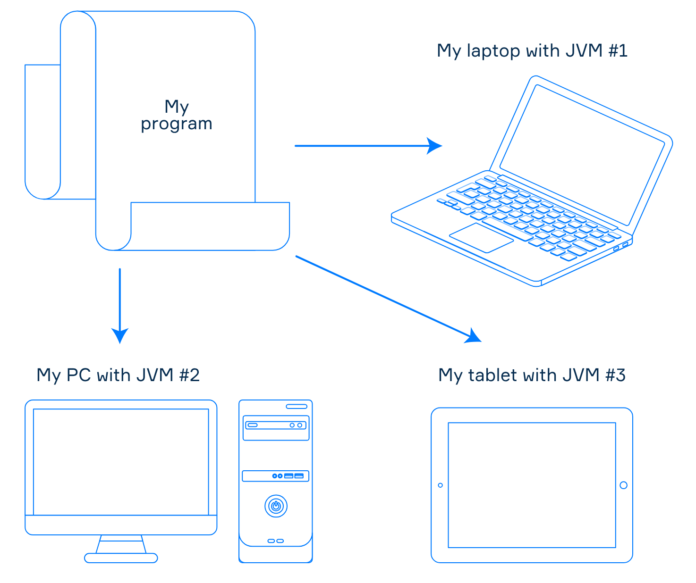
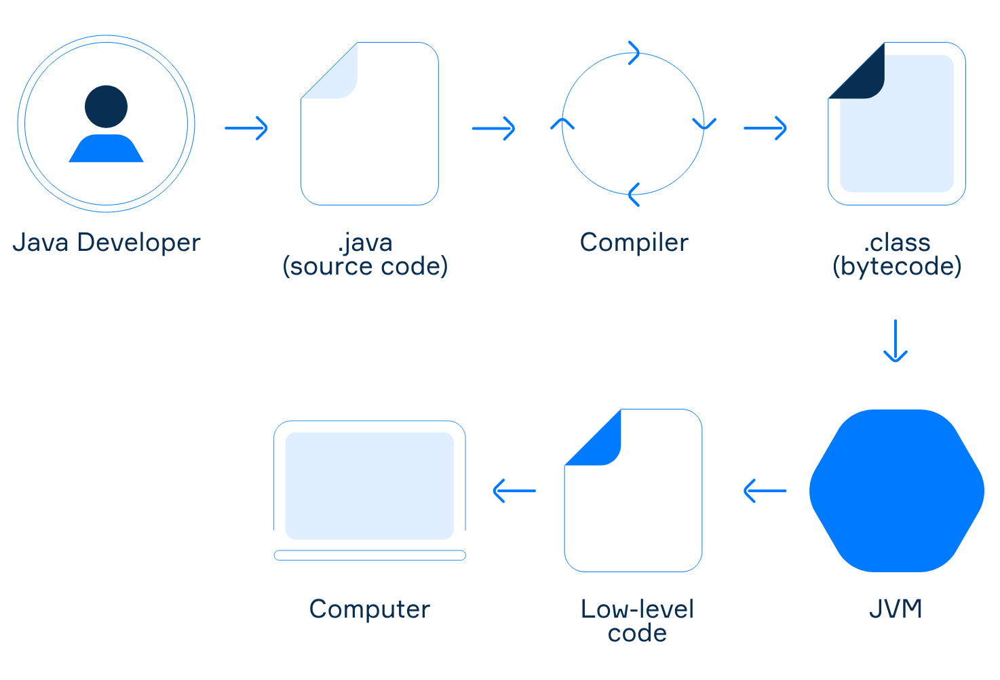
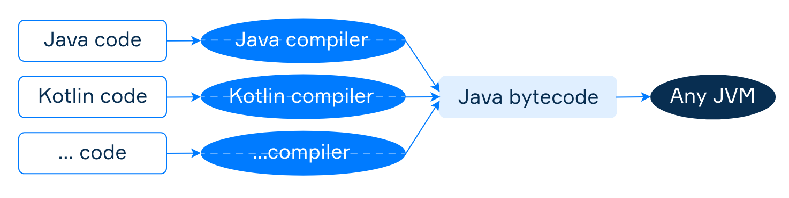

## Writing a program


As a developer, the first thing you do while creating a program is writing the source code in a plain text file and saving it with an extension corresponding to the programming language you've chosen (.java for the Java language, .kt for Kotlin, and so on). A single program consists of one or more such files, which contain instructions specifying what the program does. The source code must follow the syntax rules of the respective language and be easy to read and understand.

## Compilation
After the code is written, you need to make the computer run the program. As computers don't understand the source code, it needs to be translated into a computer-comprehensible format. That's where a special program called a compiler comes in handy. The code obtained after compilation is called native code or low-level code. Each computer platform uses different low-level commands, just like people around the world speak different languages. It creates an additional challenge to use a program on different devices.

In the world of Java, a compiler (the javac tool for Java or the kotlinc tool for Kotlin) translates source code into an intermediate representation known as Java bytecode stored in files with a .class extension. Computers can't read bytecode without translation, but a system called the Java Virtual Machine (JVM) can execute it.

## Running a program

The **Java Virtual Machine** is an application that represents a virtual computer according to the JVM specification document. It executes the compiled Java bytecode and translates it into low-level commands, which the computer understands. Each platform has its own version of the JVM, but since all JVMs match the same specification, your program will behave identically on different devices.

One of the main concepts of the Java Platform is "write once, run anywhere". It means that a program can run on various devices as long as they have a JVM installed. This concept is also frequently called **platform independence** or portability.

>[!NOTE]
>It's important to remember: the code input into the JVM is platform-independent, while the output code is platform-dependent.




If the JVM is installed on the computer, you can run a compiled JVM program using the `java` tool. It will open a file with the `.class` extension to launch the program from this file. The tool is the same for all JVM languages.

The picture below briefly summarizes the work cycle of a JVM program.



## JVM languages

The Java Platform allows using more than one programming language to create programs. This is achieved by the design of the JVM: it doesn't know anything about any particular programming language. It only understands Java bytecode. If the tools for a programming language can generate bytecode, programs written in this language can be executed on the JVM. Such languages are often called **JVM languages**. They include Java itself, Kotlin, Scala, Groovy, Clojure, and others. So, to create programs in the world of Java, you can choose the most convenient language of your choice.




## JAR files

A Java Archive (JAR) is a platform-independent file format to pack multiple files together and distribute them as a single unit. So it comes in handy if your application contains lots of files.

These are the main benefits of a JAR file:
 - it can aggregate multiple files of different types;
 - it is a compressed archive (with a ZIP algorithm) that reduces the size of the application and makes it easier to move it over a network;
 - you can digitally sign it (this feature won't be discussed in this topic).

A JRE can start an application packed into a JAR, but to create a JAR you need to use a JDK.


### The structure of a JAR file

A JAR file is simply an aggregation of bytecode files (.class), configuration files (e.g., .json, .xml), images, and even sound clips into a single compressed file. All files except bytecode files are usually called resources. It is also recommended that a JAR file contains a special file named `MANIFEST.MF` in a special folder named `META-INF`. This file should describe the JAR file itself (a manifest is a kind of metadata): its version, the author, and so on.

Here is the example of a structure of a JAR file:

```
example.jar
├── META-INF
│   └── MANIFEST.MF
├── second
│   ├── Main.class
│   └── MyIcon.png
└── third
    └── another
        └── OneMore.class
```

### Running a JAR file

There are two ways to run a JAR file, depending on whether you want to use the Main-Class header in the manifest file or not.

- if this header is not present or you want to specify the main class manually, run:

```bash
    java -cp app-without-main-class-header.jar path.to.Main
```

The last parameter here is the full class name (with packages). The -cp option means classpath, i.e.

paths to all the JARs which the JRE should scan for bytecode and resources. If you want, you can repeat multiple -cp path-to-Nth.jar pairs of parameters to provide the JRE with multiple different JAR files.
- if this header is present, then run:

```bash
    java -jar app-with-main-class-header.jar
```


You can view their internal structure – just replace .jar with .zip and open these files as archives.

