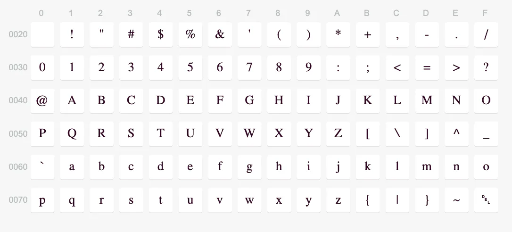
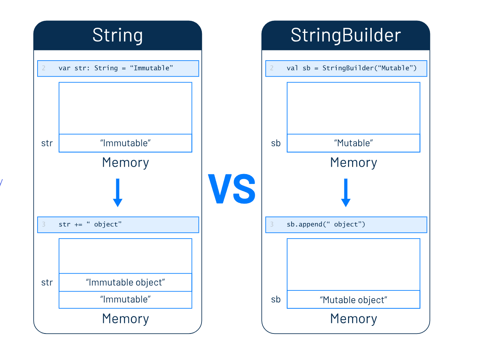
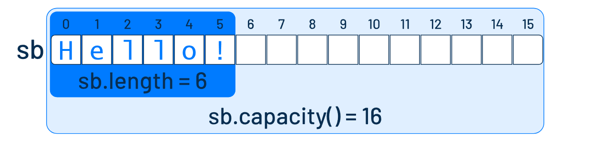

## String 

To write strings, we wrap characters in double quotes instead of single ones. Here are some valid examples: "text", "I want to learn Kotlin", "123456", "e-mail@gmail.com". So, strings can include letters, digits, whitespaces, and other characters.

### Unicode

<details>
  <summary>
    The solution to all these problems had to be a unified system and that is when Unicode comes in.
  </summary>
    As you know, computers operate in binary code so, naturally, different kinds of symbols that we use need to be transformed into numbers. For this purpose, different encodings were created and implemented over the years.

    One of the earliest was the ASCII encoding. It's a 7-bit encoding that contains 128(2^7) symbols based on the English alphabet. It wasn't perfect for everyone for several reasons.

    - First, computers started to use 8-bit sequences, bytes, for storing information and ASCII strings had extra memory that wasn't being used.
    - Second and most important, 128 symbols just wasn't enough for everyone, not even for the English script itself

    There was a clear need for new, improved encodings and many of them started to appear after ASCII. There were extensions of ASCII (like ISO 8859-1) or encodings for specific scripts (for example, Windows-1251 for Cyrillic). However, in different encodings, the same number could represent different symbols and that would complicate communications. 
</details>

Unicode is a standard for encoding and representing text. It is not an encoding per se since it doesn't determine how symbols are converted to bytes. **It is simply a specification that defines the mapping between symbols and numbers.**

Unicode can also be viewed as an extension of the `ASCII` table: in fact, the first 128 numbers in the Unicode represent ASCII symbols. All in all, Unicode can accommodate 1,112,064 code points, but as of May 2019, only 137,994 are occupied. The fact that most code points aren't designated yet is also one of Unicode's advantages. It means that for years and years to come, we can add new letters, scripts, punctuation marks, and pictograms to the standard without running out of space.

Unicode consists of two parts: **Universal character set**(UCS), and **Universal transformation format** (UTF).

UCS is essentially an index of all symbols supported by the Unicode and codes for those symbols.This is a part of Basic Latin, the symbols that have traveled from ASCII:

In Unicode, every symbol corresponds to a number—**code point**. A code point is usually presented with U+ followed by its hexadecimal value. 
The hexadecimal number in the code has from 4 to 6 digits depending on its place in the standard. For example, the code for the Latin Capital Letter Q is `U+0051`.


Unicode code points are divided into 17 planes with numbers from 0 to 16. Each plane is a continuous group of 65 536 (2^16) code points. The plane with the number 0 is called **Basic Multilingual Plane** (BMP) and it contains characters for most modern writing systems and languages as well as many symbols. The ASCII part of the BMP includes the first 128 characters, from `U+0000` to `U+007F`.

The rest of the planes (1 through 16) are called "supplementary planes". Most of the supplementary planes are unassigned and empty which leaves room for additions.

The **Supplementary Multilingual Plane** (SMP) (codes from `U+10000` to `U+1FFFF`) is the next plane after BMP. It includes many historic scripts and, what is quite interesting, special characters and symbols. SMP has musical notations, alchemical symbols, geometric shapes, and even emojis! If your favorite programming language supports Unicode strings, chances are you can put emojis or other interesting characters in your strings!

### Unicode Implementation

We've already mentioned that along with UCS, Unicode has **UTF — Universal Transformation Format**.
UTF is a set of encodings that support Unicode. Encodings describe how symbols (or, rather, their code points) are transformed into bytes according to a particular character set and vice versa.

UTF-8 is the most commonly used encoding in the world as around 94% of the Internet is encoded in UTF-8. UTF-8 uses from 1 to 4 bytes per code point and is capable of representing all code points of the Unicode. UTF-8 is also backward compatible with ASCII.

## Getting substrings

> [!NOTE]
> Don't forget that strings are immutable, therefore, functions that change a string return a new string.

Oftentimes, you need to get only a certain part of a string. Kotlin provides the `substring` function for this.

The `substring` function accepts `startIndex` and `lastIndex` as arguments and returns a string that starts at the `startIndex` and ends right **before** the `lastIndex`.

The parameter `lastIndex` can be omitted; then you will get a `substring` from the `startIndex` element to the end of the original string.

```kotlin
val greeting = "Hello"
println(greeting.substring(0, 3)) // "Hel"
println(greeting.substring(1, 3)) // "el"
println(greeting.substring(2))    // "llo"
println(greeting.substring(4, 5)) // "o"
```
The `substring` method is not the only way to get part of a string. You can also use the `substringAfter` and `substringBefore` functions:

>[!NOTE]
> Most of the functions in this topic accept not only characters but also strings as arguments.
The function accept the second argument. 
Just keep it in mind that as a second argument, you can specify the message to be returned if the `delimiter` argument is not present in the string. 
For example, .`substringBefore('z', "can't find a character")`.

The functions `substringBeforeLast` and `substringAfterLast` have a logic similar to `substringBefore` and `substringAfter` but return a string before or after the last occurrence of the `delimiter`.

## Replacing parts of a string

The `replace` function **replaces all** occurrences of the first argument in the string with the second argument.
If you need to replace only the **first occurrence** of an argument, use `replaceFirst`.

## Changing the case

in Kotlin you can use the `lowercase` function:

```kotlin
val example = "UPPERCASE String"
println(example.lowercase()) // uppercase string
```
If you need to do the opposite, then use the `uppercase` function:

```kotlin
val example = "Lowercase String"
println(example.uppercase()) // LOWERCASE STRING
```

## Splitting the string

A string can be separated by delimiters to a list of strings. To perform this, call the method split() , it divides a string into substrings by a **separator**.
The method returns a `List` of all the substrings. 

```kotlin
val sentence = "a long text"
val wordsList: List<String> = sentence.split(" ") // ["a", "long", "text"]
```


## String Builder

### Mutable strings

In Kotlin, `String` objects are immutable, meaning that once created, they cannot be changed. 

> [!CAUTION]
> Every time we perform operations like concatenation using the + operator or the plus() function, a new string object is created, which can result in unnecessary memory allocations and performance overhead.

To address these challenges, Kotlin has a special class named `StringBuilder` that represents a **mutable sequence of characters**.

It can be used to efficiently perform multiple string manipulation operations, allowing you to modify its contents without creating a new object. This can help reduce the memory overhead and improve performance.




> [!CAUTION]
> Don't confuse immutability with the use of val or var when declaring variables. Immutability refers to certain data types that cannot be changed in memory once they have been created. On the other hand, val or var defines if a variable can be reassigned or not.


### Constructors of StringBuilder

There are two main ways to construct a `StringBuilder` object in Kotlin:

1. Using the `StringBuilder` constructor

```kotlin

val sb = StringBuilder()

val sb1 = StringBuilder("Kotlin")
val sb2 = StringBuilder(sb1)

val sb3 = StringBuilder(100)
```

2. Using the `buildString` function

```kotlin
val str = buildString {
    append("Hello")
    append(' ')
    append("Kotlin")
}
println(str) // Output: Hello Kotlin


val str1 = buildString(100) {
    // some code here
}
```

> [!CAUTION]
> It is important to note that the buildString function returns a String, not a StringBuilder.

### Methods of StringBuilder

- The `append` method: it allows you to add characters or strings to the end of a `StringBuilder`. This method is overloaded to accept different types of arguments.

```kotlin
val str = buildString {
    append("Kotlin v") // Appending a String
    append(1.8)        // Appending a Double
}
println(str) // Output: Kotlin v1.8
```

- The `insert` method: it allows you to insert characters or strings at a specific position in a `StringBuilder`. This method is also overloaded to accept different types of arguments.

```kotlin
val str = buildString {
    append("Hello World")
    insert(5, ",")
}
println(str) // Output: Hello, World
```

- The `delete` method: it allows you to remove characters or strings from a specific range in a `StringBuilder`. This method takes two arguments: the start index (included) and the end index (excluded) of the range to delete.

```kotlin
val str = buildString {
    append("That's impossible!")
    delete(7, 9)
}
println(str) // Output: That's possible!
```

- The `replace` method: it allows you to replace characters or strings within a specific range in a `StringBuilder`. This method takes three arguments: the start index (included), the end index of the range to replace (excluded), and the string to replace with.

```kotlin
val str = buildString {
    append("one, two, two, ...")
    replace(10, 13, "three")
}
println(str) // Output: one, two, three, ...
```

- The `reverse` method: it allows you to reverse the characters in a `StringBuilder`. This method takes no arguments and reverses the entire sequence of characters.

```kotlin
val str = buildString {
    append("Hello, Kotlin!")
    reverse()
}
println(str) // Output: !niltoK ,olleH
```

### Length vs. capacity

The `StringBuilder` class has two important members: `length` and `capacity()`. The **length** property represents the number of characters a `StringBuilder` object contains, while the **capacity** method returns the number of characters it can hold before it needs to be resized.

```kotlin
val sb = StringBuilder()
println("Length: ${sb.length}, Capacity: ${sb.capacity()}") // Output: Length: 0, Capacity: 16
sb.append("Hello!")
println("Length: ${sb.length}, Capacity: ${sb.capacity()}") // Output: Length: 6, Capacity: 16
```



When you create a new `StringBuilder`, its initial **capacity** is determined by the constructor you use. If you use the default constructor, the initial capacity will be `16` characters. If you pass a string when constructing a `StringBuilder`, it will add the length of that string to the initial capacity.

As you append new characters to a `StringBuilder`, its `length` increases. If the `length` exceeds the current `capacity`, the `StringBuilder` **automatically increases** its `capacity` to accommodate the additional characters.

The new capacity is calculated using the following formula: `newCapacity = max(oldCapacity * 2 + 2, newLength)`.

Example that demonstrates how the capacity of a `StringBuilder` created with the default constructor:

```kotlin
val sb = StringBuilder()              // Capacity = initial capacity = 16
println("Capacity: ${sb.capacity()}") // Output: Capacity: 16

sb.append("0123456789abcdef")         // (oldCapacity >= newLength) then: newCapacity = oldCapacity
println("Capacity: ${sb.capacity()}") // Output: Capacity: 16

sb.append('g')                        // // (oldCapacity < newLength) then: newCapacity = max(oldCapacity * 2 + 2, newLength) = oldCapacity * 2 + 2
println("Capacity: ${sb.capacity()}") // Output: Capacity: 34
```

Example with a `StringBuilder` created by passing a string to its constructor:

```kotlin
val sb = StringBuilder("Kotlin!")   // Capacity = initial capacity + "Kotlin!".length = 16 + 7
println("Capacity: ${sb.capacity()}")   // Output: Capacity: 23

sb.append("0123456789abcdef")           // (oldCapacity >= newLength) then: newCapacity = oldCapacity
println("Capacity: ${sb.capacity()}")   // Output: Capacity: 23

sb.append("0123456789abcdef0123456789abcdef") // (oldCapacity < newLength) then: newCapacity = max(oldCapacity * 2 + 2, newLength) = newLength
println("Capacity: ${sb.capacity()}, Length: ${sb.length}") // Output: Capacity: 55
```

### Best practices

Here are some best practices for using the `StringBuilder` class:

1. Use `StringBuilder` for **complex** string manipulation tasks.
2. **Pre-allocate** the capacity of the `StringBuilder`. If you know the approximate size of the final string, you can pre-allocate the capacity of the `StringBuilder` to reduce the number of times it needs to be resized. This can help improve performance by reducing the number of memory allocations.

3. **Reuse** the same `StringBuilder` object. If you need to perform multiple string manipulation operations, consider reusing the same `StringBuilder` object rather than creating a new one each time. This can help reduce memory overhead and improve performance. To do that, you can reset the `StringBuilder` to an empty state by calling its `setLength` method with an argument of `0`. This will clear the contents of the `StringBuilder` without changing its capacity, allowing you to reuse it for further string manipulation operations. 

```kotlin
val sb = StringBuilder()
sb.append("Java")
println(sb.toString()) // Output: Java
sb.setLength(0)
sb.append("Kotlin")
println(sb.toString()) // Output: Kotlin
```

4. **Convert** a `StringBuilder` to a `String` when finished. Once you have finished manipulating a `StringBuilder`, you may want to convert it to a String. This can be done easily by calling the toString method on the `StringBuilder` object. Keep in mind that calling this method creates a new `String` object, so if you need to perform further string manipulation operations, it may be more efficient to continue using the `StringBuilder`.


Also, here are some best practices for using the `buildString` function:

1. Use `buildString` for **simple** string construction.
2. **Avoid** unnecessary object creation.
3. **Leverage** the scope of the lambda. The buildString function takes a lambda as an argument, which provides a convenient scope for building the string. Use this scope to your advantage by declaring local variables and functions that can help simplify your code.


## toString()

### Default behavior

The `toString()` function is defined for the type `Any?`. This means that all the classes inherit all of the `Any?` methods, including `toString()`.

The point is that `toString()` for `Any?` returns **the class name and memory location** as a string. For some classes, the default behavior is adjusted for correct processing. For example, take `Int` or `Double`.

### Overriding toString()

It seems that our problems can be solved by redefining the `toString()` method. `toString()` is automatically defined for all the classes you create, and you can override it for any class

### Overriding toString(): Inheritance

Another reason for overriding the` toString()` method is working with superclasses or parent classes. Here, the general rules of inheritance also apply. If the `toString()` method is defined in the parent class, the derived class will use this particular override.

### Using the superclass definition

It may be necessary to invoke the `toString()` parent implementation in the child class. It can be done with `super`, as you remember from inheritance:

```kotlin
class Author(id: Int, login: String, email: String, val books: String): User(id, login, email) {
        override fun toString(): String {
            return "Author: ${super.toString()};\nBooks: $books"
    	}
}
```

##  String formatting

In Kotlin, the `String.format()` method returns a string formatted using a format string and a number of arguments. The format string defines how the arguments form the resulting string. As an example, let's create a string and print it:

```kotlin
val string = String.format("%s %s", "Hello", "World")
println(string)
//Hello World
```

An alternative syntax with the same result is:

```kotlin
val string = "%s %s".format("Hello", "World")
println(string)
//Hello World
```

In order to print all string characters in the upper case, we can use the format specifier `%S`

> [!CAUTION]
> In case the syntax of a format string is incorrect, an IllegalFormatException is thrown.

You can change the order using parameters for it: `%n\$s` , where `n` represents the number of the parameter that we want to insert into the result String and `s` is the parameter of the type `String`.

```kotlin
val str1 = "Kotlin"
val str2 = "the best language"
    
// %s is used to represent the String value,
// %1 is used to represent first argument
// %2 is used to represent second argument
var str = String.format("%1\$s is %2\$s", str1, str2)
println(str) // // Kotlin is the best language
    
// you can change the order of arguments
str = String.format("%2\$s is %1\$s", str1, str2)
println(str) // the best language is Kotlin
```

there are some special specifiers. Thus, `%%` inserts the `%` sign, while `%n` inserts a newline.

Note that `%n` may be interpreted as either `\r\n` or `\n`, depending on the platform. 

### Formatting integers

The main format specifier for integers (`Int`), including `Long`, `Short`, `Byte`, and `BigInteger`, is `%d`

- **%0Nd**: Leading zeros fill in the indicated width.
- **%,d**: Thousands divisor.
- **%+d**: Number always signed, even if positive.
- **% d**: For a positive number, insert one leading space.
- **%(d** : Put a negative number in parentheses, without the minus sign.
Note that `-` is incompatible with `0`.


```kotlin
val int1 = 1234
val int2 = -4567

println(String.format("%d", int1))       //1234
println(String.format("%8d", int1))      //    1234
println(String.format("%-8d", int1))     //1234  
println(String.format("%+d", int1))      //+1234

println(String.format("%+d", int2))      //-4567
println(String.format("%09d", int1))     //000001234
println(String.format("%,10d", int1))    //     1,234
println(String.format("%+,010d", int1))  //+00001,234

println(String.format("%-+,10d", int1))  //+1,234  
println(String.format("% d", int1))      // 1234
println(String.format("% d", int2))      //-4567
println(String.format("%(d", int2))      //(4567)
```

### Formatting floating point numbers

For normal decimal representation, we use `%f`.

```kotlin
val double1 = 1234.5678
val double2 = -1234.5678

println(String.format("%f", double1))      //1234.567800
println(String.format("%f", double2))      //-1234.567800
println(String.format("% f", double1))     // 1234.567800
println(String.format("% f", double2))     //-1234.567800

println(String.format("%(f", double1))     //1234.567800
println(String.format("%(f", double2))     //(1234.567800)
println(String.format("%+f", double1))     //+1234.567800
println(String.format("%,f", double1))     //1,234.567800

println(String.format("%-15f", double1))   //1234.567800    
println(String.format("%015f", double1))   //00001234.567800
println(String.format("%15.2f", double1))  //        1234.57
println(String.format("%.3f", double1))    //1234.568
println(String.format("%.6f", double1))    //1234.567800
```

