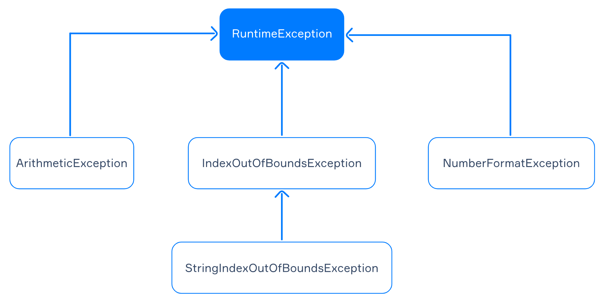

# Error in programs

Suppose, you're writing a Kotlin program. Different errors may occur during its compilation or execution. 
We will divide all possible errors into two groups: **compile-time** errors and **run-time** errors.

> [!NOTE]
> Remember: in many cases, you can avoid exceptions using conditions. So think about special cases in your program and add checks.

## Compile-time errors


Compile-time errors are errors that prevent a program compiling.
For example:
- syntax errors: incorrect keyword, typo, missing parenthesis or brace;
- incorrect imported package name;
- non-existing method invocation.

To avoid such errors, programmers use modern IDE (Integrated Development Environment) with a static code analyzer. 

## Run-time errors

Run-time errors (also known as "bugs") are errors that occur when the program is running. Run-time errors will cause your program to behave unexpectedly or may even stop the execution.

There are two subtypes of run-time errors:

- logic errors – when a program produces a wrong result because the code is not correct (for example, instead of "Hello!", your program outputs "Hi!");
- **unhandled exceptions** like division by zero, not found files, and other unexpected cases.

There are different strategies to find such errors:

- to debug your program;
- to write automatic tests for your program;
- to use code review practice as part of the development process. In general, this practice stands for a case when one or more developers visually inspect the source code of a program.

## Exception

Therefore, an error can happen while a program is running, even though it's syntactically correct and has been compiled without any problem. Such situations are called Exceptions in Kotlin and we are going to explore this concept.

## Hierarchy of exceptions

For different unexpected situations, there are different specialized types of exceptions. They are all related, making up a hierarchy of types

### Subtype and supertype

First of all, let's figure out the terminology. Types in Kotlin are organized into a hierarchy of subtype-supertype relationships

 What are subtypes and supertypes?

We can state the fact that coffee and tea are both related to a specific type: drink. In Kotlin terms, coffee and tea are **subtypes** of drink, while drink is a **supertype** for these two types

- The **subtype** is a datatype that is related to another datatype (supertype) and inherits common characteristics and rules of behavior from it.
- Logically, a **supertype** is a type whose properties and methods specify the characteristics and rules of behavior that its subtypes will follow.

### Overview of the exception hierarchy

The following picture illustrates a simplified hierarchy of exceptions:


As you can see, the foundation of this hierarchy is the type `Throwable`. It is the root of the hierarchy, and all exceptions somehow belong to this type. It provides a set of useful methods for handling exceptions.

The type `Throwable` has two direct subtypes: `Error` and `Exception`. An `Error` indicates serious problems that a reasonable application should not try to process. 

We shouldn't think about handling errors in the program code. Here we’ll focus on the `Exception`; when you develop an application, you normally will catch and process exactly exceptions

Keep in mind that **subtype** and **supertype** are relative terms, so a given type doesn't have to be one or the other. In this case, `Exception` is a subtype of `Throwable` and also the supertype of `RuntimeException`.

Subtypes of the `Exception` type, such as `RuntimeException` and `IOException`, deal with exceptional events inside applications. 


#### RuntimeException

The `RuntimeException` type is a rather special subtype of Exception. Subtypes of `RuntimeException`, such as `ArithmeticException` and `NumberFormatException`, can be thrown during the normal program execution.



- `ArithmeticException` is the runtime exception that is thrown when the code attempts an illegal arithmetic operation. Consider an extremely common example:

```kotlin
val example = 2 / 0 // throws ArithmeticException
```

- `NumberFormatException` During calculations you can get another type of exception: NumberFormatException. It is thrown when a method expects to receive a number,but the actual input is something else.

```kotlin
val string = "It's not a number"
val number = string.toInt() // throws NumberFormatException
```

- `IndexOutOfBoundsException` IndexOutOfBoundsException occurs when you access some non-existent index.

```kotlin
val sequence = "string"
println(sequence[10])   // throws StringIndexOutOfBoundsException
```

#### Throwing exceptions

Why should we write Exception(...)? That's the right question! Actually, all exceptions are located in a hierarchy tree. In this way, Exception represents a common type without any specifics.

### Root type Any

In Kotlin, type Any is a **supertype** for all types (**Any is at the top of the Kotlin type hierarchy**) that don't support `null`. This means that any `non-nullable` type is a **subtype** of Any.

While type `Any` is a supertype for all types that do not support null, `Any?` is a supertype for types that can be either `null` or not. **From this fact, it follows that type Any? is a supertype for type Any**


Non-null type is a subtype of its nullable equivalents, for example, type `Number` is a subtype of type `Number?`, and type `Int` is a subtype of type `Int?`. Let's see what it looks like:


This is why you can store a non-null `Number` value in a nullable `Number?` variable, but you cannot store a nullable `Number?` value in a non-null `Number` variable.

### Unit

`Unit` type can be used as the return type of a function that does not return any meaningful value

Like any other type, `Unit` is a subtype of `Any`. It can also be a nullable `Unit?`, which is a subtype of `Any?`.

