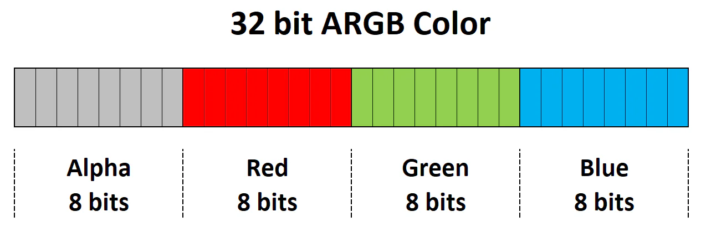
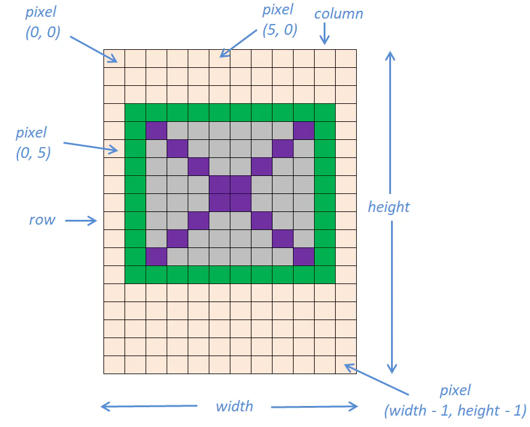
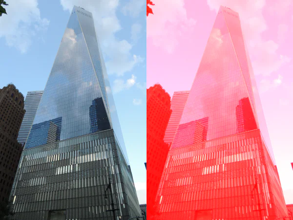

# Image Colors

## RGB Color, Alpha channel

In most cases, the RGB color model is used with 24-bit data for each pixel.
Hence, each pixel can have 16,777,216 different colors. This color scheme is called True Color.

An extension to the RGB is the ARGB color mode, which is similar to RGB colors but also contains opacity information.
‘A’ stands for Alpha or Alpha channel and denotes the transparency of each pixel.
An Alpha value of 0 indicates that the pixel is clear, while the maximum value indicates that the pixel is opaque.

Most commonly, ARGB is used with 32-bit data for each pixel. Each color and alpha channel is 8-bit long.



## Image coordinate system

Java and consequently Kotlin use the BufferedImage class in order to handle images.
It belongs to the `import java.awt.image.BufferedImage` package and is a subclass of the Image class.
Therefore, it has to be imported into a program:

- A pixel position is defined by a pair of natural numbers that correspond to the pixel column and row respectively, with columns running from left to right and rows running from top to bottom

- The starting row and column position number is zero.



## Read and Set pixel color

A pixel’s color can be read/set as an integer using the `getRGB(x, y)`/`setRGB(x, y, rgb)` function, where `x` and `y` are the column and row pixel positions respectively, and `rgb` is the pixel color as an integer.

A Kotlin integer has a size of 32 bits, so it can hold the color values for both the 24-bit RGB and 32-bit ARGB color schemes.

In the following code example, an image file is read. Then, for each pixel in the created `BufferedImage` instance, the red color is set to 255, while the green and the blue colors remain unchanged. The `BufferedImage` instance is then saved as a new file. Note that a new `Color` instance has to be created.

```kotlin
import java.io.File                   // Import the File class for file handling
import javax.imageio.ImageIO          // Import the ImageIO class for reading and writing images
import java.awt.image.BufferedImage   // BufferedImage Class
import java.awt.Color                 // Color class

fun main() {
   val inputFile = File("24bit.png")  // Create a file instance in order to read the "24bit.png" image file

   // Create a BufferedImage instance from the 24-bit image file data
   val myImage: BufferedImage = ImageIO.read(inputFile)  

   // myImage.width is the image width
   // myImage.height is the image height
   for (x in 0 until myImage.width) {               // For every column.
       for (y in 0 until myImage.height) {          // For every row
           val color = Color(myImage.getRGB(x, y))  // Read color from the (x, y) position

           val g = color.green              // Access the Green color value
           val b = color.blue               // Access the Blue color value
           // Use color.red in case the Red color is needed

           val colorNew = Color(255, g, b)  // Create a new Color instance with the red value equal to 255
           myImage.setRGB(x, y, colorNew.rgb)  // Set the new color at the (x, y) position
       }
   }
   val outputFileJpg = File("newImageFile.jpg")  // Output the file
   ImageIO.write(myImage, "jpg", outputFileJpg)  // Create an image using the BufferedImage instance data
}
```



## Reference

- https://hyperskill.org/learn/step/14484


