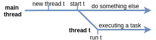

# Custom thread
## Create custom threads with inheritance

Two primary ways to create a new thread that performs a task you need are the following:

- extending the `Thread` class and overriding its `run` method;
  
```kotlin
class HelloThread : Thread() {
    override fun run() {
        val helloMsg = "Hello, i'm $name"
        println(helloMsg)
    }
}
```

- implementing the `Runnable` interface and passing the implementation to the constructor of the `Thread` class.

```kotlin
class HelloRunnable : Runnable {
    override fun run() {
        val threadName = Thread.currentThread().name
        val helloMsg = "Hello, i'm $threadName"
        println(helloMsg)
    }
}
```
the Thread class has a lot of constructors. You may find a full list [here](https://docs.oracle.com/javase/7/docs/api/java/lang/Thread.html#constructor_summary).

## Easy way to create a thread

You may create a thread with the function `thread(...): Thread`. In this case, the executing code is passed in the `block` argument:

```kotlin
import kotlin.concurrent.thread


val t4 = thread(start = false, name = "Thread 4", block = {
        println("Hello, I'm ${Thread.currentThread().name}")
    })
```

This function may have a lot of parameters that will describe your custom thread:

- `start` – if `true`, the thread is immediately started (then the thread will be created);

- `isDaemon` – if `true`, the thread is created as a daemon thread (we will talk about them later);

- `contextClassLoader` – a class loader for loading classes and resources in this thread (you will learn more about this later);

- `name` – the name of the thread;

- `priority` – the priority of the thread;

- `block` – thread's execution code.

## Starting threads

The class Thread has a method called `start()`, which is used to start a thread

At some point, after you invoke this method, the method run will be invoked automatically, but it won't happen immediately.

Also, if you set the value of the `start` parameter to true (it's the default value), you can start the thread without invoking the method `start()`

## Thread working

Here's a picture that explains how a thread actually starts and why it is not happening immediately.



As you may see, there is some delay between starting a thread and the moment when it really starts working (running).

> [!CAUTION]
> You must invoke start if you'd like to execute your code inside run in another thread. If you invoke run directly, the code will be executed in the same thread.
>
> If you try to start a thread more than once, start throws IllegalThreadStateException.
