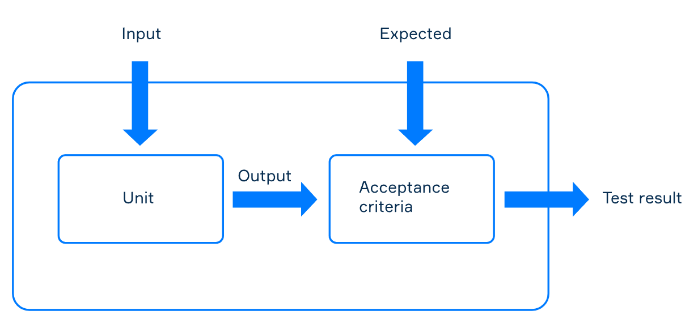
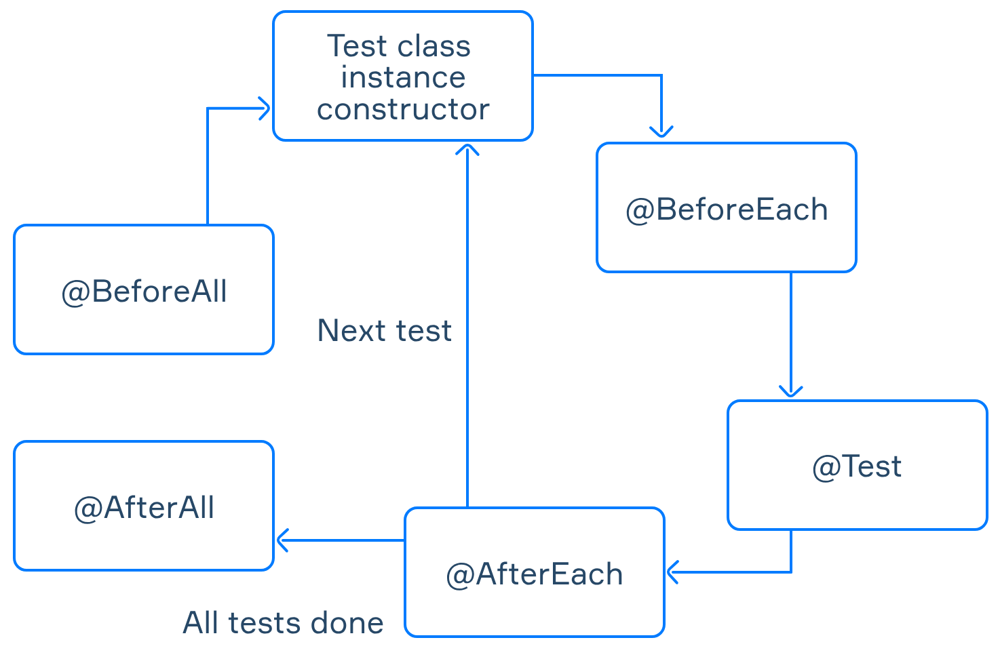
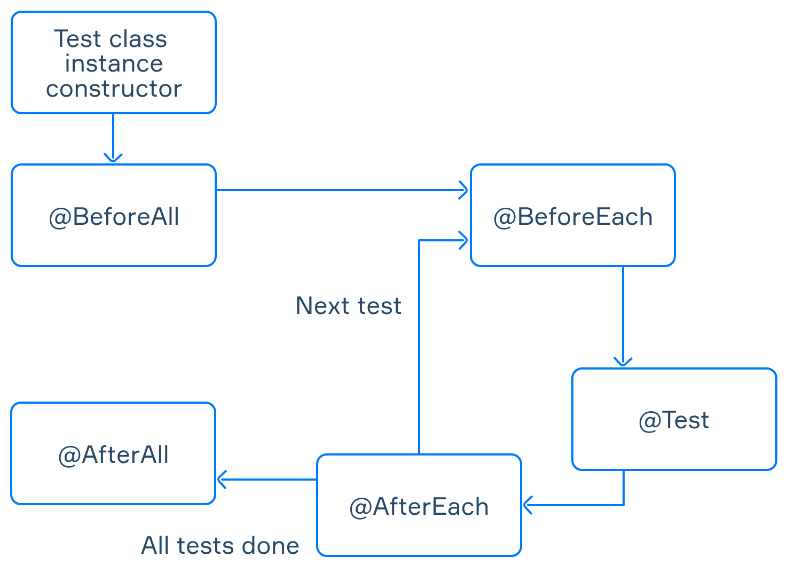

# Unit Test

We will consider one that is performed by developers: unit testing. 
This is probably the most popular methodology: it implies testing the behavior of a unit of an application.
A unit is a portion of code that does exactly one task, so it's the smallest testable part of an application.

### Steps to test a unit

The main idea of unit testing is to isolate a specific unit and check that it works properly.

The test goes through the following stages:

- We create two datasets: the input and the expected output;
- We define acceptance criteria: some conditions determining if the unit works as expected 
(usually, the acceptance criterion is a comparison of the actual output with the expected one);
- We pass the created input dataset to the tested unit;
- The input invokes code of the tested unit;
- The code produces an output;
- The produced output is checked by the acceptance criteria, 
which compares the actual output with the expected one;
- Acceptance criteria return the result: pass or fail.



>![NOTE]
> Note that we use unit tests to test our program without its external dependencies such as databases, 
> web services, and so on, which would fall into the category of integration tests.


## Manual Vs Automated

All these steps can be carried out manually or automated. 
It is in fact very uncommon to opt for manual unit testing, and there are a couple of sound reasons for that. 

- First, testing is a really repetitive process: every time you make a small change in your code, you have to retest it. 
Doing this manually would be daunting. 
Second, unit testing can be easily automated, so there is simply no reason to do it manually. Automated test cases are reusable. 
Suppose you add a new feature to your program; you can execute existing test cases to check whether the new feature has affected the application.

- Secondly, unit testing protects your code from further incorrect changes.

- Finally, unit testing makes the integration process easier.


Unit testing is an essential part of a developer's daily work. Even though it is quite time-consuming, it protects your code from bugs and saves you a lot of energy at the end of the day.

## JUnit


In Kotlin, methods may return values or change the internal state of objects. 
To verify the correctness of any method, you may compare the value returned by that method with the expected value or compare the internal state of an object modified by that method with the expected internal state.
Of course, you can do the tests manually, but it tends to be tedious and time-consuming. 
That's why some frameworks were developed to provide convenient tools for automated unit testing. The most popular of them is **JUnit**.

Test functions should have clear and descriptive names that make it easy to understand the purpose of the test and identify the source of a failure or bug when running multiple tests. 
A common naming convention is to use the format `FunctionName_TestCondition_ExpectedOutcome`. 
This helps to clearly communicate the purpose of the test, including the method being tested, the inputs or conditions that the method is being called with, and the expected outcome

## Assertions

The `Assertions` class of the JUnit framework has a lot of overloaded methods that will allow you to test different conditions

| Method | Description |
|---|---|
| assertEquals | Tests if the arguments are equal |
| assertTrue | Tests if a value is `true` |
| assertFalse | Tests if the argument is `false` |
| assertNull | Tests if the argument is `null` |
| assertNotNull | Tests if the argument is not `null` |
| assertThrows | Tests if the argument throws a certain exception |

Example

```kotlin 
import org.junit.jupiter.api.assertTrue

class CalculatorTest {
    
    ...

    @Test
    fun `when 2 is checked if even expect true`() {
        assertTrue(Calculator.isEven(2))
    }
}
```

We could also add a test to check if our `division` method throws an `IllegalArgumentException` if the second argument provided when calling it is 0:


```kotlin
import org.junit.jupiter.api.assertThrows

class CalculatorTest {

    ...
    
    @Test
    fun `when dividing by 0 expect IllegalArgumentException`() {
        assertThrows<IllegalArgumentException> {
            Calculator.divide(10, 0)
        }
    }
}
```

### Running tests

To run the tests is by using the terminal window. 
First, add the following lines to the `build.gradle` file to see a more detailed output for the executed tests:

```kotlin
test {
    ...
    
    testLogging {
        events "passed", "skipped", "failed"
    } 
}
```

After that, run the following command in the Terminal window (make sure you are in your project's root directory):

```kotlin
./gradlew test
```
Once the tests are executed, you will get this output:

```
...
> Task :test
CalculatorTest > when adding 1 and 2 expect 3() PASSED
CalculatorTest > when subtracting 2 from 3 expect 1() PASSED
CalculatorTest > when multiplying 2 by 3 expect 6() PASSED
CalculatorTest > when dividing 4 by 2 expect 2() PASSED
CalculatorTest > when 2 is checked if even expect true() PASSED
CalculatorTest > when dividing by 0 expect IllegalArgumentException() PASSED

BUILD SUCCESSFUL in 3s
```

Sometimes you may want to skip a test that was implemented.
Maybe because it's testing a feature that is not yet ready for release or the feature contains bugs that are not yet fixed.
To do so, annotate the test method with `@Disabled`:

```kotlin 
class CalculatorTest {
    
    @Disabled
    @Test
    fun `when adding 1 and 2 expect 3`() {
        ...
    }
}
```

## MockK

MockK is a powerful mocking library designed for the Kotlin language. 
It offers a simple and intuitive way to create and manage mock objects for testing purposes.

### Unit testing and MockK

One of the challenges in unit testing is dealing with dependencies, such as external services or a database access.
Mocking is a technique used to simulate these dependencies and create isolated tests.
By using mock objects instead of real dependencies, developers can control the behavior of these dependencies and make their tests more predictable.
This allows them to focus on testing specific parts of their code without worrying about external factors that may affect the test results.

## Test lifecycle annotations

We should not create a single instance of a class and share it among all tests, 
since a certain test may leave some state in the object that might affect the results of other tests. 
That is why we should execute each test using a new instance of the tested class.

### Test class instance lifecycle

First, let's talk about how JUnit5 executes our tests. 
It creates a new instance of the test class before executing each test method.
This way, it ensures execution of individual test methods in isolation to avoid possible side effects produced by any changes of state of the test class instance.


> [!NOTE]
> @TestInstance annotation controls the test class instance lifecycle.
> It is set to TestInstance.Lifecycle.PER_METHOD by default but can be changed if necessary.

Also, JUnit5 has special annotations to designate any methods as lifecycle methods,
such as `@BeforeAll`, `@AfterAll`, `@BeforeEach`, or `@AfterEach`.
They instruct the framework to execute the designated methods before or after executing actual test methods.

The annotations `@BeforeEach` and `@AfterEach` indicate, respectively, that the annotated method will be executed before and after each method of the test class annotated with `@Test`,
while `@BeforeAll` and `@AfterAll` methods will be executed before or after all the `@Test` methods in the test class.

In the following example, we create a new test class to see how lifecycle annotations actually work:

```kotlin
import org.junit.jupiter.api.*

class LifeCycleTest {

    constructor(){
        println("Test Class Constructor")
    }

    @BeforeEach
    fun beforeEach() {
        println("Before each test")
    }

    @AfterEach
    fun afterEach() {
        println("After each test")
    }

    @Test
    fun test1() {
        println("Test 1")
    }

    @Test
    fun test2() {
        println("Test 2")
    }
}
```

```bash
Test Class Constructor
Before each test
Test 1
After each test
Test Class Constructor
Before each test
Test 2
After each test
```

The following diagram illustrates this order to help you better understand the test class lifecycle:



### Test instance per class

If for any reason you would like to execute all test methods on the same instance of the test class,
JUnit5 allows you to do so by annotating the test class with `@TestInstance(Lifecycle.PER_CLASS)`.
In this mode, a new instance of the test class will be created only once,
therefore if your test methods rely on a state stored in its non-static variables, you may need to reset that state in `@BeforeEach` or `@AfterEach` methods.




## Reference
- https://hyperskill.org/learn/step/7545
