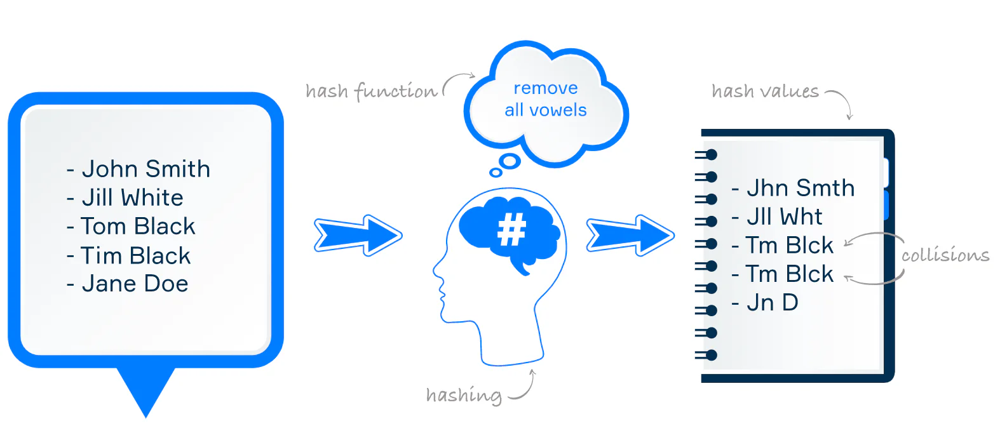

# Hasing Overview

Formally, hash functions are functions that we can use to map data of arbitrary size to fixed-size values. That's quite vague, so let's look at a real-life comparison to understand them better:

Imagine you have a friend Paul who keeps a phone book. Your friend is lazy and doesn't want to spend a lot of time writing the full names of his contacts.

So, instead, Paul writes only the consonants in their names. For example, instead of John Smith, Paul writes Jhn Smth.

In quite a few ways, this process is similar to **hashing**. We can consider that "remove all vowels" is the **hash function**.

We call the result of applying a hash function to some input a **hash value**, or simply its hash. 

Now, not all hash values will be distinct: think about two people with names Tim Black and Tom Black. The hash value for both of those names will be Tm Blck. When this happens, we call it a **collision**.

The main difference between our example and a real hash function is that, in our case, the hash values do not have a fixed size.

The real hash function take input that can be really big and return something of a fixed size, so there is no way to completely avoid collisions!

## Applications of hash functions

As we mentioned in the beginning, hash functions have many applications. Let's look at a few of the most important ones:

- Message digests

Say you have a message that you want to send to a friend over the internet but are afraid that someone might change its contents before it reaches your friend. One of the things you can do is to compute a hash value for your message before sending it. When your friends receive it, they compute the hash value of the message using the same hash function as you. You can then compare the two hashes and check that they are equal. Hash functions used for this have the property that it is hard to find collisions. Such hash functions are called **cryptographic** hash functions. 

- Password Storage

Ever wondered why websites don't have an option to send you your password in case you forget it, and they make you reset it? To be able to send it back, they have to store it in plain text. By doing so, if someone gets access to the password database, they can easily steal all the accounts! What websites do is to store a hash of your password. When you send the password to log in, they compute its hash and check if it is equal to what they have stored. In this case, finding collisions is not such a big problem. Here, you need to know that if someone finds the hash of your password, they should not be able to find out your password from it.

- Hash tables

A more common use in day-to-day programming is hash tables. They are fast and convenient data structures that use hashing. With them, you can search, insert, or remove elements from a table. The main idea behind them is that you want to use hash values to index data in an array. For example, if you want to use a hash table to store a phone book, you can save the pair (Tim Black, 0123456789) at index Tm Blck. Then, to find Tim's phone number, you only have to search at index Tm Blck. After that, you can also save (Tom Black, 9876543210) at the same index and, whenever you need to find Tim's or Tom's phone number, you only have to search between two pairs, rather than the whole phone book. Hash functions used in hash tables are less restrictive than the ones used for message digests and password storage, and their hash values are, generally, numbers.

