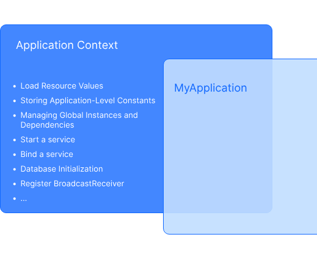
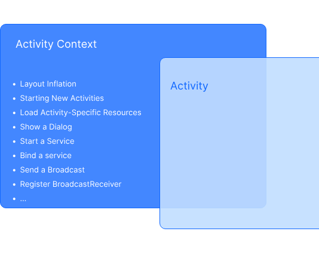

# Application and Context

## The Application class

The `Application` class plays a central role in the application lifecycle and represents the starting point of any Android application. 

This class is fundamental for overseeing the global state of an app and takes charge of certain setup activities that must occur before the app's primary components, like Activities, Services, or BroadcastReceivers, are initiated.

When an application is launched, the Android system automatically creates an instance of the `Application` class. This class has the pivotal role of guiding the application through its entire lifecycle. Notably, there is just one instance of the Application class for each app that ensures consistent management. This unique instance starts its operation before any other app components and continues until the app either closes or is cleared from the system's memory.

## Lifecycle of Application

The `Application` class gives developers ways to manage what happens at different stages of an app's life. Here are the main parts:

- **onCreate()**: when the application starts, the first thing it does is run this method. Here, it prepares everything needed for the app to work properly, such as setting up resources and getting libraries ready.

- **onConfigurationChanged()**: when there's a change in device configurations, such as screen rotations or language settings, this method ensures that the app adjusts and behaves correctly.

- **onLowMemory()**: if the device starts running low on memory, this method is triggered, prompting the app to manage its resources more efficiently to continue smooth operations.

- **onTrimMemory()**: When the system asks your app to free up some memory, this method is activated. It gives specific details about how much memory should be saved. The app can then decide how to respond based on the urgency of the memory situation.


## Subclassing the Application class

To create a custom implementation, follow these steps:

1. **Extend Application class**. Create a new class in the Android project that extends the base class `android.app.Application`.
You can now override the previously mentioned methods to manage the lifecycle of your application:

```kotlin
package com.example.myapp

import android.app.Application

class MyApp : Application() {

    override fun onCreate() {
        super.onCreate()

        // Initialize and set up your custom global state here
        // For instance, setting up analytics, database, or other services.
    }

    // You can add other methods or override other `Application` methods if needed
}
```

2. **Define a custom application class in the manifest**. Add the custom application class to the file using attributes in the element.
This tells the Android system to use your custom class to manage your application's global state.

```xml
<manifest xmlns:android="http://schemas.android.com/apk/res/android"
    package="com.example.myapp">

    <application
        android:name=".MyApp"  <!-- This points to your custom Application subclass -->
        android:icon="@mipmap/ic_launcher"
        android:label="@string/app_name"
        android:theme="@style/AppTheme">

        <!-- Other components like activities, services, etc. -->

    </application>

</manifest>
```

3. **Access custom application classes**. You can then access custom application classes throughout your application, allowing you to share data and manage resources globally. To access your custom application class, cast the `applicationContext` property results of any Activity, Service, or BroadcastReceiver to your custom class.

## Context

**Context** is a core concept that bridges an application to the larger Android operating system.
It's the conduit through which apps can access system resources, services, and specific information about the application environment.
This means that using Context, apps can tap into system services, retrieve resources, launch activities, broadcast messages, access specific directories, and manage permissions. Essentially, it's the app's way of understanding and interacting with its surrounding environment within the Android ecosystem.

Each Activity and Service has its own associated Context, distinct from the Application Context.
Therefore, the total number of Contexts in an application is calculated as the sum of the number of Activities, the number of Services, plus one representing the Application Context.

For other components like Content Providers and Broadcast Receivers, which are not subclasses of Context: they are not counted as separate Contexts.
However, it's important to note that these components often require access to a `Context` object when they are created or executed to interact with the Android system and resources effectively

### Retrieving Context

There are three primary properties to obtain Context:

- **applicationContext**: gives you a broader context that spans the entire application. This context is alive as long as your app is running. Since it's not specifically tied to any UI component, you wouldn't use it for tasks like starting an activity or inflating a UI element. **Instead, it's great for app-wide actions such as starting services or broadcasting messages.**



- The **context** property gives you a context specifically tied to the component you're in, like an Activity or a View. This context is linked to that component's lifecycle, making it suitable for UI-related tasks such as inflating layouts or showing dialogs. When the component (e.g., an Activity) is destroyed, its context is also cleared out.



- **baseContext** is a property associated with the `ContextWrapper` class in Android. This property allows you to retrieve the original or underlying Context that the `ContextWrapper` is wrapping around or proxying. In simpler terms, when you have a `ContextWrapper` that modifies or extends the behavior of a Context, the `baseContext` property gives you access to that original, unmodified Context inside the wrapper. Typically, you'd rarely need to use this. However, it becomes particularly handy when you want to ensure that no additional styling or theming layers interfere with your operations. When using views or operations that need to be free of the current activity's or application's theme, this context becomes useful.


To sum up, while **applicationContext** provides a broader scope and can access most functionalities, it should be used for non-UI tasks. On the other hand, `context` is more suitable for UI-related operations within the context of the current UI component. Choosing the appropriate context based on the task at hand is crucial in Android to ensure smooth operations and avoid potential pitfalls like memory leaks.

### Context vs applicationContext


|           | **Context**                                                                                                                       | **Application Context**                                                                                           |
|------------------------|------------------------------------------------------------------------------------------------------------------------------------|-------------------------------------------------------------------------------------------------------------------|
| **Scope**              | Component-specific. Used within the confines of a specific UI component such as an Activity, Fragment, or View.                    | Application-wide. Represents the global state of the entire application.                                          |
| **Lifespan**           | Closely tied to its parent component's lifecycle. When the parent component (like an Activity) is destroyed, this context is also disposed of. | Persistently alive as long as the app's process is running, from the application's start to its termination.      |
| **Usage**              | UI-related operations (layouts, toasts, dialogs)                                                                                   | App-wide operations (services, broadcasts, app-level resources)                                                  |
| **Theming**            | Adheres to the UI configurations (themes, styles) of the parent component, ensuring UI elements remain consistent in appearance.   | Does not carry specific UI modifications                                                                          |
| **Potential Pitfalls** | Can result in memory leaks if, for example, a long-running background task references an Activity context, and that Activity is destroyed before the task completes. | While it avoids many pitfalls of other contexts, using it to directly manipulate or present UI can lead to inconsistencies. |


