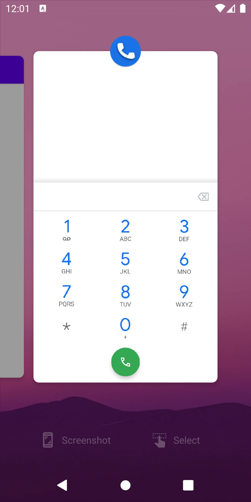
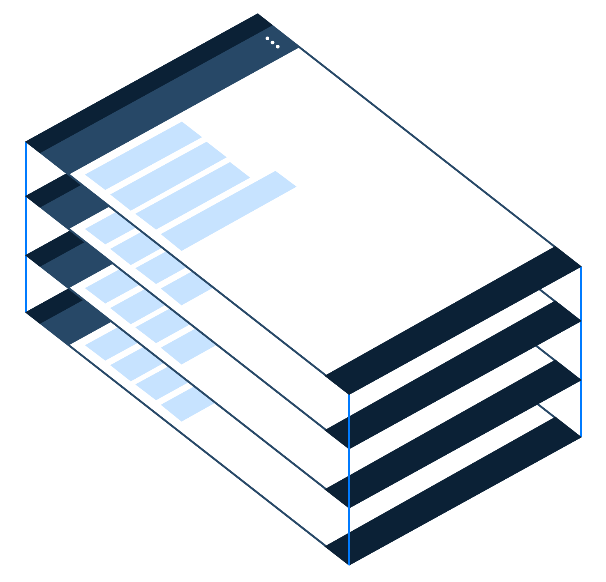
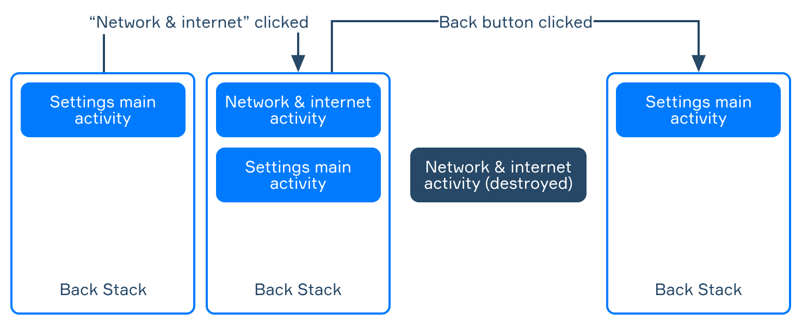
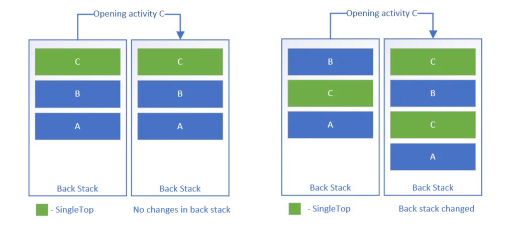
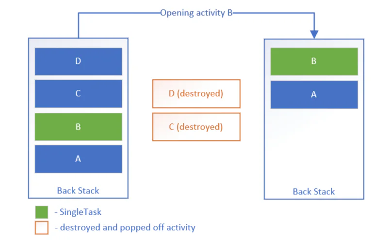
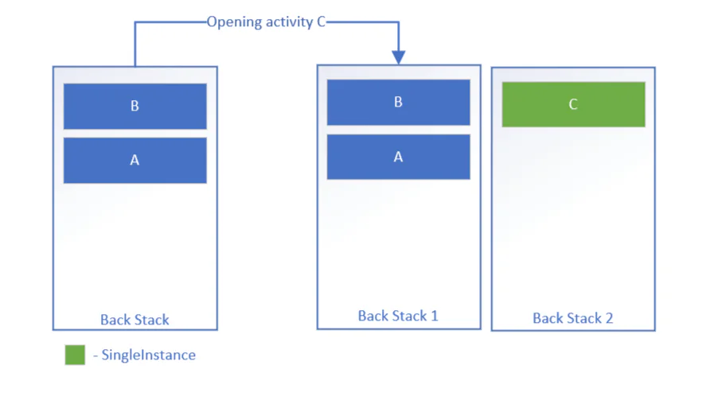

# Tasks and back stack

A **task** is a collection of activities that a user interacts with when using an app.
Activities are stacked in the **back stack** in the order in which they are opened.
In this topic, you will learn more about tasks and the back stack.
You'll find out what **launch modes** are and how to use Intent **flags** when developing your applications.

## Tasks and back stack

If you click the "Recently opened" button on your phone, you will see a list of tasks:



The activities in a task are arranged in a stack (known as the back stack).
You can see a visualization of this below:



Let's take the Settings app as an example.

A new task will be created when you open it, and the main settings activity will be shown on the screen and added (**pushed**) to the task's stack.

Then, if you click on any item in the settings list, a new activity will be created, shown, and pushed to the stack. 

Pressing the "Back" button will destroy that activity and remove (**pop**) it from the stack.

Clicking the "Back" button again will pop the previous activity off.

And once all activities are popped off the stack, you will be returned to the Home screen, and the task will no longer exist.
This is the stack's standard behavior. 

It's known as "last in, first out" and results in the most recent activity being shown on the screen. It's a launch mode that works well for most apps.



If a user hits the "Home" button without closing activities, the associated task will be **backgrounded**.

It should then be possible to return to this task later with no changes in the back stack. 

However, if the user has many tasks (or apps) in the background, the system might kill some of them to recover resources, leading to the loss of unsaved data. Therefore it is the developer's responsibility to ensure that important data is saved.

## Launch modes

There are four activity launch modes available:
- `standard`

The default launch mode. The system creates a new activity and routes an Intent to it.
The activity is pushed on top of the stack, even if the same activity is already **foregrounded**.

- `singleTop`

This mode behaves differently from `standard` if the activity you would like to start is already on the top of the stack.
Instead of creating it again, the system routes an Intent to the existing instance through a call to the `onNewIntent()` method.

Example:
The stack consists of three activities (A-B-C). C is at the top of the stack with its launch mode set to `singleTop`.

In this scenario, if you try to open activity C again, the stack will remain the same (A-B-C), and the `onNewIntent()` method will be called.

However, if the activities were ordered differently to start with (A-C-B), calling activity C again would change the stack (A-C-B-C), as you can see below.



- `singleTask`

Be careful with this launch mode because its behavior seems strange to most users.

Only one instance of an activity with this launch mode can exist at a time.

So, if this activity doesn't already exist in the task, it will be created and pushed to the top of the stack (in the same way as with `standard` mode).

But if it does exist, all activities placed higher in the stack will be immediately destroyed, revealing the one that has been called and firing an `onNewIntent()` method.

Example:
Four activities have already been pushed to the stack (A-B-C-D), and activity B has been assigned the `singleTask` launch mode. As shown below, calling activity B will pop activities C and D off the stack, leaving only A and B.



The official documentation for Android developers describes this mode's behavior differently:
"The system creates a new task and instantiates the activity at the root of the new task."
"Root" here is a first item (activity) in the task.

The `taskAffinity` attribute is used to specify which task an activity prefers to belong to, and its default value is essentially just the package name of your app.

You can change the `taskAffinity` in the relevant `<activity />` tag, which is located in the `AndroidManifest.xml` file.

However, the behavior described in the documentation only applies when the `taskAffinity` attribute is not set to the default value.
And, after changing `taskAffinity`, `singleTask` will behave exactly as the official documentation describes.

- `singleInstance`.

This mode is the same as `singleTask`, except that an activity with this launch mode will always be the only member of the task. If a `singleInstance` activity launches another activity, it will be launched in a different task (Back Stack).

Example:
The stack already contains two standard activities (A-B). Activity C is set to singleInstance, so launching it creates a new task (A-B)(C), as you can see in the below diagram.




---

They are defined in the `AndroidManifest.xml` file in the activity tag:

```xml
<manifest xmlns:android="<http://schemas.android.com/apk/res/android>"
    package="com.hyperskill.tasks">

    <application ...> <!-- skipped some attributes -->

        <activity
            android:name=".SecondActivity"
            android:launchMode="standard" />

        <activity ...>
            <!-- intent-filter etc -->
        </activity>
    </application>
</manifest>
```
## Intent flags

Making launch mode changes in the manifest file works well when you always need the same behavior, but they can't be made during runtime.

Fortunately, Intent flags provide more flexibility.

For example:

Apps usually send interactive notifications: you click on them, and an activity pops up.

If these notifications constantly repeat, it becomes really annoying to press the "Back" button a million times to close all the created activities.

Intent flags can help us solve problems like this, so let's learn about some of them:

- `FLAG_ACTIVITY_SINGLE_TOP` has the same behavior as the `singleTop` launch mode.

- `FLAG_ACTIVITY_NEW_TASK` creates a new instance of the activity in the task. The documentation says that this flag acts like `singleTask`.

- `FLAG_ACTIVITY_CLEAR_TOP` looks at whether the activity already exists in the stack. If it does, it destroys every activity above, which results in the activity being at the top of the stack. If it doesn't already exist, it creates the activity in the usual way.
Using this flag with `FLAG_ACTIVITY_NEW_TASK` will result in similar behavior to the `singleTask` launch mode, but the activity will be restarted.
To avoid restarting and losing the activity state, use the `singleTask` launch mode in the manifest file.

- `FLAG_ACTIVITY_CLEAR_TASK` clears the stack and places the freshly opened activity at the root of the stack. It's used with `FLAG_ACTIVITY_NEW_TASK`.

- `FLAG_ACTIVITY_REORDER_TO_FRONT` reorders the opened activity to the front. For example, if the initial stack order was A-B-C-D and activity A was called with this flag, the new order of the stack would be B-C-D-A.

- `FLAG_ACTIVITY_NO_HISTORY` prevents the activity from being kept in the stack.

Once you've decided which flags you want to use, you need to add them to your existing Intent.
This can be done in the following way:

```kotlin
val intent = Intent(this, MainActivity::class.java)
intent.addFlags(Intent.FLAG_ACTIVITY_NEW_TASK)
startActivity(intent)

//in case you want to replace previous flags (if there are any) instead of adding them:

val intent = Intent(this, SecondActivity::class.java)
intent.flags = Intent.FLAG_ACTIVITY_NEW_TASK
startActivity(intent)
```
Or, when you need more than one flag:

```kotlin
val intent = Intent(this, SecondActivity::class.java)
intent.addFlags(Intent.FLAG_ACTIVITY_NEW_TASK or Intent.FLAG_ACTIVITY_CLEAR_TOP)
startActivity(intent)

//in case you want to replace previous flags (if there are any) instead of adding them:

val intent = Intent(this, SecondActivity::class.java)
intent.flags = Intent.FLAG_ACTIVITY_CLEAR_TASK or Intent.FLAG_ACTIVITY_NEW_TASK
startActivity(intent)
```


