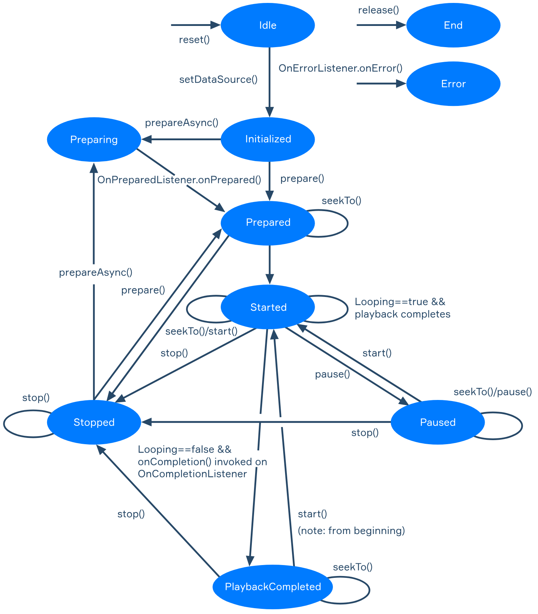

# Playing audio with MediaPlayer

We all love to listening music and watching videos with our phones, but how does it work? The answer is multimedia players. There are a few of them, they differ in complexity and provide different possibilities for customization. The most popular one that is not part of the Android framework is ExoPlayer, but it's too complex for us now, so it will be better to take a look at the MediaPlayer API first, which is part of the Android framework

In this topic, we will discuss only the audio capabilities of MediaPlayer.

## How to play a song

MediaPlayer supports different data sources such as:

- App resources
- Local URIs using a Content Resolver
- External URLs
Here is the easiest way to obtain media from app resources:

```kotlin
var mediaPlayer = MediaPlayer.create(applicationContext, R.raw.song)

mediaPlayer.setAudioAttributes(
    AudioAttributes.Builder()
        .setContentType(AudioAttributes.CONTENT_TYPE_MUSIC)
        .setUsage(AudioAttributes.USAGE_MEDIA)
        .build()
)

mediaPlayer.start()
```


We just create an instance with the MediaPlayer.create() method and start playback with the start() method. We obtained our file from R.raw, which is actually src/main/res/raw that can contain files without specifying any particular type. However, it should still be a properly encoded and formatted file in one of the supported formats.

setAudioAttributes() can set some attributes that give information about the audio stream. The two we used in the snippet are:

- Usage, which describes "why" you are playing a sound, for example, USAGE_MEDIA and USAGE_ALARM
- ContentType, which describes what type of content you're playing, for example CONTENT_TYPE_MOVIE and CONTENT_TYPE_MUSIC.


There are some other types of AudioAttributes that can research by yourself if you are interested. However, MediaPlayer could work even if you don't specify the type of content. But it is better to specify them because this information could be used by a platform or audio framework to set a more refined volume or some post-processing of your audio stream to get better quality.

If you want to play media from an internal URI, you can look at the following snippet:

```kotlin
val myUri: Uri = .... // initialize Uri here

val mediaPlayer = MediaPlayer().apply {
    setAudioAttributes(
        AudioAttributes.Builder()
            .setContentType(AudioAttributes.CONTENT_TYPE_MUSIC)
            .setUsage(AudioAttributes.USAGE_MEDIA)
            .build()
    )
    setDataSource(applicationContext, myUri)
    prepare()
    start()
}
```

Here we have two new methods: setDataSource() and prepare(). The latter is about managing the state of a MediaPlayer which we'll discuss later in the topic, let's take a look at the first one:

We specify which content we want to playback via setDataSource(). In the cases when we use internal URI, we should additionally pass the Context.

Finally, if you want to playback media from a remote URL, the snippet would look pretty much the same, but you don't need to pass Context anymore:

```kotlin
val url = "http://........" // your URL here

val mediaPlayer = MediaPlayer().apply {
    setAudioAttributes(
        AudioAttributes.Builder()
            .setContentType(AudioAttributes.CONTENT_TYPE_MUSIC)
            .setUsage(AudioAttributes.USAGE_MEDIA)
            .build()
    )
    setDataSource(url)
    prepare()
    start()
}
```

> [!CAUTION]
> If you're using this type of obtaining media, a prepare() call might take a long time! So it may be a better idea for using prepareAsync() which we'll discuss in a later section of this topic.

## Managing the state

An important aspect of MediaPlayer that you should keep in mind is that it is state-based. MediaPlayer has an internal state that you should always be aware of when writing code. Some of the operations are valid only when the player is in a specific state. There is a whole diagram of possible MediaPlayer states and which methods could move from one to another:



However, this scheme is pretty complex and has a lot of information to take in, so let's take a closer look at each of these states.

- Idle. MediaPlayer is in this state when you first instantiate it or call reset().
Initialized. MediaPlayer reaches the state when you set a data source. If you try to set a data source not in the idle state, IllegalStateException occurs.
- Prepared. Before you can play any media, you have to prepare MediaPlayer by calling prepare(). You can also call prepareAsync(), but we will discuss it later in the topic. However, if you use MediaPlayer.create() for instantiation as we did in the first example, your MediaPlayer will be created in the prepared state.
- Started. As soon as your MediaPlayer is prepared, you can call start() to reach this state. While the media is playing, the MediaPlayer is in the started state.
- Paused. You can pause your media by calling pause().
- Stopped. MediaPlayer in the state when the media is stopped. If you want to play it again, you need to prepare it first.
- PlaybackCompleted. Once the media is played, MediaPlayer is in this state. You can play the media again by calling start() and you can set a callback via setOnCompletionListener().
- End. MediaPlayer moves into this state after release() is called which we will discuss later. In this state, you can't play or pause media.
- Error. If you try to perform a playback control operation in an illegal-state MediaPlayer, you will reach this state. You can catch the error by setting a callback via setOnErrorListener()

As you can see, it's a lot of different states and possible ways to move from one to another. However, sometimes methods won't change the state. For example, we can look at seekTo() which searches the media to the given time code.

## Using MediaPlayer efficiently


Using MediaPlayer can be pretty straightforward but it's important to remember that a few more things are necessary to use it correctly. Calling prepare() can take a long time for fetching and decoding data, so you should never call it from the UI thread. This could lead to hanging UI and even ANR. Instead, it's better to call prepareAsync() which will start preparing your data in the background. Once the preparation is done, it will call a callback which you can configure with setOnPreparedListener()

This is an example of how you can start asynchronous preparation and start playing the media immediately as it's done:


```kotlin
val url = ...   
                       
val mediaPlayer = MediaPlayer().apply {
    setDataSource(url)     

    setOnPreparedListener {            
        start()                        
    }            
     
    prepareAsync()                           
}                                      
```

> [!CAUTION]
> As you remember, when we created MediaPlayer with MediaPlayer.create() we should not call prepare() because the builder does it for us. But this means that there is no way to call prepareAsync with it!


Another important note is that MediaPlayer consumes valuable system resources. So you should never have more instances than you need. If you are done with MediaPlayer you should call release() to free all system resources that were allocated. You should do the same thing when your Activity receives a call to onStop() because there is no reason to hold it on while your activity is not interacting with the user (unless you want to play the media in the background, which we won't elaborate on in this topic). When the activity is resumed or restarted, you can create and prepare a new MediaPlayer and restore its state.

Here is an example of how you should release and nullify your MediaPlayer when you are done with it:

```kotlin
mediaPlayer?.release()
mediaPlayer = null
```

We did not have nullable MediaPlayer in the previous examples for concise but it is good practice to nullify it.

For instance, if you don't release MediaPlayer in onStop() and the user rotates the device between portrait and landscape, you might quickly consume all of the system resources because every orientation change will create a new MediaPlayer that will never be released.

## Conclusion


To play media on Android you can use the MediaPlayer API. MediaPlayer can obtain files from app resources, or local URIs or download them from an external URL. Even though using MediaPlayer can seem pretty straightforward, always keep in mind a few things:

- Correctly manage MediaPlayer states.
- MediaPlayer can take a long time to download resources, so don't prepare in the UI thread.
- Remember to release resources when you don't need them anymore.


## references
- [Playing audio with MediaPlayer](https://hyperskill.org/learn/step/26069)