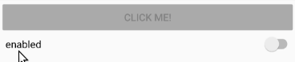

# Drawables

**Color, Bitmap, and VectorDrawable are types of Drawable objects used in Android development.** They represent colors, images, and vector graphics, respectively, and are essential for creating various visual elements within the user interface.


## Color

A color is represented as an integer containing four distinct values, delineating the opacity (referred to as alpha) and the intensity of the red, green, and blue components. Consequently, any Kotlin integer can serve as a valid color representation.

As previously discussed in the section concerning Values, color resources play a pivotal role. For instance, the color resource

```xml
<color name="green_lime">#CDDC39</color>
```

can be accessed via `ContextCompat.getColor(context, R.color.green_lime)`. This invocation retrieves the color from the application's resources and is synonymous with the Kotlin expression Lime square `0xFFCDDC39.toInt()`.

Colors in Android can be applied in different ways:

- `android:background="@color/green_lime"`

- `setBackgroundColor(0xFFCDDC39.toInt())`

- `setBackgroundResource(R.color.green_lime)`

these methods essentially equate to `setBackground(ColorDrawable(0xFFCDDC39.toInt()))` at the implementation level.

### Color selector

In contrast to attributes such as background, which typically accept Drawable objects, there exist several properties within the Android framework that do not inherently operate with Drawables.
These include properties like `backgroundTint` of a View, as well as `textColor`, `hintTextColor`, and `drawableTint` of a TextView.

While colors serve as appropriate values for these properties, an alternative option exists: the `ColorStateList`, commonly referred to as a color selector. 

This resource facilitates the definition of multiple colors corresponding to different states of a View. 


Below is an example of such a selector, depicted in the resource file `res/color/button_background_tint.xml`:


 ```xml
 <selector xmlns:android="http://schemas.android.com/apk/res/android">
    <item android:state_pressed="true" android:color="#AC8AFF"/>
    <item android:state_focused="true" android:color="#6C3ADF"/>
    <item android:state_enabled="false" android:color="#AAAAAA"/>
    <item android:color="#8C5AFF"/>
</selector>
```




The versatility of color selectors extends beyond merely defining colors for View properties like textColor to also encompass Drawable properties such as background.
This is evidenced by the fact that referencing a color selector, such as `android:textColor="@color/button_background_tint"`, can be equally valid for both color and Drawable attributes.

When fetching such a resource programmatically using ContextCompat, the return types differ based on the context: 
`ContextCompat.getColorStateList(context, R.color.button_background_tint)` yields a `ColorStateList`,
while `ContextCompat.getDrawable(context, R.color.button_background_tint)` provides a `ColorStateListDrawable`.
Furthermore, invoking getColor on a `ColorStateList` will yield the "default color" defined within the selector.

Expressing the color selector example provided earlier in Kotlin showcases an alternative syntax, highlighting a different order compared to XML.
Here, the first argument enumerates all possible states, while the second lists their corresponding colors.
Additionally, negation (-some_state) serves as the equivalent for the condition when a particular state is false.

```kotlin 
ColorStateList(
    arrayOf(
        intArrayOf(android.R.attr.state_pressed),
        intArrayOf(android.R.attr.state_focused),
        intArrayOf(-android.R.attr.state_enabled),
        intArrayOf()
    ),
    intArrayOf(
        0xFFAC8AFF.toInt(),
        0xFF6C3ADF.toInt(),
        0xFFAAAAAA.toInt(),
        0xFF8C5AFF.toInt()
    )
)
```

## Bitmap

Bitmaps serve as digital representations of images, composed of a grid of pixels, each pixel representing a specific color.

Commonly encountered in raster file formats such as PNG, GIF, WEBP, or JPEG, these formats store image data in a way that can be decoded into a Bitmap using various `BitmapFactory.decode*` methods available in Android development.

In practical application, Bitmaps offer a wide range of functionalities.
- They can act as versatile intermediate buffers for rendering complex graphics
- Straightforward visual content displayed within ImageView components in Android applications.

## Vector

`VectorDrawables` are images in Android that are defined using vector graphics, which means they are created using lines, curves, and shapes rather than pixels like traditional images.
They are similar to `SVG` (Scalable Vector Graphics) images used on the web.

Here's an example:
 In Android Studio, you can easily import existing SVG files and convert them to VectorDrawables (File → New → Vector Asset).
This process simplifies the creation of vector graphics for your app without needing to manually write XML code.

`VectorDrawable` class is used to handle vector graphics. Unlike colors or images, there isn't a specific class for vectors.
Also, you can't create vector drawings programmatically using code; you have to use XML files to define them.
This means you can't dynamically generate vector graphics at runtime, they need to be defined beforehand in your app's resources.


