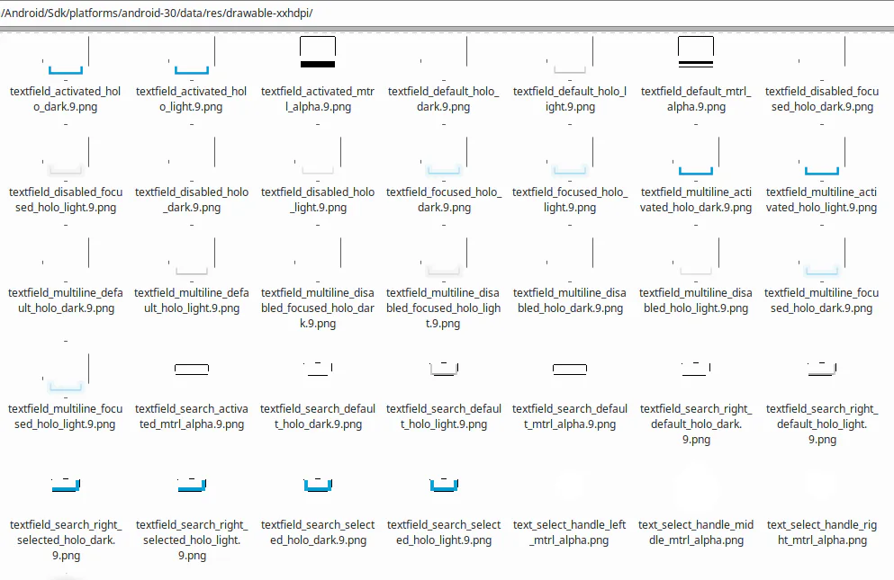
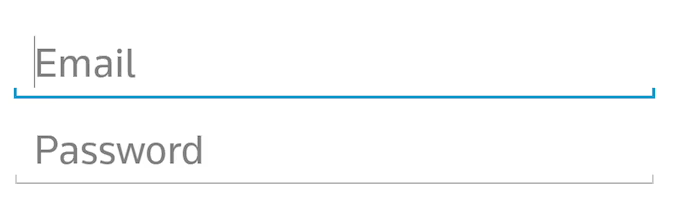
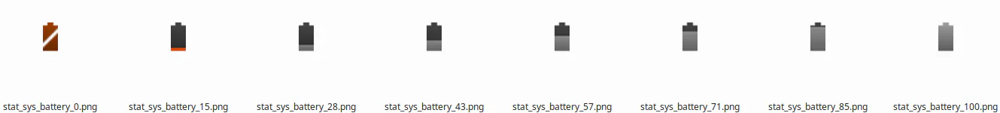

# Drawables

A **Drawable** object represents a graphic element. Any color, shape, gradient, vector, or raster image can be represented as a Drawable. It's even possible to implement your own.

## Color

A color is an integer holding four separate numbers that define the opacity (known as alpha), and the brightness of the red, green, and blue components. Consequently, any Kotlin integer can serve as a valid color representation.

For example, Purple square `0xFF8C5AFF.toInt()` is fully opaque (`FF`), quite red (`8C`), a little green (`5A`), and very blue (`FF`).

The same color can be expressed as `#8C5AFF` or `#FF8C5AFF` in XML.
Note that the alpha component is optional.

For instance, the color resource

```xml
<color name="green_lime">#CDDC39</color>
```

can be accessed via `ContextCompat.getColor(context, R.color.green_lime)`. This invocation retrieves the color from the application's resources and is synonymous with the Kotlin expression Lime square `0xFFCDDC39.toInt()`.

Colors in Android can be applied in different ways:

- `android:background="@color/green_lime"`

- `setBackgroundColor(0xFFCDDC39.toInt())`

- `setBackgroundResource(R.color.green_lime)`

these methods essentially equate to `setBackground(ColorDrawable(0xFFCDDC39.toInt()))` at the implementation level.

### Color selector

In contrast to attributes such as `background`, which typically accept `Drawable` objects, there exist several properties within the Android framework that do not inherently operate with Drawables.
These include properties like `backgroundTint` of a `View`, as well as `textColor`, `hintTextColor`, and `drawableTint` of a `TextView`.

While colors serve as appropriate values for these properties, an alternative option exists: the `ColorStateList`, commonly referred to as a color selector. 

This resource facilitates the definition of multiple colors corresponding to different states of a `View`. 


Below is an example of such a selector, depicted in the resource file `res/color/button_background_tint.xml`:


 ```xml
 <selector xmlns:android="http://schemas.android.com/apk/res/android">
    <item android:state_pressed="true" android:color="#AC8AFF"/>
    <item android:state_focused="true" android:color="#6C3ADF"/>
    <item android:state_enabled="false" android:color="#AAAAAA"/>
    <item android:color="#8C5AFF"/>
</selector>
```


The versatility of color selectors extends beyond merely defining colors for View properties like textColor to also encompass Drawable properties such as background.
This is evidenced by the fact that referencing a color selector, such as `android:textColor="@color/button_background_tint"`, can be equally valid for both color and Drawable attributes.

When fetching such a resource programmatically using ContextCompat, the return types differ based on the context: 
`ContextCompat.getColorStateList(context, R.color.button_background_tint)` yields a `ColorStateList`,
while `ContextCompat.getDrawable(context, R.color.button_background_tint)` provides a `ColorStateListDrawable`.
Furthermore, invoking getColor on a `ColorStateList` will yield the "default color" defined within the selector.

Expressing the color selector example provided earlier in Kotlin showcases an alternative syntax, highlighting a different order compared to XML.
Here, the first argument enumerates all possible states, while the second lists their corresponding colors.
Additionally, negation (`-some_state`) serves as the equivalent for the condition when a particular state is `false`.

```kotlin 
ColorStateList(
    arrayOf(
        intArrayOf(android.R.attr.state_pressed),
        intArrayOf(android.R.attr.state_focused),
        intArrayOf(-android.R.attr.state_enabled),
        intArrayOf()
    ),
    intArrayOf(
        0xFFAC8AFF.toInt(),
        0xFF6C3ADF.toInt(),
        0xFFAAAAAA.toInt(),
        0xFF8C5AFF.toInt()
    )
)
```

## Bitmap

**Bitmaps** serve as digital representations of images, composed of a grid of pixels, each pixel representing a specific color.

Commonly encountered in raster file formats such as PNG, GIF, WEBP, or JPEG, these formats store image data in a way that can be decoded into a Bitmap using various `BitmapFactory.decode*` methods available in Android development.

## Vector

`VectorDrawables` are images in Android that are defined using vector graphics, which means they are created using lines, curves, and shapes rather than pixels like traditional images.
They are similar to `SVG` (Scalable Vector Graphics) images used on the web.

Here's an example:

In Android Studio, you can easily import existing SVG files and convert them to VectorDrawables (File → New → Vector Asset).
This process simplifies the creation of vector graphics for your app without needing to manually write XML code.

`VectorDrawable` class is used to handle vector graphics. Unlike colors or images, there isn't a specific class for vectors.

> [!CAUTION]
> Also, you can't create vector drawings programmatically using code;
> you have to use XML files to define them. This means you can't dynamically generate vector graphics at runtime, they need to be defined beforehand in your app's resources.

## Shapes and gradients

We can create a rectangle with rounded corners, a horizontal gradient fill in the following way:

```xml
<?xml version="1.0" encoding="utf-8"?>
<shape xmlns:android="http://schemas.android.com/apk/res/android">
    <corners
        android:radius="8dp" />
    <gradient
        android:angle="0"
        android:startColor="#8C5AFF"
        android:endColor="#408BCF" />
    <stroke
        android:width="1dp"
        android:color="#333333" />
</shape>
```

Ironically, the `ShapeDrawable` class is not actually used when you define a `<shape>` in XML.
Instead, when you create a `<shape>`, Android converts it into a `GradientDrawable`, even if it only contains a solid color.

Here’s the Kotlin equivalent of the above `<shape>` definition:

```kotlin
GradientDrawable().apply {
    cornerRadius = dp(8f)
    orientation = GradientDrawable.Orientation.LEFT_RIGHT
    colors = intArrayOf(0xFF8C5AFF.toInt(), 0xFF408BCF.toInt())
    setStroke(dp(1), 0xFF333333.toInt())
}
```

this example use two additional function:

```kotlin
/** Converts Device Independent Pixels to pixels. Returns an `Int` or a `Float` based on [value]'s type. */
inline fun Context.dip(value: Int): Int = (value * resources.displayMetrics.density).toInt()

/** Converts Device Independent Pixels to pixels. Returns an `Int` or a `Float` based on [value]'s type. */
inline fun Context.dip(value: Float): Float = (value * resources.displayMetrics.density)
```

## 9-patch

A **9-patch** is a raster (PNG) image with stretchable areas.
It is mainly used as a background because it automatically accommodates to the dimensions of the view.

To illustrate this, let's take a peek at some patches from the Android SDK:



So, these files have `.9.png` extensions, they are valid PNG files, but there are some black dashes around the image.
Patches have a special one-pixel border: black pixels on the left and at the top denote stretchable areas, and non-black pixels on the right and at the bottom indicate padding.

Example render of EditTexts which use stretched `textfield_` images from the screenshot above:



For more details, see [the official docs on 9-patch](https://developer.android.com/guide/topics/graphics/drawables#nine-patch) and [how to create patches in Android Studio](https://developer.android.com/studio/write/draw9patch). For the API, please refer to [NinePatch](https://developer.android.com/reference/android/graphics/NinePatch) and [NinePatchDrawable](https://developer.android.com/reference/android/graphics/drawable/NinePatchDrawable).

In the above screenshot, there are some 9-patches called "default", "activated", "disabled", "focused" and "selected".

## Drawable selector

A `<selector>` can also reference `Drawables`, so a `StateListDrawable` is a composite `Drawable` that also depends on the current state.

```xml
<?xml version="1.0" encoding="utf-8"?>
<!-- Apache 2.0 License header skipped… -->

<selector xmlns:android="http://schemas.android.com/apk/res/android">
    
    <item android:state_window_focused="false" android:state_enabled="true"
        android:drawable="@drawable/textfield_search_default" />
        
    <item android:state_pressed="true"
        android:drawable="@drawable/textfield_search_pressed" />
        
    <item android:state_enabled="true" android:state_focused="true"
        android:drawable="@drawable/textfield_search_selected" />
    
    <item android:drawable="@drawable/textfield_search_default" />
    
</selector>
```

When creating selectors programmatically:

```kotlin
StateListDrawable().apply {
    addState(
        intArrayOf(-android.R.attr.state_window_focused, android.R.attr.state_enabled),
        textfieldSearchDefault
    )
    addState(
        intArrayOf(android.R.attr.state_pressed),
        textfieldSearchPressed
    )
    addState(
        intArrayOf(android.R.attr.state_enabled, android.R.attr.state_focused),
        textfieldSearchSelected
    )
    addState(
        intArrayOf(),
        textfieldSearchDefault
    )
}
```

## Other Drawables

- Since the release of Lollipop, clickable elements like list items respond to clicks with a [RippleDrawable](https://developer.android.com/reference/android/graphics/drawable/RippleDrawable).

- A [LayerDrawable](https://developer.android.com/reference/android/graphics/drawable/LayerDrawable) is a composite that draws its children one over another.

- [InsetDrawable](https://developer.android.com/reference/android/graphics/drawable/InsetDrawable) is a decorator that adds some paddings to another Drawable.

- `Drawables` can also have a level: an integer in the `0..10_000` range. For example, battery, Wi-Fi, and mobile signal levels are [LevelListDrawables](https://developer.android.com/reference/android/graphics/drawable/LevelListDrawable):



- There are also the `RotateDrawable`, the `ScaleDrawable`, and the `ClipDrawable`. The way these Drawables look is dependent on the level value, too.

- Finally, for something that moves, you can check out the `TransitionDrawable`, the `AnimationDrawable`, or the `AnimatedVectorDrawable`, amongst others.


