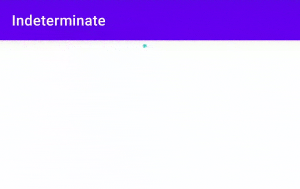
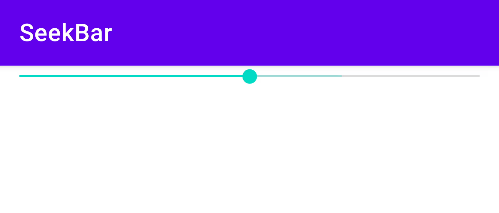
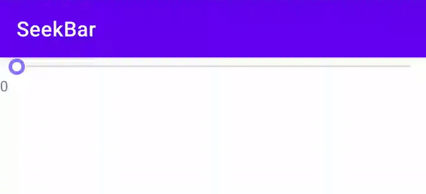

# ProgressBar, SeekBar and RatingBar

Every app has some metrics and settings that are shown to a user and could be affected by them. For example, as a user of an app, you want to know how long the loading would take, which part of a video you are now watching, and how other customers rated this specific online store product. An app can show this information presented as text. This is a good solution, for example, a timecode 2:44/5:55 and a rating of 4.4/5 are pretty informative. But wouldn't it be better for the user experience to visualize it somehow? Also, this could improve some settings that users can directly affect. It's much more convenient to scroll through the video with some kind of slider instead of typing in a timecode you are searching for.

In this topic, we will cover some of the widgets provided by the Android framework to make your application more intuitive and convenient to use: ProgressBar, SeekBar, and RatingBar.

## ProgressBar

ProgressBar is a user interface element that indicates the progress of an operation. ProgressBar has two modes: indeterminate and determinate. Let's take a look at them.

The indeterminate mode does not show how long the operation will take. That is the default mode for ProgressBar. You can show it when you start an operation and hide it after it is completed with the setVisibility() method or the android:visibility attribute. The default value for visibility is 'visible'. Here is how you can create it:

```xml
<ProgressBar
    android:layout_width="match_parent"
    android:layout_height="wrap_content"/>
```




To indicate determinate progress you can set the style to android.R.style.Widget_ProgressBar_Horizontal, like in the following snippet:

```xml
<ProgressBar
    style="@android:style/Widget.ProgressBar.Horizontal"
    android:layout_width="match_parent"
    android:layout_height="wrap_content"
    android:secondaryProgress="50"
    android:progress="25"/>
```

You also can use this style for a more modern look:

```xml
style="@style/Widget.AppCompat.ProgressBar.Horizontal"
```

As you can see, we defined android:progress and android:secondaryProgress. They are specified between 0 and android:max with the default value of 100. So in this case we got 25% of progress and 50% of secondaryProgress. The last one will be drawn between background and primary progress. This could be useful, for example, to display buffering and playing progresses of some media at the same bar

## SeekBar
SeekBar is an extension of ProgressBar. The difference is that now we have a draggable thumb. The fact that SeekBar is the extension of the ProgressBar means that they have mostly the same attributes. For example, we still have android:max, android:progress, android:secondaryProgress.

So let's create our first SeekBar:

```xml
<SeekBar
    android:id="@+id/seekBar"
    android:progress="50"
    android:secondaryProgress="70"
    android:layout_width="match_parent"
    android:layout_height="wrap_content"/>
```
And this is how it will look:



The most important feature of SeekBar is that we can attach SeekBar.OnSeekBarChangeListener to be notified of the users' actions. Let's illustrate it with a small application that would show us the progress of SeekBar into TextView!

First of all, define our layout with SeekBar and TextView:

```xml
<?xml version="1.0" encoding="utf-8"?>
<LinearLayout xmlns:android="http://schemas.android.com/apk/res/android"
    xmlns:tools="http://schemas.android.com/tools"
    android:layout_width="match_parent"
    android:layout_height="match_parent"
    android:orientation="vertical"
    tools:context=".MainActivity">

    <SeekBar
        android:id="@+id/seekBar"
        android:layout_width="match_parent"
        android:layout_height="wrap_content" />

    <TextView
        android:id="@+id/progressTv"
        android:layout_width="wrap_content"
        android:layout_height="wrap_content"
        android:text="0" />
</LinearLayout>
```
After we defined our layout we go to our activity, get views, and set change listener:

```kotlin
val progressTv = findViewById<TextView>(R.id.progressTv)
val seekBar = findViewById<SeekBar>(R.id.seekBar)


seekBar.setOnSeekBarChangeListener(object : SeekBar.OnSeekBarChangeListener {
    override fun onProgressChanged(sb: SeekBar, progress: Int, fromUser: Boolean) {
        // we get in parameters SeekBar in case we add this listener to more that one SeekBar
        // fromUser give us information if change was initiated by user or programmatically
        
        // we set text in our TextView to the progress value we got
        progressTv.text = progress.toString()
    }
    
    override fun onStartTrackingTouch(seekBar: SeekBar) {
        println("Tracking started!")
    }
        
    override fun onStopTrackingTouch(seekBar: SeekBar) {
        println("Tracking stopped!")
    }
        
})
```
The onStartTrackingTouch() and onStopTrackingTouch() methods can be useful if you want to perform some action when the user starts or stops dragging a thumb. Even if you don't use them, they still should be overridden. If they aren't, a compile error will occur.

And here is the result:



## RatingBar

RatingBar is an extension of SeekBar that shows a rating in stars. It has a few main XML attributes:

- android:isIndicator which can be set to true or false and define if users can change the rating by themselves or if it is used only as an indicator.

- set the layout width to wrap_content, otherwise, the result is unpredictable!

- android:rating which sets the initial rating in stars to the widget.

- android:stepSize sets the minimum step size in stars.

In case you're using it in interactive mode, you probably would want to be notified when the user changes the rating. For this purpose, you can attach RatingBar.onRatingBarChangeListener. This interface has only one method, so you can implement it in lambda inside RatingBar.setOnRatingBarChangeListener() like this:

```kotlin
yourRatingBar.setOnRatingBarChangeListener { ratingBar: RatingBar, rating: Float, fromUser: Boolean ->
    // perform your actions here!
}
```

The meanings of ratingBar, rating, and fromUser are similar to the ones in SeekBar.onSeekBarChangeListener.

Now to illustrate what we've just learned, let's modify the snippets we saw in SeekBar part with RatingBar and make TextView show ratings from RatingBar in stars!

First of all, we define our layout with RatingBar and TextView:


```xml
<?xml version="1.0" encoding="utf-8"?>
<LinearLayout xmlns:android="http://schemas.android.com/apk/res/android"
    xmlns:tools="http://schemas.android.com/tools"
    android:layout_width="match_parent"
    android:layout_height="match_parent"
    android:orientation="vertical"
    tools:context=".MainActivity">

    <RatingBar
        android:layout_width="wrap_content"
        android:id="@+id/ratingBar"
        android:layout_height="wrap_content"
        android:numStars="5"
        android:stepSize="0.5" />

    <TextView
        android:id="@+id/ratingBarTv"
        android:layout_width="wrap_content"
        android:layout_height="wrap_content"
        android:text="0" />
</LinearLayout>
```

We set five stars as the maximum rating and half of a star as a step for our RatingBar.

Now we need to attach RatingBar.onRatingBarChangeListener inside our activity:

```kotlin
val tv = findViewById<TextView>(R.id.ratingBarTv)
val rb = findViewById<RatingBar>(R.id.ratingBar)
        
// We do not use first and third parameters so we should omit them and replace them with _
rb.setOnRatingBarChangeListener { _, rating, _ ->
    // We set text in out TextView to the number of stars that was set on RatingBar
    tv.text = rating.toString()
}
```


In this topic, you've learned how to use ProgressBar and its extensions. Now you know how to:

- Show progress with ProgressBar widget

- Show users that some actions are being performed and that they should wait for a while with ProgressBar in indeterminate mode

- Get user input with SeekBar

- Show rating in stars with RatingBar and get user input from it


## reference
- [Overview of ProgressBar, SeekBar and RatingBar](https://hyperskill.org/learn/step/28515)