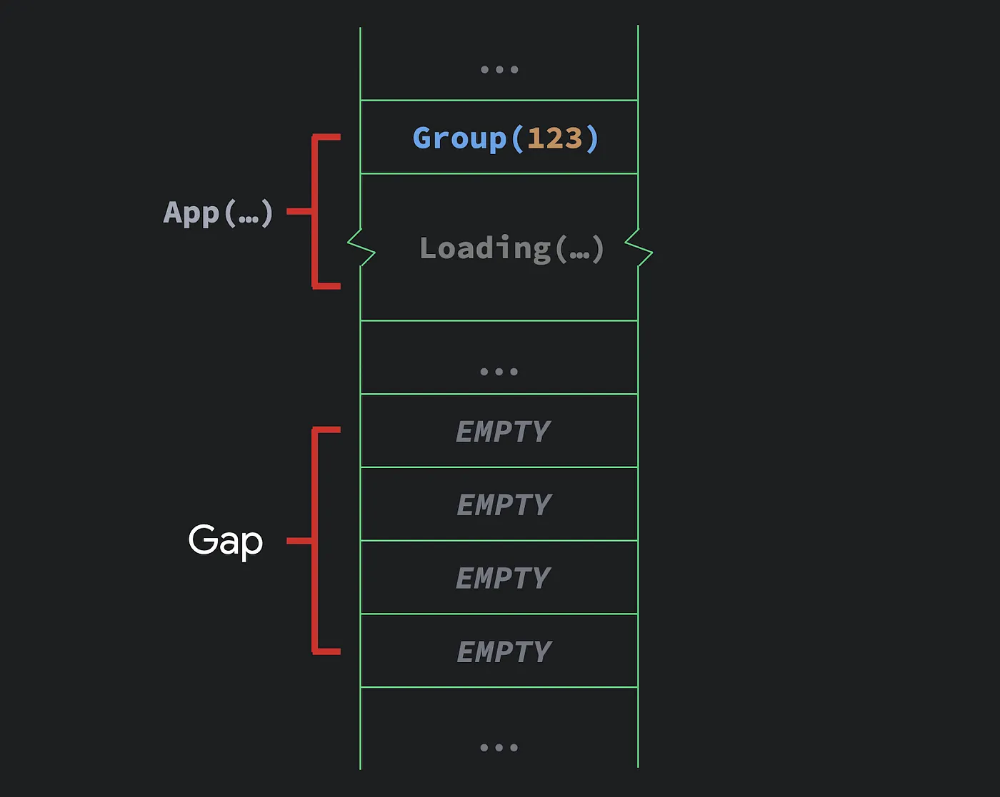
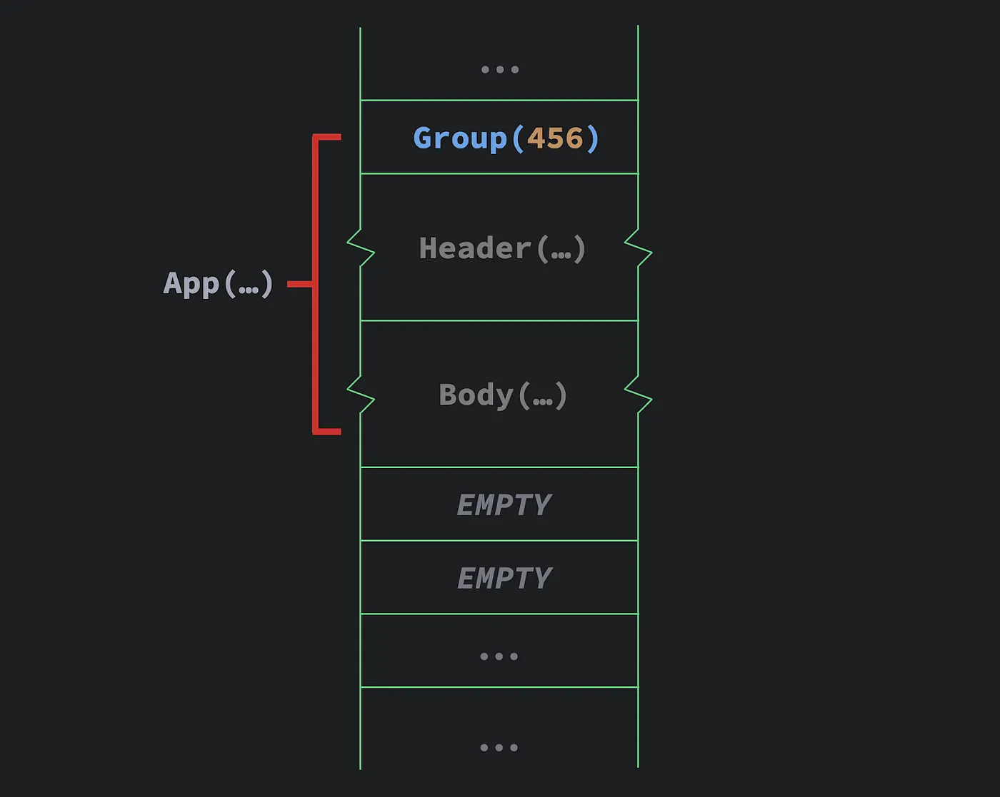

# Under the hood of Jetpack Compose


## What does @Composable mean?

- `@Composable` is not an annotation processor but acts as a language keyword, similar to `suspend` in Kotlin.
- When a function is marked with `@Composable`, it changes the function's type, and it can only be called inside another `@Composable` function.
- This is because `@Composable` requires a calling context, called Composer, to manage the lifecycle and state of the user interface.

## Execution model

- The `Composer` uses a data structure similar to a `Gap Buffer`, commonly used in text editors, to store and manage UI components.
- This structure allows adding, removing, and moving UI elements with constant time complexity **(O(1))**, except for the gap shifting operation, which has a complexity of **O(n)**.
- The choice of this structure is based on the assumption that UI structures don't change frequently; the main changes lie in the displayed values.

**For example**:

  
```kotlin
@Composable fun App() {
 val result = getData()
 if (result == null) {
   Loading(...)
 } else {
   Header(result)
   Body(result)
 }
}
```

The getData function returns some result and renders a loading composable in one case and a header and a body in another case. The compiler inserts separate keys for each branch of the if statement.

```kotlin
fun App($composer: Composer) {
 val result = getData()
 if (result == null) {
   $composer.start(123)
   Loading(...)
   $composer.end()
 } else {
   $composer.start(456)
   Header(result)
   Body(result)
   $composer.end()
 }
}
```

Let’s assume that when this code first executes result is null. This inserts a group into the gap array and the loading screen runs.



The second time the function runs let’s assume that result is no longer null so that the second branch of the if statement executes.

The call to composer.start has a group with the key `456`. The compiler sees that the group in the slot table of `123` doesn’t match, so now it knows that the UI has changed in structure.

The compiler then moves the gap to the current cursor position and extends the gap across the UI that was there, effectively getting rid of it.

At this point, the code is executed as normal, and the new UI — the header and the body — is inserted.



This concept is that we call *Positional Memoization* and this is the concept that Compose is built around

## Positional Memoization

Normally, we have global memoization meaning that the compiler caches the result of a function based on the inputs of that function

**For example**

```kotlin
@Composable
fun App(items: List<String>, query: String) {
 val results = items.filter { it.matches(query) }
 // ...
}
```

The function takes in a list of string items and a query and then performs a filter computation on the list. We can wrap this computation in a call to `remember`: `remember` is something that knows how to appeal to the slot table. `remember` looks at items and stores the list and query in the slot table. The filter computation then runs and `remember` stores the result before passing it back.

The second time the function executes, `remember` looks at the new values being passed in and compares them with the old values. If neither of them has changed, then the filter operation is skipped and the previous result returned. That’s positional memoization.

## Storing parameters
To illustrate how a Composable function’s parameters are stored, Look at the example :

```kotlin
@Composable fun Google(number: Int) {
 Address(
   number=number,
   street="Amphitheatre Pkwy",
   city="Mountain View",
   state="CA"
   zip="94043"
 )
}
 
@Composable fun Address(
 number: Int,
 street: String,
 city: String,
 state: String,
 zip: String
) {
 Text("$number $street")
 Text(city)
 Text(", ")
 Text(state)
 Text(" ")
 Text(zip)
}
```

Compose stores the parameters of a composable function in the slot table. Looking at the example above we see some redundancies: “Mountain View” and “CA”, which are added in the address invocation, are stored again in the underlying text invocations, so these strings will be stored twice.

We can get rid of this redundancy by adding the static parameter to Composable functions at the compiler level.

```kotlin
fun Google(
 $composer: Composer,
 $static: Int,
 number: Int
) {
 Address(
   $composer,
   0b11110 or ($static and 0b1),
   number=number,
   street="Amphitheatre Pkwy",
   city="Mountain View",
   state="CA"
   zip="94043"
 )
}
```


The static parameter in this case is a bit field indicating whether or not the runtime knows the parameter does not change. If a parameter is known to not change, then there’s no need for it to be stored. **So, in this Google example, the compiler passes a bit field that says none of the parameters are going to change.**

Then, in Address, the compiler can do the same thing and pass it into text.

```kotlin
fun Address(
  $composer: Composer,
  $static: Int,
  number: Int, street: String, 
  city: String, state: String, zip: String
) {
  Text($composer, ($static and 0b11) and (($static and 0b10) shr 1), "$number $street")
  Text($composer, ($static and 0b100) shr 2, city)
  Text($composer, 0b1, ", ")
  Text($composer, ($static and 0b1000) shr 3, state)
  Text($composer, 0b1, " ")
  Text($composer, ($static and 0b10000) shr 4, zip)
}
```

This bitwise logic is hard to read and is confusing, but there is no need for us to understand this: compilers are good at this, humans aren’t.

Because of this, we can go further and generate code that understands that number is the only thing that’s going to change. This code can then work so that if a number hasn’t changed the body of the function would be skipped entirely, and we can just instruct the composer to move its current index to where it would be as if the function had executed.


```kotlin
fun Google(
 $composer: Composer,
 number: Int
) {
 if (number == $composer.next()) {
   Address(
     $composer,
     number=number,
     street="Amphitheatre Pkwy",
     city="Mountain View",
     state="CA"
     zip="94043"
   )
 } else {
   $composer.skip()
 }
}
```


> [!NOTE]
> Jetpack Compose automatically adds static parameters for optimization, eliminating the need for manual handling of unchanged values.
## Recomposition

To explain how recomposition works, let’s go back to the counter example.


```kotlin
fun Counter($composer: Composer) {
 $composer.start(123)
 var count = remember($composer) { mutableStateOf(0) }
 Button(
   $composer,
   text="Count: ${count.value}",
   onPress={ count.value += 1 },
 )
 $composer.end()
}
```

Recomposition is the process in Jetpack Compose where a Composable function is run again when the data it depends on changes. In the counter example, each time the value of count changes, Jetpack Compose re-runs the `Counter` function.

- `composer.start(123)` marks the start of a group in the composable tree. Each group represents a UI element.
- remember and `mutableStateOf` store the value of count. When count changes, Compose knows that it needs to - recompose the UI to reflect the new value.
- `Button` displays the value of count and updates it when clicked.
- `composer.end()` marks the end of the group.

When the `Counter` function is executed, count.value is read from a `mutableStateOf` object. Every time count changes, Jetpack Compose triggers a recomposition to update the UI.

After calling `composer.end()`, if any value changes, Jetpack Compose checks if a recomposition is necessary by using `updateScope`.


```kotlin
$composer.end()?.updateScope { nextComposer ->
 Counter(nextComposer)
}
```

The `?` (null check) here indicates that if no model object (like `count`) is read during the execution of `Counter`, then the system doesn’t need to track how to update this composable because it knows the UI won’t change. If there are no changes, `updateScope` is unnecessary.
If a change occurs, Jetpack Compose knows how to restart the `Composable` by calling `Counter`(nextComposer).


