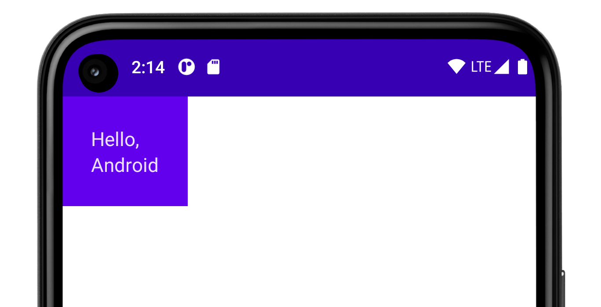
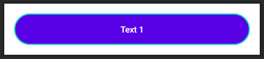

# Modifier
## Definition

Modifiers allow you to decorate or augment a composable. Modifiers let you do these sorts of things:
- Change the composable's size, layout, behavior, and appearance
- Add information, like accessibility labels
- Process user input
- Add high-level interactions, like making an element clickable, scrollable, draggable, or zoomable

Modifiers are standard Kotlin objects. **Create a modifier by calling one of the Modifier class functions**:

```kotlin
@Composable
private fun Greeting(name: String) {
    Column(modifier = Modifier.padding(24.dp)) {
        Text(text = "Hello,")
        Text(text = name)
    }
}
```


It's a best practice to have all of your composables accept a modifier parameter, and pass that modifier to its first child that emits UI. Doing so makes your code more reusable and makes its behavior more predictable and intuitive.


### Order of modifiers matters


The order of modifier functions is **significant**. Since each function makes changes to the Modifierreturned by the previous function, the sequence affects the final result. 

<details>
  <summary style="color: orange;">
  <b>
  Let's see an example of this:
  </b>
  </summary>
  
  <p>
  
```kotlin
@Composable
fun ArtistCard(/*...*/) {
    val padding = 16.dp
    Column(
        Modifier
            .clickable(onClick = onClick)
            .padding(padding)
            .fillMaxWidth()
    ) {
        // rest of the implementation
    }
}

```


In the code above the whole area is clickable, including the surrounding `padding`, because the `padding` modifier has been applied after the `clickable` modifier. If the modifiers order is reversed, the space added by `padding` does not react to user input:

```kotlin
@Composable
fun ArtistCard(/*...*/) {
    val padding = 16.dp
    Column(
        Modifier
            .padding(padding)
            .clickable(onClick = onClick)
            .fillMaxWidth()
    ) {
        // rest of the implementation
    }
}
```


  </p>
</details>

### How to add margin in Compose?

You can consider padding and margin as the same thing (imagine it as "spacing"). A padding can be applied twice (or more) in the same composable and achieve the similar behavior you would get with margin+padding. For example:

```kotlin
val shape = CircleShape
Text(
    text = "Text 1",
    style = TextStyle(
        color = Color.White,
        fontWeight = FontWeight.Bold,
        textAlign = TextAlign.Center),
    modifier = Modifier.fillMaxWidth()
        .padding(16.dp)
        .border(2.dp, MaterialTheme.colors.secondary, shape)
        .background(MaterialTheme.colors.primary, shape)
        .padding(16.dp)
)
```
Will result on this:



As you can see, the first padding is adding a space between the component and its border. Then the background and border are defined. Finally, a new padding is set to add space between the border and the text.


> [!NOTE]
> The explicit order helps you to reason about how different modifiers will interact. Compare this to the view-based system where you had to learn the box model, that margins applied "outside" the element but padding "inside" it, and a background element would be sized accordingly. The modifier design makes this kind of behavior explicit and predictable, and gives you more control to achieve the exact behavior you want. **It also explains why there is not a margin modifier but only a padding one.**

### Built-in modifiers

#### padding and size

- By default, layouts provided in Compose wrap their children. However, you can set a size by using the size modifier:

```kotlin
@Composable
fun ArtistCard(/*...*/) {
    Row(
        modifier = Modifier.size(width = 400.dp, height = 100.dp)
    ) {
        Image(/*...*/)
        Column { /*...*/ }
    }
}
```

- Note that the size you specified might not be respected if it does not satisfy the constraints coming from the layout's parent. **If you require the composable size to be fixed regardless of the incoming constraints, use the requiredSize modifier:**

```kotlin
@Composable
fun ArtistCard(/*...*/) {
    Row(
        modifier = Modifier.size(width = 400.dp, height = 100.dp)
    ) {
        Image(
            /*...*/
            modifier = Modifier.requiredSize(150.dp)
        )
        Column { /*...*/ }
    }
}
```

> [!NOTE]
> Layouts are based on constraints, and normally, the parent passes those constraints to the children. The child should respect the constraints. However, that might not always be what the UI requires. There are ways to bypass this child behavior. For example, you can pass modifiers like `requiredSize` directly to the child, overriding the constraints received by the child from the parent, or you can use a custom layout with different behavior. When a child does not respect its constraints, the layout system will hide this from the parent. The parent will see the child's `width` and `height` values as if they were coerced in the constraints provided by the parent. The layout system will then center the child within the space allocated by the parent under the assumption that the child respected the constraints. Developers can override this centering behaviour by applying `wrapContentSize` modifiers to the child.


- If you want a child layout to fill all the available height allowed by the parent, add the `fillMaxHeight` modifier, while `fillMaxWidth` utilizes all the available horizontal space. `fillMaxSize` occupies all the available space within a composable.

```kotlin
@Composable
fun ArtistCard(/*...*/) {
    Row(
        modifier = Modifier.size(width = 400.dp, height = 100.dp)
    ) {
        Image(
            /*...*/
            modifier = Modifier.fillMaxHeight()
        )
        Column { /*...*/ }
    }
}
```

> [!CAUTION]
> However, it's important to exercise caution.
> For instance, when creating a tablet app; a button can fill the entire screen width, leading to a bad user experience.
> This gets worse in landscape mode. Despite that, you can fix it quickly; these modifiers take fraction as a parameter, which takes floating–point numbers.
> You can specify it from zero to one, respectively.
>  The fraction parameter applies not only to the fillMaxWidth but also to the fillMaxHeight and the fillMaxSize.

- To add padding all around an element, set a `padding` modifier. If you want to add padding above a text baseline such that you achieve a specific distance from the top of the layout to the baseline, use the `paddingFromBaseline` modifier

#### Offset

To position a layout relative to its original position, add the offset modifier and set the offset in the x and y axis. Offsets can be positive as well as non-positive. **The difference between padding and offset is that adding an offset to a composable does not change its measurements**(offset  không thêm không gian vào composable mà chỉ thay đổi vị trí vẽ của nó trong không gian bố trí hiện tại.):

```kotlin
@Composable
fun ArtistCard(artist: Artist) {
    Row(/*...*/) {
        Column {
            Text(artist.name)
            Text(
                text = artist.lastSeenOnline,
                modifier = Modifier.offset(x = 4.dp)
            )
        }
    }
}
```

> [!CAUTION]
> The `offset` modifier is applied horizontally according to the layout direction. In a **left-to-right** context, a positive `offset` shifts the element to the right, while in a **right-to-left** context, it shifts the element to the left. If you need to set an offset without considering layout direction, see the `absoluteOffset` modifier, in which a positive offset value always shifts the element to the right.

## Scope safety in Compose

In Compose, there are modifiers that can only be used when applied to children of certain composables. Compose enforces this by means of custom scopes.

**For example**, if you want to make a child as big as the parent `Box` without affecting the `Box` size, use the `matchParentSize` modifier. `matchParentSize` is only available in `BoxScope`. Therefore, it can only be used on a child within a `Box` parent.

**Scope safety prevents you from adding modifiers that wouldn't work in other composables and scopes and saves time from trial and error.**

> [!NOTE]
> In the Android View system, there is no scope safety. Developers usually find themselves trying out different layout params to discover which ones are considered and their meaning in the context of a particular parent.

### `matchParentSize` in `Box`

In the example below, the child `Spacer` takes its size from its parent `Box`, which in turn takes its size from the biggest children, `ArtistCard` in this case.

```kotlin
@Composable
fun MatchParentSizeComposable() {
    Box {
        Spacer(
            Modifier
                .matchParentSize()
                .background(Color.LightGray)
        )
        ArtistCard()
    }
}
```


If `fillMaxSize` were used instead of `matchParentSize`, the Spacer would take all the available space allowed to the parent, in turn causing the parent to expand and fill all the available space.


### `weight` in `Row` and `Column`

You can set a composable size to be flexible within its parent using the `weight` Modifier that is only available in `RowScope`, and `ColumnScope`. 

> [!NOTE]
> The weight doesn't apply to BoxScope, even though it can also have numerous composables. Because it's unclear how the weight would be distributed – vertically, horizontally, or both. 

Let’s take a `Row` that contains two `Box` composables. The first box is given twice the `weight` of the second, so it's given twice the width. Since the `Row` is `210.dp` wide, the first `Box` is `140.dp` wide, and the second is `70.dp`:

```kotlin
@Composable
fun ArtistCard(/*...*/) {
    Row(
        modifier = Modifier.fillMaxWidth()
    ) {
        Image(
            /*...*/
            modifier = Modifier.weight(2f)
        )
        Column(
            modifier = Modifier.weight(1f)
        ) {
            /*...*/
        }
    }
}
```

> [!NOTE]
> The main difference between fillMaxSize and weight is that a parent layout uses weight to distribute the available space among the different composables.

> [!CAUTION]
> However, remember that weight can increase the complexity of layouts. Also, on smaller devices, if the content is too crowded, it can overlap.
## Extracting and reusing modifiers

Sometimes it can be beneficial to reuse the same modifier chain instances in multiple composables, by extracting them into variables and hoisting them into higher scopes. It can improve code readability or help improve your app's performance for a few reasons:

- The re-allocation of the modifiers won’t be repeated when recomposition occurs for composables that use them
- Modifier chains could potentially be very long and complex, so reusing the same instance of a chain can alleviate the workload Compose runtime needs to do when comparing them
- This extraction promotes code cleanliness, consistency and maintainability across the codebase

### Extracting and reusing modifiers when observing frequently changing state

<details>
  <summary style="color: orange;">
  <b>
  For Example
  </b>
  </summary>
  
  <p>

When observing frequently changing states inside composables, like animation states or scrollState, there can be a significant amount of recompositions done. In this case, your modifiers will get allocated on every recomposition and potentially for every frame:

```kotlin
@Composable
fun LoadingWheelAnimation() {
    val animatedState = animateFloatAsState(/*...*/)

    LoadingWheel(
        // Creation and allocation of this modifier will happen on every frame of the animation!
        modifier = Modifier
            .padding(12.dp)
            .background(Color.Gray),
        animatedState = animatedState
    )
}
```
Instead, you can create, extract and reuse the same instance of the modifier and pass it to the composable like this:

```kotlin
// Now, the allocation of the modifier happens here:
val reusableModifier = Modifier
    .padding(12.dp)
    .background(Color.Gray)

@Composable
fun LoadingWheelAnimation() {
    val animatedState = animateFloatAsState(/*...*/)

    LoadingWheel(
        // No allocation, as we're just reusing the same instance
        modifier = reusableModifier,
        animatedState = animatedState
    )
}
```


  </p>
</details>

### Extracting and reusing unscoped modifiers

<details>
  <summary style="color: orange;">
  <b>
  For Example
  </b>
  </summary>
  
  <p>
  
Modifiers can be unscoped or scoped to a specific composable. In the case of unscoped modifiers, you can easily extract them outside of any composables as simple variables:

```kotlin
val reusableModifier = Modifier
    .fillMaxWidth()
    .background(Color.Red)
    .padding(12.dp)

@Composable
fun AuthorField() {
    HeaderText(
        // ...
        modifier = reusableModifier
    )
    SubtitleText(
        // ...
        modifier = reusableModifier
    )
}
```

This can be especially beneficial when combined with Lazy layouts. In most cases, you’d want all of your, potentially significant, amount of items to have the exact same modifiers:

```kotlin
val reusableItemModifier = Modifier
    .padding(bottom = 12.dp)
    .size(216.dp)
    .clip(CircleShape)

@Composable
private fun AuthorList(authors: List<Author>) {
    LazyColumn {
        items(authors) {
            AsyncImage(
                // ...
                modifier = reusableItemModifier,
            )
        }
    }
}
```


  </p>
</details>

### Extracting and reusing scoped modifiers

<details>
  <summary style="color: orange;">
  <b>
  For example
  </b>
  </summary>
  
  <p>
  
When dealing with modifiers that are scoped to certain composables, you can extract them to the highest possible level and reuse where appropriate:

```kotlin
Column(/*...*/) {
    val reusableItemModifier = Modifier
        .padding(bottom = 12.dp)
        // Align Modifier.Element requires a ColumnScope
        .align(Alignment.CenterHorizontally)
        .weight(1f)
    Text1(
        modifier = reusableItemModifier,
        // ...
    )
    Text2(
        modifier = reusableItemModifier
        // ...
    )
    // ...
}
``` 

You should only be passing the extracted, scoped modifiers to the same-scoped, direct children

```kotlin
Column(modifier = Modifier.fillMaxWidth()) {
    // Weight modifier is scoped to the Column composable
    val reusableItemModifier = Modifier.weight(1f)

    // Weight will be properly assigned here since this Text is a direct child of Column
    Text1(
        modifier = reusableItemModifier
        // ...
    )

    Box {
        Text2(
            // Weight won't do anything here since the Text composable is not a direct child of Column
            modifier = reusableItemModifier
            // ...
        )
    }
}
```

  </p>
</details>

### Further chaining of extracted modifiers


<details>
  <summary style="color: orange;">
  <b>
  For Example
  </b>
  </summary>
  
  <p>
  
You can further chain or append your extracted modifier chains by calling the .then() function:

```kotlin
val reusableModifier = Modifier
    .fillMaxWidth()
    .background(Color.Red)
    .padding(12.dp)

// Append to your reusableModifier
reusableModifier.clickable { /*...*/ }

// Append your reusableModifier
otherModifier.then(reusableModifier)
```


  </p>
</details>

## Create Custom Modifiers

Custom modifiers in Jetpack Compose are a powerful tool that allows us to extract complex UI logic and create reusable, modular modifier components.

This process promotes **the single responsibility principle**, enhances code maintainability, and enables the abstraction of UI logic.

Jetpack Compose leverages Kotlin's extension functions, a quick and efficient way to add new functionality to existing classes.

Example :

```kotlin
fun Modifier.roundedCorners(radius: Dp): Modifier =
    clip(RoundedCornerShape(radius))

@Composable
fun CustomModifiers() {
    Box(
        modifier = Modifier.size(300.dp)
            .roundedCorners(16.dp)
            .background(Color.Blue)
    )
}
```

The custom modifier in this example is **stateless**; it's important to note that you can also create **stateful** modifiers.

To achieve this, you can leverage the `composed` function to remember its own state and react to changes.
This function takes two parameters:
- `inspectorInfo`, which is helpful if you want to debug your modifier.
- `factory`, where we define the logic for both the composable and its associated states.

Example:
```kotlin
fun Modifier.changeColorWhenClicked() = composed {
    var isClicked by remember { mutableStateOf(false) }
    val color = if (isClicked) Color.Red else Color.Blue

    then(
        Modifier
            .background(color = color)
            .clickable { isClicked = !isClicked }
    )
}
```

`then` function accepts a `Modifier` as an argument and returns it, allowing further extraction of the modifier chain.


## Best practices when build UI with Modifier

- There are a lot of ways to achieve the same result on UI. For instance, you can use `Spacer` to separate the image from the text. Or instead of applying padding in `Row`, you can use padding in every composable. 
However, doing something with less is better if it does not complicate the code. Imagine that the component count in `Row` can be much more.


## Reference

- https://developer.android.com/develop/ui/compose/modifiers
- https://hyperskill.org/learn/step/38658

