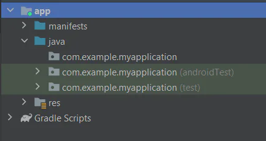
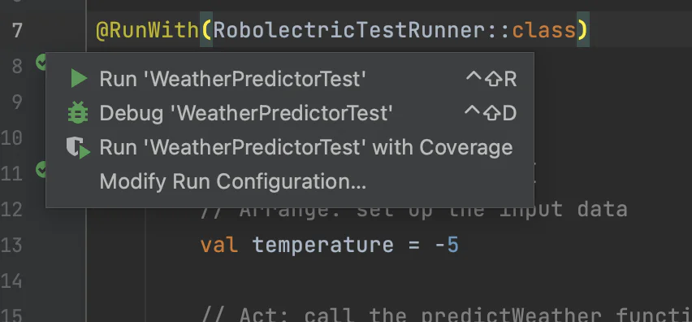

# Testing Android Applications

Testing is an important step in app development, because it improves the app's quality.
Well-tested code is easier to maintain and extend as the app evolves.

Also, testing provides developers and stakeholders with confidence that the app works as intended.

Additionally, as testing allows us to catch and address issues early in the development cycle, it reduces the cost of fixing them later.

## Types of tests in Android

There are various types of tests, each serving a unique purpose in the development process.

- **Unit tests** are written to verify that specific pieces of code work correctly.
These focus on testing individual units or functions of the code in isolation. Android Studio supports the use of JUnit for writing unit tests.

- **Integration tests** check how different parts of the app work together. We would use integration testing to ensure that components (e.g., activities, fragments, services) interact correctly. Tools like Robolectric are commonly used for integration testing.

- **UI tests** verify that the UI elements and workflows behave as expected. UI tests simulate user interactions with the app's graphical user interface (GUI). Espresso is a popular framework for creating UI tests in Android Studio.

## Setting up the testing environment

To get started with testing in Android Studio, we'll need to configure our project for testing.

Android Studio groups different code into directories called **source sets**

By default, there is the `main` source set, which contains the app code. There are also the source sets `test` for local tests and `androidTest` for instrumented tests.

Local tests and instrumented tests differ in how they are executed:
- **Local tests** (e.g., unit tests) run on the local development machine or server.
- **Instrumented tests** (e.g., UI tests) run on a physical device or an emulator.


We'll also need to ensure that our project's `build.gradle` file includes the necessary dependencies for testing frameworks like JUnit, Robolectric, Espresso, or any other testing library we plan to use

There are two types of dependencies:
`testImplementation` and `androidTestImplementation`.
The former is a dependency for tests in the test source set and the latter is a dependency for tests in the androidTest source set.



To create a test class, we need to right-click on the directory where we want to create our test (e.g., `com.example.myapplication` (test) for unit tests).

Select `New` -> `Kotlin Class/File`. Let's give our class a meaningful name.
For example, if we're testing our Calculator class, we can name our unit test class as `CalculatorUnitTest`.

## Writing unit tests

We can use frameworks like **JUnit**, **Mockito** to help with writing unit tests.

In this example, we'll create a test for a "WeatherPredictor" class that is responsible for predicting the weather based on the temperature.

```kotlin
class WeatherPredictor {
    companion object {
        fun predictWeather(temperature: Int): String {
            return when {
                temperature < 0 -> "Cold"
                temperature in 0..25 -> "Moderate"
                else -> "Hot"
            }
        }
    }
}
```

The following is an example of how to write a test class with unit tests. Let's create three test methods to test the logic of the "WeatherPredictor" class.

```kotlin
package com.example.hyperskilltesting

import org.junit.Test
import org.junit.Assert.*;

class WeatherPredictorTest {

    @Test
    fun testPredictColdWeather() {
        // Arrange: set up the input data
        val temperature = -5

        // Act: call the predictWeather function of the WeatherPredictor class
        val result = WeatherPredictor.predictWeather(temperature)

        // Assert: assert that the result matches the expected weather prediction
        assertEquals(result,"Cold")
    }

    @Test
    fun testPredictModerateWeather() {
        // Arrange
        val temperature = 20

        // Act
        val result = WeatherPredictor.predictWeather(temperature)

        // Assert
        assertEquals(result,"Moderate")
    }

    @Test
    fun testPredictHotWeather() {
        // Arrange
        val temperature = 30

        // Act
        val result = WeatherPredictor.predictWeather(temperature)

        // Assert
        assertEquals(result,"Hot")
    }
}
```

We're using the "Arrange, Act, Assert" pattern to organize our test case.

## Writing UI tests

For instrumented tests (UI tests), we will create test classes in the `com.example.myapplication` (androidTest) directory.
We can use frameworks like **Espresso** or UI Automator for UI testing to simulate user interactions and verify the behavior of our app's user interface.

Let's see an example of an Espresso UI test for a screen that contains a button. We will try to verify that the button makes the text "Button clicked" appear when clicked.

```kotlin
import androidx.test.espresso.Espresso
import androidx.test.espresso.action.ViewActions
import androidx.test.espresso.matcher.ViewMatchers
import androidx.test.ext.junit.runners.AndroidJUnit4
import androidx.test.rule.ActivityTestRule
import org.junit.Rule
import org.junit.Test
import org.junit.runner.RunWith

@RunWith(AndroidJUnit4::class)
class ButtonScreenTestKt {

    @get:Rule
    val activityRule = ActivityTestRule(ButtonActivity::class.java)

    @Test
    fun clickButton_displaysText() {
        // Click the button
        onView(ViewMatchers.withId(R.id.button)).perform(ViewActions.click())

        // Verify that the text "Button clicked" is displayed
        onView(ViewMatchers.withText("Button clicked")).check(ViewAssertions.matches(ViewMatchers.isDisplayed()))
    }
}
```

1. We use the `@RunWith(AndroidJUnit4::class)` annotation to specify that we're using AndroidJUnit4 as the test runner.

2. The `@Rule` annotation sets up an `ActivityTestRule` for the `ButtonActivity`, which helps launch the activity for testing.

3. We use Espresso's `onView` method along with `ViewMatchers` to locate and interact with UI elements (e.g., `R.id.button`, `R.id.newScreenTextView`).

4. We perform an action by clicking the button using `ViewActions`.

5. Finally, we use `ViewAssertions` to check that the text "Button clicked" is displayed.

6. Again, don't worry if you don't understand all the code. For now, know that we're using Espresso to test the functionality of a button.

## Running tests and analyzing the results

To run the tests, we can right-click on the test class or the test directory in the project explorer.

Select "Run (Test Class Name)". Android Studio will execute the test and display the results in the "Run" or "Debug" window

For instrumented tests, Android Studio will execute the test on an emulator or physical device and report the test results.



Android Studio will provide feedback on whether the tests have passed or failed.
If a test fails, the framework will provide information about which assertion failed and the expected vs.
actual values, helping us pinpoint the issue. When we encounter a failed test, we can:

- Diagnose the failure by checking the code we're testing, the test input, dependencies, and assertions.

- Identify and fix the root cause of the failure.

- Rerun the test to verify that it passes after the fix.


