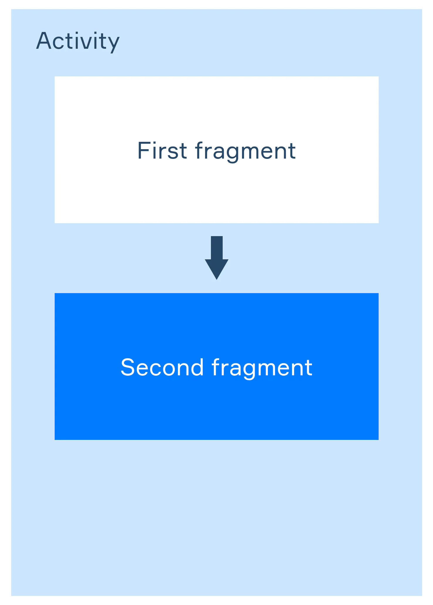
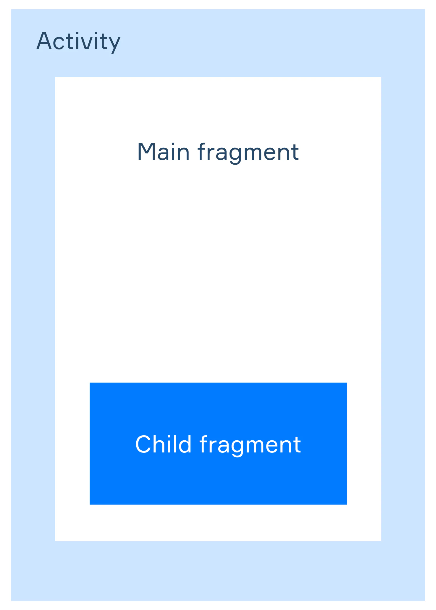

# Fragments

A Fragment is like an Activity that can be connected to different parts of an application.
However, it is important to understand that they are not the same.
This means that a Fragment cannot exist unless it's embedded in an Activity.

Fragments are used in **Single Activity Architecture** to create Navigation and save state.

## Fragment lifecycle

The lifecycle of a fragment is slightly different from that of an activity since the fragment itself is completely dependent on the activity and doesn't exist on its own. So, many methods are either named the same as activity methods or have very similar names:

- `onAttach()` the method called when the fragment is attached to the activity.

- `onCreate()` the method called when a fragment is created.

- `onCreateView()` the method which creates and returns the view hierarchy associated with the fragment. You can use it to inflate your layout.

- `onViewCreated()` the method called when the views have been created and attached. All views must be initialized here.

- `onActivityCreated()` — the method called after the `Activity.onCreate()` method.

- `onStart()` — the method called when the fragment becomes visible to the user (see the `Activity.onStart()` method).

- `onResume()` — the method called before the fragment becomes available for user interaction (see the `Activity.onResume()` method).

- `onPause()` — the user doesn't interact with the fragment but part of the fragment is visible to the user.

- `onStop()` — the method that makes the fragment invisible to the user.

- `onSaveInstanceState()` — the method that saves the fragment state.

- `onDestroyView()` – the fragment clears the resources associated with the view hierarchy. Here you have to null all your views because holding destroyed views can cause a memory leak.

- `onDestroy()` – the method called before the fragment is destroyed.

- `onDetach()` – method called before the fragment is detached from the activity.

## Fragment manager

Fragments inherit from the `androidx.fragment.app.Fragment` class, which comes from the AndroidX library.
But there are also several Fragment subclasses: `ListFragment`, `DialogFragment`, `PreferenceFragment`, `WebViewFragment`, and others.
There are two methods in `FragmentManager` that can be used to find Fragments associated with an Activity.
These are `findFragmentById(int id)` and `findFragmentByTag(String tag)`.
The `findFragmentById()` method finds a Fragment by an identifier and `findFragmentByTag()` searches by a given tag.
If you want to perform any operations on Fragments, be it replacing, deleting, or hiding them, you need to use the special `androidx.app.FragmentTransaction` class.

The main methods of the `FragmentTransaction` class are below:

- `add()` adds the Fragment to the Activity.
- `remove()` is used to remove the Fragment from the Activity.
- `replace()` replaces one Fragment with another.
- `hide()` is used to hide the Fragment on the screen.
- `show()` shows the Fragment on the screen.

Lastly, it's important to remember that you must call the `commit()` method at the end of every transaction!

## Communicating to activity

### 1. Using Interface
   
In order to pass something to an activity, first, you need to create an interface in the desired fragment.

```kotlin
class YourFragment : Fragment() {

    override fun onCreateView(...) { ... }

    interface YourFragmentListener {
        fun doSomething()
    }
}
```
Next, you need to implement your interface in the desired activity.

```kotlin
class MainAсtivity : AppCompatActivity(), YourFragment.YourFragmentListener {

    ...

    override fun doSomething() {
        Log.d("Log", "Doing something!")
    }
}
```

The penultimate step is to get an instance of the Activity implementing your interface in the Fragment.

```kotlin
    private var callback: YourFragmentListener? = null
    override fun onAttach(context: Context) {
        super.onAttach(context)
        callback = context as YourFragmentListener
    }
    override fun onDetach() {
        super.onDetach()
        callback = null
    }
```

Finally, you only need to call the interface instance at the location you want,

### 2. Result listener

Android has a very useful API for passing data between fragments, the **Fragment Result API**. It's a tool that makes it possible to pass data between fragments using a user-specified key. 

All this happens with a `FragmentManager` — `parentFragmentManager` and `childFragmentManager`.

If your fragments are independent of each other, it's a good idea to use `parentFragmentManager`.



In cases when one fragment is a child fragment, the parent fragment must use `childFragmentManager`, and the child fragment must use `parentFragmentManager`.



After selecting the desired `FragmentManager` in the fragment which will send data, call the `setFragmentResult()` method.

In this method, set the result in the `FragmentManager` identical to the first one and use the same key.
The parameters of this method are the key itself and the `Bundle` object that needs to be passed to another fragment.

```kotlin
button.setOnClickListener {
    parentFragmentManager.setFragmentResult("key", bundleOf("bundleKey" to yourObject))
}
```

Next, in the `onCreate()` method of the fragment where you want to receive your data, you need to call the `setFragmentResultListener()` method.

The first parameter of this method is the key parameter: it must be the same as the key you specified in the other fragment.

```kotlin
YourFragmentManager.setFragmentResultListener("key", this) { key, bundle ->
    val result = bundle.get("bundleKey")
}
```

references:

https://hyperskill.org/learn/step/12981
https://hyperskill.org/learn/step/21929

