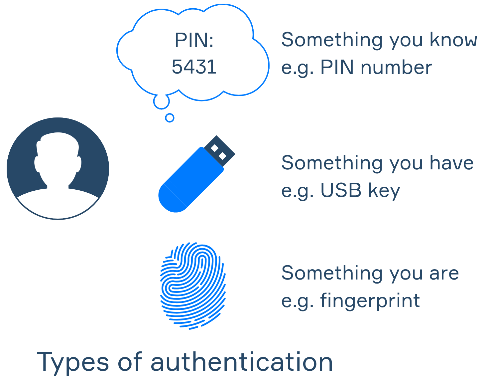

# Authentication

Authentication forms an integral part of identity and access management (IAM) systems, dictating who can view data and what actions they can perform with it. It's a foundational element that supports the integrity and confidentiality of information in various digital interactions.

## The role of authentication in cybersecurity

Authentication is more than just a security measure; it's a fundamental aspect of how we interact with digital systems.
At its core, authentication involves verifying the identity of a user or system, a process akin to checking a passport at an airport.
This verification is essential not only for human users but also for ensuring that servers, software, and APIs are legitimate and secure.

In the realm of cybersecurity, authentication's role extends across various domains.

- For instance, **Transport Layer Security (TLS)**, a protocol that secures internet communications, relies heavily on authentication to confirm the identity of web servers. 
This process ensures that when you visit a website, your device is not tricked into loading a fraudulent one. 
- Similarly, in modern web applications that depend on APIs, authentication is crucial for securing both ends of API integrations, safeguarding against attacks that target these APIs.

Email security is another area where authentication plays a key role.
Technologies like **DomainKey Identified Mail (DKIM)** authenticate emails by verifying that they originate from permitted servers, thereby reducing spam and phishing risks.

## How authentication works

Authentication systems use specific criteria known as 'factors.' 
These factors can be something a user knows (like a password), something they have (like a security token), or something inherent to them (like a fingerprint). 
Each of these factors contributes to constructing a digital identity that is unique and verifiable.

Authentication typically involves checking characteristics known as "factors." These factors are:

1. **Something the Person Knows**: This includes passwords, PINs, or security questions. It's a secret piece of knowledge expected to be known only by the authentic user.

2. **Something the Person Has**: This factor involves possessing a physical item, like a key. In digital terms, this could be a hardware token (hard token) or a software-based token (soft token) that generates a code sent to a device like a smartphone.

3. **Something the Person Is**: This factor is based on inherent personal attributes, such as fingerprints, facial recognition, or voice patterns. It leverages unique biological traits for identity verification.

In addition to these main factors, location and time can also be used as additional authentication criteria.
Furthermore, digital certificates play a crucial role in authentication. They are digital files that contain identity verification information, similar to ID cards in real life.
These certificates, often digitally signed by a trusted authority, contain a public key linked to a private key held by the certificate's owner. 
This mechanism is widely used in securing web communications, notably in HTTPS protocol.

## Multi-Factor and Two-Factor Authentication

**Multi-Factor Authentication (MFA)** strengthens security by requiring two or more authentication factors.
This approach significantly enhances protection, as it's much harder for attackers to counterfeit multiple authentication elements. For example, even if a hacker obtains a user's password, they still face the challenge of bypassing a biometric verification like a facial scan or acquiring a physical token.

**Two-Factor Authentication (2FA)** is a subset of MFA, utilizing exactly two distinct factors.
A common implementation combines "something you know" (like a password) with "something you have" (such as a code sent to a phone).
This method has proven effective in reducing the impact of phishing attacks and other security breaches.

## Authentication vs. Authorization

**Authentication is about verifying who a user is**. It involves confirming the user's identity using various methods like passwords, biometrics, or tokens.
This process ensures that users are who they claim to be before granting them access to a system.

Once a user is authenticated, authorization comes into play. **Authorization is the process of determining what an authenticated user is allowed to do**. It involves granting or denying permissions to access different resources within a system. For example, a user might have the authentication to log into a network but may only be authorized to view certain files or applications, not the entire system.

## Single Sign-On (SSO)

**Single Sign-On (SSO)** is a streamlined authentication process allowing users to access multiple applications or websites using one set of login credentials. 
This approach offers numerous benefits in the digital landscape.

- SSO enhances user convenience by reducing the number of passwords they need to remember, thereby simplifying their access to various services. 
- It also plays a crucial role in reducing the risk of phishing attacks by limiting the frequency of login prompts. 
- Additionally, SSO is beneficial for IT management, providing a unified platform to enforce security measures.
- Overall, SSO not only improves user experience but also strengthens security and administrative efficiency in managing access across diverse digital platforms

