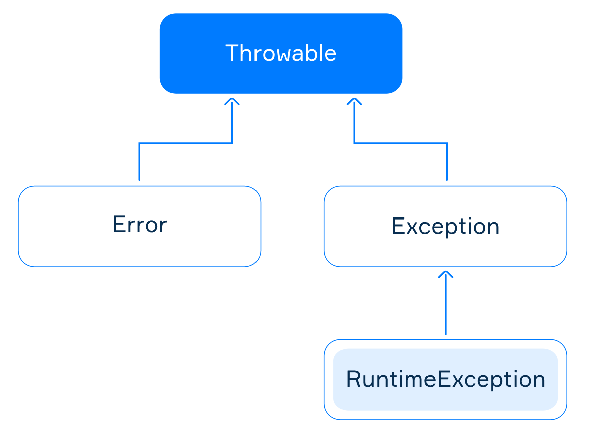
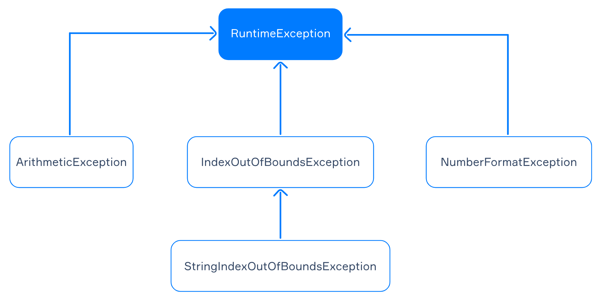
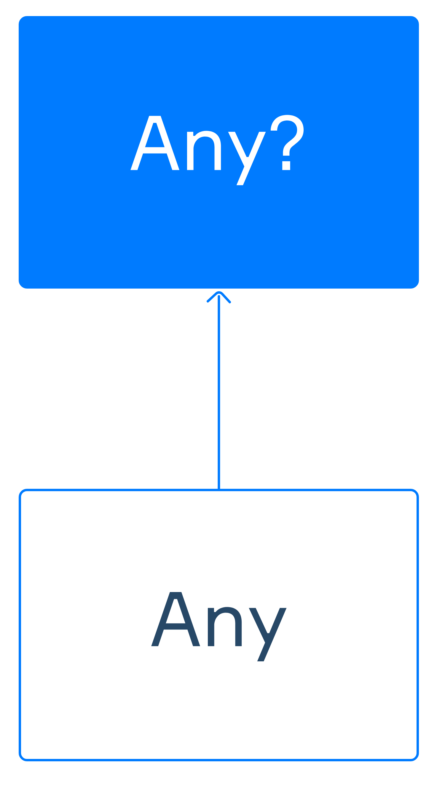
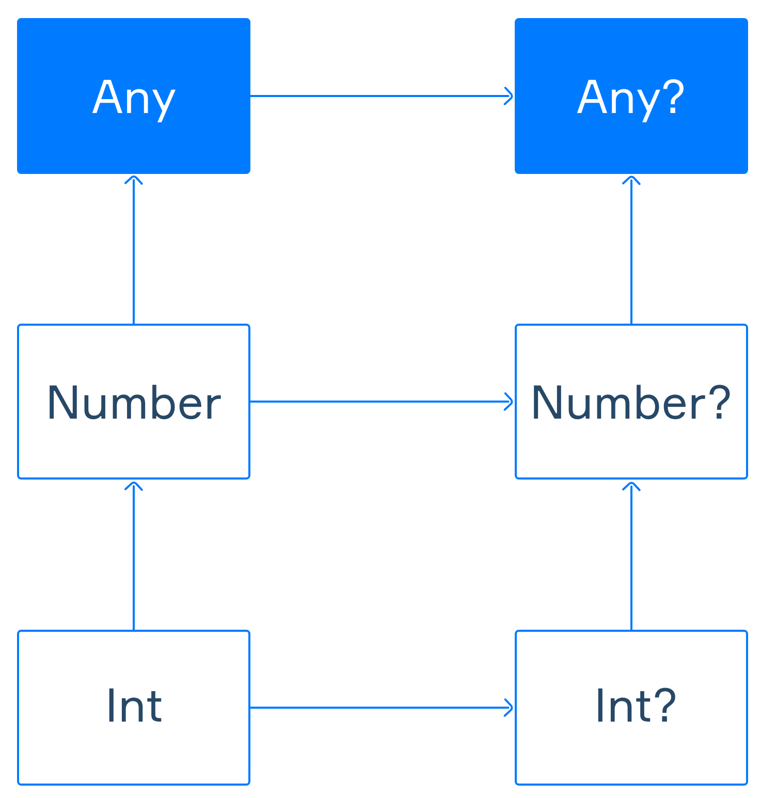
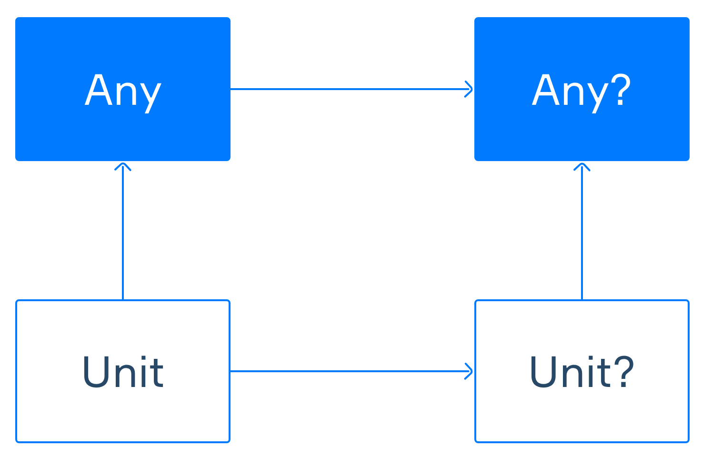

# Error in programs

Suppose, you're writing a Kotlin program. Different errors may occur during its compilation or execution. 
We will divide all possible errors into two groups: **compile-time** errors and **run-time** errors.

> [!NOTE]
> Remember: in many cases, you can avoid exceptions using conditions. So think about special cases in your program and add checks.

## Compile-time errors


Compile-time errors are errors that prevent a program compiling.
For example:
- syntax errors: incorrect keyword, typo, missing parenthesis or brace;
- incorrect imported package name;
- non-existing method invocation.

To avoid such errors, programmers use modern IDE (Integrated Development Environment) with a static code analyzer. 

## Run-time errors

Run-time errors (also known as "bugs") are errors that occur when the program is running. Run-time errors will cause your program to behave unexpectedly or may even stop the execution.

There are two subtypes of run-time errors:

- logic errors – when a program produces a wrong result because the code is not correct (for example, instead of "Hello!", your program outputs "Hi!");
- **unhandled exceptions** like division by zero, not found files, and other unexpected cases.

There are different strategies to find such errors:

- to debug your program;
- to write automatic tests for your program;
- to use code review practice as part of the development process. In general, this practice stands for a case when one or more developers visually inspect the source code of a program.

## Exception

Therefore, an error can happen while a program is running, even though it's syntactically correct and has been compiled without any problem. Such situations are called Exceptions in Kotlin and we are going to explore this concept.

## Hierarchy of exceptions

For different unexpected situations, there are different specialized types of exceptions. They are all related, making up a hierarchy of types

### Subtype and supertype

First of all, let's figure out the terminology. Types in Kotlin are organized into a hierarchy of subtype-supertype relationships

 What are subtypes and supertypes?

We can state the fact that coffee and tea are both related to a specific type: drink. In Kotlin terms, coffee and tea are **subtypes** of drink, while drink is a **supertype** for these two types

- The **subtype** is a datatype that is related to another datatype (supertype) and inherits common characteristics and rules of behavior from it.
- Logically, a **supertype** is a type whose properties and methods specify the characteristics and rules of behavior that its subtypes will follow.

### Overview of the exception hierarchy

The following picture illustrates a simplified hierarchy of exceptions:




As you can see, the foundation of this hierarchy is the type `Throwable`. It is the root of the hierarchy, and all exceptions somehow belong to this type. It provides a set of useful methods for handling exceptions.

The type `Throwable` has two direct subtypes: `Error` and `Exception`. An `Error` indicates serious problems that a reasonable application should not try to process. 

We shouldn't think about handling errors in the program code. Here we’ll focus on the `Exception`; when you develop an application, you normally will catch and process exactly exceptions

Keep in mind that **subtype** and **supertype** are relative terms, so a given type doesn't have to be one or the other. In this case, `Exception` is a subtype of `Throwable` and also the supertype of `RuntimeException`.

Subtypes of the `Exception` type, such as `RuntimeException` and `IOException`, deal with exceptional events inside applications. 


#### RuntimeException

The `RuntimeException` type is a rather special subtype of Exception. Subtypes of `RuntimeException`, such as `ArithmeticException` and `NumberFormatException`, can be thrown during the normal program execution.



- `ArithmeticException` is the runtime exception that is thrown when the code attempts an illegal arithmetic operation. Consider an extremely common example:

```kotlin
val example = 2 / 0 // throws ArithmeticException
```

- `NumberFormatException` During calculations you can get another type of exception: NumberFormatException. It is thrown when a method expects to receive a number,but the actual input is something else.

```kotlin
val string = "It's not a number"
val number = string.toInt() // throws NumberFormatException
```

- `IndexOutOfBoundsException` IndexOutOfBoundsException occurs when you access some non-existent index.

```kotlin
val sequence = "string"
println(sequence[10])   // throws StringIndexOutOfBoundsException
```

#### Throwing exceptions

Why should we write Exception(...)? That's the right question! Actually, all exceptions are located in a hierarchy tree. In this way, Exception represents a common type without any specifics.

### Root type Any

In Kotlin, type Any is a **supertype** for all types (**Any is at the top of the Kotlin type hierarchy**) that don't support `null`. This means that any `non-nullable` type is a **subtype** of Any.

While type `Any` is a supertype for all types that do not support null, `Any?` is a supertype for types that can be either `null` or not. **From this fact, it follows that type Any? is a supertype for type Any**



Non-null type is a subtype of its nullable equivalents, for example, type `Number` is a subtype of type `Number?`, and type `Int` is a subtype of type `Int?`. Let's see what it looks like:



This is why you can store a non-null `Number` value in a nullable `Number?` variable, but you cannot store a nullable `Number?` value in a non-null `Number` variable.

### Unit

`Unit` type can be used as the return type of a function that does not return any meaningful value

Like any other type, `Unit` is a subtype of `Any`. It can also be a nullable `Unit?`, which is a subtype of `Any?`.




## Try-catch statement

Kotlin has the exception handling mechanism. After a line of code throws an exception, Kotlin attempts to find a suitable handler for it. As soon as a suitable handler is found and executed, the exception is considered handled and the program runs normally.

```kotlin
try {
    // code that may throw an exception
} catch (e: SomeException) {
    // code for handling the exception
}
```
The `try` block is used to wrap the code that may throw an exception. This block can include all lines of code, including method calls. The `catch` block is a handler for the specified type of exception and all its subtypes. 

Pay attention! The variables announced in the `try` block will only be available inside the block: you can't work with them either outside or in the `catch` block.

> [!NOTE]
>If the result of the execution of the try block throws an exception not foreseen in the catch expression, the program will fail despite all precautions.

### Where and how to handle an exception

Technically, an exception can be handled in the method where it occurs or in the calling method. The best approach to handle an exception is to do it in a method that has sufficient information to make the correct decision based on this exception.

So, why should we throw out specific types of exceptions when there is a general `Exception` that includes all possible cases and is always appropriate? 
Well, keep in mind that your colleagues or maybe even yourself in a couple of weeks may not really know what’s going on in the code. It would be best for you to provide as much information as possible. This will make handling exceptions much easier.

**Always try to find the exception type that fits best to your exceptional event.**

Actually, there is another possible block called `finally`. All the statements present in this block will always execute regardless of whether an exception occurs in the `try` block or not.

You will find `finally` helpful in situations when you need to perform some finishing actions regardless of whether an exception is thrown.

It is also possible to write try and finally without a catch block


### Try-with-resources

When an input stream is created, the JVM notifies the OS about its intention to work with a file.

If the JVM process has enough permissions and everything is fine, the OS returns a file descriptor — a special indicator used by a process to access the file. The problem is that the number of file descriptors is limited.

This is the reason why it is important to notify the OS that the job is done and the file descriptor that is held can be released for further reuse. In previous examples, we invoked the method `close` for this purpose. Once it is called, the JVM releases all system resources associated with the stream.

Resource releasing works if the JVM calls the `close` method, but it is possible that the method will not be called at all.

Look at the example:

```kotlin
val reader: Reader = FileReader("file.txt")
// code which may throw an exception
reader.close()
```

Suppose something goes wrong before the `close` invocation and an exception is thrown. It leads to a situation in which the method will never be called and system resources won't be released. It is possible to solve the problem by using the **try-catch-finally** construction:

```kotlin
var reader: Reader? = null
try {
    reader = FileReader("file.txt")
    // code which may throw an exception
} finally {
    reader!!.close()
}
```

**Unfortunately, this solution still has some problems**. That is, the `close` method can potentially raise exceptions itself. Suppose there are two exceptions: the first was raised inside the `try` section, and the second was thrown by the `finally` section. 

#### Solution

A simple and reliable way called **try-with-resources** was introduced in Java 7. In Kotlin, there is no implementation of try-with-resources, but we can apply the `use` extension method:


```kotlin
FileReader("file.txt").use {
    reader ->
    // some code
}
```


As you see, there are no explicit calls of the `close` method at all. It is implicitly invoked for all objects declared in the first part. The construction guarantees closing all resources in a proper way.

> [!NOTE]
> Surely, we do our best to write error-free programs. However, it is difficult to foresee all possible problems. The best practice is to place any code concerning system resources in the use method.

### Closeable resources

We have dealt with a file input stream to demonstrate how try-with-resources is used. However, not only the resources based on files should be released. Closing is also crucial for other outside sources, like web or database connections. Classes that handle them have a `close` method and, therefore, can be wrapped by the try-with-resources statement.

For example, let's consider `java.util.Scanner`. Earlier, we used `Scanner` for reading data from the standard input, but it can read data from a file as well. `Scanner` has a close method for releasing outside sources.

```kotlin
Scanner(File("file.txt")).use { scanner ->
    val first: Int = scanner.nextInt()
    val second: Int = scanner.nextInt()
    println("arguments: $first $second")
}
```

#### What's under the hood?

The use implementation looks like this:

```kotlin
public inline fun <T : Closeable?, R> T.use(block: (T) -> R): R {
    contract {
        callsInPlace(block, InvocationKind.EXACTLY_ONCE)
    }
    var exception: Throwable? = null
    try {
        return block(this)
    } catch (e: Throwable) {
        exception = e
        throw e
    } finally {
        when {
            apiVersionIsAtLeast(1, 1, 0) -> this.closeFinally(exception)
            this == null -> {}
            exception == null -> close()
            else ->
                try {
                    close()
                } catch (closeException: Throwable) {
                    // cause.addSuppressed(closeException) // ignored here
                }
        }
    }
}
```

This function is defined as a generic extension on all` Closeable?` types. `Closeable` is Java's interface that uses try-with-resources.

If Kotlin didn't implement the use extension functions, we would need to write more code, take a look:

```kotlin
import java.io.Closeable

fun main() {
    val resource = CustomCloseable()
    resource.use {
        println("I am an example of some code!")
        it.exampleMethod()
    }
    println("End of program!")
}

class CustomCloseable : Closeable {
    override fun close() {
        println("Close resource")
    }

    fun exampleMethod() {
        println("Example of some method for the CustomCloseable class")
    }
}
```
