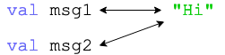

# Object And Properties in Kotlin

Objects are complex structures that can store some data and do something.

## State and behavior

An object is a part of memory that stores some sort of information. Variables and values just point to objects. So, you can work with objects with the help of variables.


A simple example of an object is a `String` that stores a message. Let's take a closer look at it.

First of all, a message has a **state**: it contains not only a sequence of symbols but also the size of the sequence, that is, the length of the message. In Kotlin, something that allows you to access the state of an object is called a **property**.Some **functions** are bound to a specific type. This makes using the objects more logical because functions represent the behavior of those objects. These functions are also called **member functions** or **methods**.

## Copying by reference

In programming, copying something is a very common operation. We use = in almost all the cases.

If you create a variable and assign an object to it, another variable can point to the same object as well. 

In Kotlin, similar rules apply. If you create a variable and assign an object to it, another variable can point to the same object as well



**In other words, the = sign does not copy the object itself, it only copies a reference to it.**

## Mutability

An object can be either mutable or immutable.

You already know that `Int`, `String`, `Float`, and `Double` in Kotlin are objects. But there is a nuance. These variables behave just like the primitive types of data in other programming languages, but at the same time, they are objects – in other words, unchangeable objects.

## Structural vs referential equality

### Comparison

When you can use the comparison operator `==`. 
For example, print(msg1 == msg2) gives true, and `print(msg1 == "Hello")` gives `false`. 
Variables msg1 and msg2 have the same state, which is called **structural equality**.

Let's look at an example of copying a **mutable** object.

Let's create a Box object, copy it and and change its original:

```kotlin
val blueBox = Box(3)          // box with 3 balls
val azureBox = blueBox 
println(blueBox == azureBox ) // true, it's a copy
blueBox.addBall()             // add a ball to the first box
println(blueBox == azureBox ) // true, the second box also contains 4 balls
```

### Referential equality

Kotlin provides a special operator === to check if the variables point to the same object.

For example:

```kotlin
    val blueBox = Box(3)
    val azureBox = blueBox 
    val cyanBox = Box(3)
    println(blueBox == azureBox)  // true
    println(blueBox === azureBox) // true, azureBox points to the same object
    println(blueBox == cyanBox)   // true
    println(blueBox === cyanBox)  // false, cyanBox points to another object
``` 

Also, you may check for referential inequality with the operator `!==` . For example, `print(blueBox !== cyanBox)` gives `true`.

```kotlin
    var two = 2
    var anotherTwo = 2
    println(two === anotherTwo) // true
```

These variables point to the same object! Don't worry about this: as you remember, you cannot change an immutable object.
so if you try to do something with the variable, it will point to a new object and other variables will still point to the old object.


### Base types and equality

```kotlin
var a: Int = 100
val anotherA: Int = a
println(a == anotherA)  // true
println(a === anotherA) // true
a = 200
println(a == anotherA)  // false
println(a === anotherA) // false
```

As you can see, when we change the value of the variable `a = 200`, 
we do not change its object, the variable a is assigned a new reference to the object with the value 200.

 Now, let's look at an example with modifiable objects:

 ```kotlin
val list1: MutableList<Int> = mutableListOf()
val list2: MutableList<Int> = list1
list1.add(1)
println("list1 $list1") // list1 [1]
println("list2 $list2") // list2 [1]
list2.add(5)
println("list1 $list1") // list1 [1, 5]
println("list2 $list2") // list2 [1, 5]
```

As you can see in this example, the variables `list1` and `list2` refer to the same object. 
**When you change the object through the first variable, we see the updated data through the second variable.**