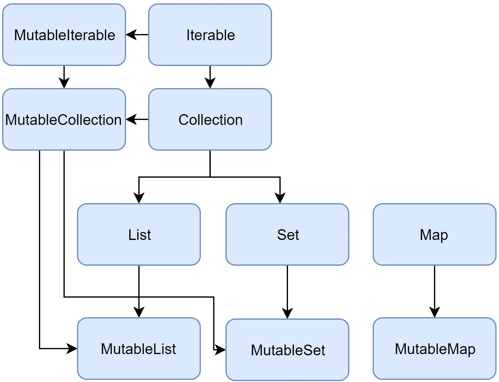

# Introduction to collections

   Collections are containers that support various ways to store and organize different objects and make them easily accessible. A collection usually contains a number of objects (this number may be zero) of the same type. Objects in a collection are called **elements** or **items**. 
Collections are an implementation of abstract data structures that can support the following operations:

- retrieving an element;

- removing an element;

- changing or replacing an element;

- adding a new element.


However, it is important to note that operations like adding, removing, and changing elements only apply to **mutable** collections.


## Mutability

Collections can be **mutable** or **immutable**.

Immutable collections cannot be changed. That is, they only allow those operations that do not change the elements.
Immutability can be helpful when you want to store items together without allowing them to be modified in the future.

Kotlin Standard Library provides the implementation for the basic types of collections: **list**, **set**, and **map**. All three exist in mutable and immutable variations.

Another way to check if an item is contained in a collection is to use the keyword `in`.It works just like the contains() function. Look at the example:

```kotlin
println(elem in collection)

println(collection.contains(elem))
```
## Map collection

A `Map` **is an immutable collection that holds pairs of objects** (**keys** and **values**) and supports efficiently retrieving values corresponding to each key. As you remember, immutable implies that the size and content of the collection cannot be changed once it's initialized. It's important to remember that `Map` keys are unique: in other words, a `Map` can hold only one value for each individual key.

## Test predicates: checking elements in collection

A **predicate** is a function that returns true or false based on the input. We will get true if the condition matches the predicate and false otherwise. A single predicate always checks for the same condition; different conditions are checked by different predicates.

A predicate is defined based on a lambda function: `(T) -> Boolean`. Also, a predicate can be passed as a function reference

```kotlin
val isEven: (Int) -> Boolean = { x -> x % 2 == 0 }

fun main() {
    val numbers = listOf(1, 2, 3, 4, 5, 6, 7, 8, 9, 10)

    // any number is even?
    println(numbers.any { x -> x % 2 == 0 }) // true
    println(numbers.any { isEven(it) }) // true
    println(numbers.any(isEven)) // true
}
```

### Any

With a predicate, the `any()` function will return true if at least one collection element matches the predicate we defined in `any()`. 
The function can be also called without a predicate to check for emptiness.

### None

With a predicate, the `none()` function will return true if none of the collection elements matches the predicate indicated in `none()`. Like `any()`, it can also be called without a predicate to check for emptiness.

### All

The `all()` function will only return true if all elements in the collection satisfy the given predicate. A special feature of this function is that it will always return true on an empty collection; this trait is also called vacuous truth in math.

## Ordering elements in collection

### Sorting objects

In Kotlin, we have two functions: `sorted()` and `sortedDescending()` for sorting the elements of a collection in natural

```kotlin
    val numbers = listOf(3, 5, 6, 4, 1, 8, 2, 7)
    println(numbers.sorted()) // [1, 2, 3, 4, 5, 6, 7, 8]
    println(numbers.sortedDescending()) // [8, 7, 6, 5, 4, 3, 2, 1]
```

### Reverse order

We can obtain a collection in reverse order (based on the index positions) using two functions: `reversed()` and `asReversed()`

- The `reversed()` function returns a copy of the original collection in reverse index order. If you change the original collection, the changes won't affect the copy.

> [!NOTE]
> Remember in ASCII or UTF-8, the uppercase letters are assigned lower numeric codes than their corresponding lowercase letters. So, the uppercase letters come before the lowercase letters when ordered by their decimal codes.

Ex:
```kotlin
val numbers = mutableListOf(3, 5, 6, 4, 1, 8, 2, 7)
    val reversedNumbers = numbers.reversed()
    
    println(numbers) // [3, 5, 6, 4, 1, 8, 2, 7]
    println(reversedNumbers) // [7, 2, 8, 1, 4, 6, 5, 3]

    val words = listOf("racecar", "mom", "dad", "abracadabra", "MANDRAKE")
    val wordsReversed = words.reversed()
    
    println(words) // [racecar, mom, dad, abracadabra, MANDRAKE]
    println(wordsReversed) // [MANDRAKE, abracadabra, dad, mom, racecar]
```
- The `asReversed()` method returns a reference to the original collection in reverse index order. It is lighter because it does not create a new copy, but if the original collection changes, the changes are reflected in the reversed list. **So we must be careful if we work with mutable collections.**

Ex:
```kotlin
fun main() {
    val numbers = mutableListOf(3, 5, 6, 4, 1, 8, 2, 7)
    val numbersAsReversed = numbers.asReversed()
    
    println(numbers) // [3, 5, 6, 4, 1, 8, 2, 7]
    println(numbersAsReversed) // [7, 2, 8, 1, 4, 6, 5, 3]
    
    numbers.add(9)
    
    println(numbers) // [3, 5, 6, 4, 1, 8, 2, 7, 9]
    println(numbersAsReversed) // [9, 7, 2, 8, 1, 4, 6, 5, 3]

    val words = listOf("racecar", "mom", "dad", "abracadabra", "MANDRAKE")
    val wordsAsReversed = words.asReversed()
    println(words) // [racecar, mom, dad, abracadabra, MANDRAKE]
    println(wordsAsReversed) // [MANDRAKE, abracadabra, dad, mom, racecar]
}
```

### Random order

The `shuffled()` method gives you a new collection where the original items are randomly shuffled. You can use it without arguments or with a Random instance as the source of randomness.
Ex:

```kotlin
fun main() {
    val numbers = mutableListOf(3, 5, 6, 4, 1, 8, 2, 7)
    val shuffledNumbers = numbers.shuffled()

    println(numbers) // [3, 5, 6, 4, 1, 8, 2, 7]
    println(shuffledNumbers) // [5, 3, 6, 7, 1, 8, 2, 4]
    
    val words = listOf("racecar", "mom", "dad", "abracadabra", "MANDRAKE")
    val shuffledWords = words.shuffled(Random(1))

    println(words) // [racecar, mom, dad, abracadabra, MANDRAKE]
    println(shuffledWords) // [MANDRAKE, abracadabra, mom, dad, racecar]
}
```

### Retrieve by position

To get the element at a specific index position, you can use `elementAt()`. We can also fetch an element in an equivalent way with the `get()` function.

However, in the Kotlin world, things are easier if we use the indexed access operator `[]`, which is equivalent to the `get()` function on lists.

All of them will throw an `IndexOutOfBoundsException` if the index is not within the indicated limits (0.. size-1).

In order not to have problems with exceptions when trying to get an invalid index element, we can make use of the following safe calls:

`elementAtOrNull()`: it will return null when the index position is out of the collection bounds.

`elementAtOrElse()`: it takes a lambda function that returns the result of the lambda if the index position is out of the collection bounds.

`getOrNull()`: it is the equivalent to `elementAtOrNull()` for a list.

`getOrElse()`: it is the equivalent to `elementAtOrElse()` for a list.

`firstOrNull()`: it is used to get the first element or null if the collection is empty.

`lastOrNull()`: it is used to get the last element or null if the collection is empty.

### Retrieve by condition

Some functions allow you to get elements based on a predicate: `first()` and `last()`. You will only get the element if the predicate is true. To avoid an exception, you can use the secure calls: `firstOrNull()` and `lastOrNull()`.

### Retrieve with selector

Sometimes, it is helpful to use a selector to map the collection before getting an element. The `firstNotNullOf()` method performs the following actions: maps the collection with a selector function and returns the first non-null value in the result. However, it throws `NoSuchElementException` if there is no non-null element. To avoid that, you can use `firstNotNullOfOrNull()`.

### Random element
If You need is to obtain a random value from a collection.
We can use the `random()` function. Remember, though, that this function throws `NoSuchElementException` if the array is empty. To avoid that, you can use the safer call `randomOrNull()`, which returns null if the collection is empty.

### Check if an element exists

you can use the `contains()` method – this methods returns true if the element is found in the collection.
To check if a collection contains multiple elements, you can make use of the method `containsAll()`.


## Collections as interface



`Collection<T>` is the root for a hierarchy of immutable collections — `List` and `Set`. It provides methods like `size`, `get()`, `find()`, `filter()`, `count()`, etc.

`MutableCollections<T>` is the root for `MutableList` and `MutableSet`, and it supports adding and removing elements with the help of the following methods: `add()`, `addAll()`, `remove()`, `removeAll()`, `retainAll()`, and `drop()`.

`Collection` and `MutableCollection` inherit from `Iterable` and `MutableIterable`. So, these interfaces support all the methods available to their parents.

However, maps don't represent `Collection` or `Iterable` interfaces, though we also call them collections. It means that they have methods different from other collections. And it is logical because they contain key-value pairs — as opposed to single elements in `Set` or `List`, so we need to separate methods for them. Unfortunately, we can't use `Map` with `Collection` interfaces.


### Iterable

there are two universal interfaces in Kotlin: `Iterable` and `MutableIterable`. They provide methods for working with sequences of elements.

Classes that inherit from `Iterable` have a set of common methods: `iterator()`, `forEach()`, `contains()`, `count()`, `drop()`, `filter()`, etc.

`MutableIterable`, unlike `Iterable`, also supports removing elements during iterations. For example, `remove()` and `removeAll()`.

> [!NOTE]
> It's interesting that they both contain the method drop() which drops a certain element. But unlike remove() from MutableIterable, which really removes a certain element in a certain object, drop() returns a new object.

### Collection

There are some common methods for all collections.

- `count()` returns the number of elements that meet the conditions.

- `drop()` returns a new List of elements without n first elements.

`containsAll()` checks if the collection contains all elements from another collection and returns `true` or `false`.
- `joinToString()` returns the collection as a string with a specific delimiter.

- `find()` returns the first element which fits the pattern.

- `filter()` returns a `List` of elements that meet the conditions.

- `minus()` returns the collection without the element or elements specified in the condition.

- `random()` returns a random element of the collection.

> [!NOTE]
> Notice that drop() or minus() don’t change the original collection; instead, they create a new collection, so they also work with Collection<T>, an immutable type.

### MutableCollection

the use of `MutableCollection`. It can use all the methods from `Collection`, but it also has some specific operations.

Notice that the specific `MutableCollection` methods, unlike `drop()` or `minus()`, change the original collection. So a function with these methods will return a boolean value — `true` if the operation was successful and `false` if the operation failed.

- `addAll()` adds all elements from one collection to another.

- `add()` adds one element to a collection.

- `clear()` removes all elements from a collection.

- `remove()` removes the first occurrence of a certain element from a collection.

- `retainAll()` method leaves the unique elements in the collection — only those that are also contained in the specified collection.


## Mapping transformation

With the `map()` and `mapIndexed()` functions, we can create a new collection by applying a transformation lambda function to our source collection.

- `map()` transforms a given collection into a new one by applying a transformation lambda function to each element.
- `mapIndexed()` transforms a given collection into a new one by applying a transformation lambda function to each element and using the element index as the first argument of the lambda.

When do we need map transformations? **You need them whenever you want to get a new collection based on the elements of the original one.**

If you apply a transformation function to the elements and the transformation cannot be performed on some of them, the result for those elements is null. You can check the above example. You can avoid these results using `mapNotNull()` or `mapIndexedNotNull()`.

Why do we need these two functions? If we can't perform a mapping operation, we'll have a `null`, so our collection is `T?`. It is essential to have such operations that allow us to avoid `null` values so that our collection will be of type `T`.

You have two options to perform a transformation: transform the keys with `mapKeys()` or transform the values associated with the said keys with `mapValues()`.

### Flatten (flatten/flatMap)

The function `flatten()` returns a single list of all the elements from all collections in the given collection. It is very helpful if we have several collections and we want to get a single collection that concatenates them.

However, this function is not valid for all kinds of collections. Remember, `flatten` returns a `List` or a `sequence`.

Example:

```kotlin
    val nestedNumbers = listOf(
        listOf(1, 2, 3),
        listOf(4, 5, 6),
        listOf(7, 8, 9)
    )
    println(nestedNumbers.flatten())  // [1, 2, 3, 4, 5, 6, 7, 8, 9]
```

The function `flatMap()` takes a function that maps the elements of one collection to another and returns a list of all the values in those elements.
It is very useful if we are faced with the task of mapping **one-to-many relationships.**

Example:
```kotlin
    val nestedNumbers = listOf(
        listOf(1, 2, 3),
        listOf(4, 5, 6),
        listOf(7, 8, 9)
    )
    // FlatMap example
    println(nestedNumbers.flatMap { 
        it.map { it * 2 } }
    ) // [2, 4, 6, 8, 10, 12, 14, 16, 18]
```

## Fold and reduce

With `fold()` and `reduce()`, we can operate on the elements of a collection as a sequence and return the accumulated result.

- `fold()` takes an initial value, uses it as the accumulated value on the first step, and applies the operation from left to right combining the current accumulated value with each element. **the initial value will be the default value with an empty collection. We can change the type of the return value thanks to the implementation of this function.**

```kotlin
fun main() {
    val list = listOf(1, 2, 3, 4, 5)
    val sum = list.fold(0) { acc, i ->
        println("acc: $acc, i: $i, acc + i: ${acc + i}")
        acc + i
    }
    println(sum) // 15
    val product = list.fold(1) { acc, i ->
        println("acc: $acc, i: $i, acc * i: ${acc * i}")
        acc * i
    }
    println(product)

    // empty list
    val emptyList = listOf<Int>()

    // fold uses the parameter as the initial value of the accumulator
    val sum1 = emptyList.fold(0) { acc, i ->
        println("acc: $acc, i: $i, acc + i: ${acc + i}") // this line will not run
        acc + i
    }
    println(sum1) // 0


    val string = list.fold(StringBuilder()) { acc, s ->
        acc.append(s)
    }
    println(string) //12345
}
```
Output
```bash
acc: 0, i: 1, acc + i: 1
acc: 1, i: 2, acc + i: 3
acc: 3, i: 3, acc + i: 6
acc: 6, i: 4, acc + i: 10
acc: 10, i: 5, acc + i: 15
15
acc: 1, i: 1, acc * i: 1
acc: 1, i: 2, acc * i: 2
acc: 2, i: 3, acc * i: 6
acc: 6, i: 4, acc * i: 24
acc: 24, i: 5, acc * i: 120
120
0
12345
```

- `reduce()` transforms a given collection into a single result. It takes a lambda function operator to combine a pair of elements into an accumulated value. Then it loops through the collection and performs the operation step by step combining the accumulated value with the next element in the collection.

```kotlin
// reduce uses the first element as the initial value of the accumulator
val sum = list.reduce { acc, i ->
    println("acc: $acc, i: $i, acc + i: ${acc + i}")
    acc + i
}
println(sum) // 15
product = list.reduce { acc, i ->
    println("acc: $acc, i: $i, acc * i: ${acc * i}")
    acc * i
}
println(product) // 120
```
Output
```bash
acc: 1, i: 2, acc + i: 3
acc: 3, i: 3, acc + i: 6
acc: 6, i: 4, acc + i: 10
acc: 10, i: 5, acc + i: 15
15
acc: 1, i: 2, acc * i: 2
acc: 2, i: 3, acc * i: 6
acc: 6, i: 4, acc * i: 24
acc: 24, i: 5, acc * i: 120
120
```


`reduce` **performs one step less because the accumulator is the first element.**. `reduce` will throw an exception if performed on an empty collection. The result of a reduce operation will always be of the same type (or a super type) as the data that is being reduced – we cannot change it to another type.


```kotlin
    // empty list
    val emptyList = listOf<Int>()

    // reduce uses the first element as the initial value of the accumulator
    // Throws exception: Empty collection can't be reduced.
    val sum = emptyList.reduce { acc, i ->
        println("acc: $acc, i: $i, acc + i: ${acc + i}")
        acc + i
     }
     println(sum)

    // with reduce you can't change the type of the accumulator. Compiler error
    val string2 = list2.reduce(StringBuilder()) { acc, s ->
       acc.append(s)
    }
```

### Reverse order

Sometimes, we need to perform the actions in the reverse order. We can use `foldRight()` and `reduceRight()` to apply operations from right to left. However, remember that the operation arguments change their order: first goes the element and then the accumulated value.

```kotlin
fun main() {
    val list = listOf(1, 2, 3, 4, 5)

    // foldRight, use the parameter as the initial value of the accumulator.
    // from right to left
    val sum = list.foldRight(0) { i, acc -> acc + i }
    println(sum) // 15
    product = list.foldRight(1) { i, acc -> acc * i }
    println(product) // 120
    
    // reduceRight, use the last element as the initial value of the accumulator
    // from right to left
    sum = list.reduceRight { i, acc -> acc + i }
    println(sum) // 15
    product = list.reduceRight { i, acc -> acc * i }
    println(product) // 120
}
```

### Accumulate result with indices

In some tasks, you may need to use the index to perform the calculation. You can apply operations that take element indices as parameters. Kotlin has `reduceIndexed()` and `foldIndexed()`, which use the index as the first parameter. Also, we can use `reduceRightIndexed()` and `foldRightIndexed()` to perform the action form right to left.

```kotlin
fun main() {
    val list = listOf(1, 2, 3, 4, 5)
   
    // foldIndexed and FoldRightIndexed are similar to Fold and FoldRight,
    // but they have an additional parameter to indicate the index of the element to fold
    // sum of even elements
    val sum = list.foldIndexed(0) { index, acc, i ->
        if (index % 2 == 0) acc + i else acc
    }
    println(sum) // 9
    
    // product of odd elements right to left
    product = list.foldRightIndexed(1) { index, i, acc ->
        if (index % 2 == 1) acc * i else acc
    }
    println(product) // 8

    // reduceIndexed and ReduceRightIndexed are similar to Reduce and ReduceRight,
    // but they have an additional parameter to indicate the index of the element to reduce
    // sum of even elements
    var sum = list.reduceIndexed { index, acc, i ->
        if (index % 2 == 0) acc + i else acc
    }
    println(sum) // 9
    
    // product of odd elements right to left
    product = list.reduceRightIndexed { index, i, acc ->
        if (index % 2 == 1) acc * i else acc
    }
    println(product) // 40
}
```

### Work with nullable collections

**All the reduce operations that we have presented throw an exception on empty collections**. If we want to get null, we must use the same methods but ending with `*OrNull()`: `reduceOrNull()`, `reduceRightOrNull()`, `reduceIndexedOrNull()`, and `reduceRightIndexedOrNull()`.

```kotlin
fun main() {
    
    // fold and reduce with empty collections
    val sum = emptyList<Int>().fold(0) { acc, i -> acc + i }
    println(sum) // 0
    
    // sum = emptyList<Int>().reduce { acc, i -> acc + i } // exception
    // println(sum)
    sum = emptyList<Int>().reduceOrNull { acc, i -> acc + i } ?: 0 // is null
    println(sum) // 0

}
```

### Accumulate with intermediate results

Finally, in some cases it is interesting to save the intermediate value of the accumulator. For this purpose, we have `runningFold()`, `runningReduce()`, `runningFoldIndexed()`, and `runningReduceIndexed()`, which return a list with the intermediate results.

```kotlin
fun main() {
    val list = listOf(1, 2, 3, 4, 5)
  
    println("runningFold and runningReduce")
    
    // runningFold and RunningReduce are similar to Fold and Reduce,
    // but they return a list of intermediate results
    val runningSum = list.runningFold(0) { acc, i -> acc + i }
    println(runningSum) // [0, 1, 3, 6, 10, 15]
}
```

## Comparable and Comparator

In Kotlin, Comparable and Comparator are two interfaces that allow developers to compare objects of the same or different classes. **Both interfaces are commonly used to sort and order collections of objects based on one or more attributes**

### Kotlin Comparable interface

The Comparable interface is used to define the natural ordering of objects. When a class implements Comparable, it must override the `compareTo()` method:

```kotlin
public operator fun compareTo(other: T): Int
```
For example, consider the following code:

```kotlin
data class Person(val name: String, val age: Int): Comparable<Person> {
  override fun compareTo(other: Person): Int {
    return this.age - other.age
  }
}
```

In this code, the Person class implements the Comparable interface and overrides the `compareTo()` method. The `compareTo()` method compares Person objects based on their age, returning a negative integer if the age of the current object is less than the age of the other object, a positive integer if the age of the current object is greater than the age of the other object, and zero if they are equal.

Now, if we have a list of `Person` objects, we can sort it by their age as follows:
```kotlin
val people = listOf(Person("Alice", 25), Person("Bob", 30), Person("Charlie", 20))
val sortedPeople = people.sorted() //[Person(name=Charlie, age=20), Person(name=Alice, age=25), Person(name=Bob, age=30)]
```

The class implementing the `Comparable` interface supports useful extension functions, among them the following:

- `coerceAtLeast()` – this function checks whether the calling object is greater than a certain minimum object. It returns the current object if it is greater; otherwise, it returns the minimum object

```kotlin
fun <T : Comparable> T.coerceAtLeast(minimumValue: T): T
```

```kotlin
fun main() {
    val people = listOf(
        Person("Alice", 25), Person("Bob", 30), Person("Charlie", 20)
    )

    val minimum = Person("Jack", 28)
    println(people[0].age.coerceAtLeast(minimum.age)) // 28
    println(people[1].age.coerceAtLeast(minimum.age)) // 30
}
```

- `coerceAtMost()` – this function checks whether the calling object is smaller than the given maximum object. It returns the current object if it's smaller; otherwise, it returns the maximum object.

```kotlin
fun <T : Comparable> T.coerceAtMost(maximumValue: T): T
```

```kotlin
fun main() {
    val people = listOf(
        Person("Alice", 25), Person("Bob", 30), Person("Charlie", 20)
    )

    val maximum = Person("Jack", 28)
    println(people[0].age.coerceAtMost(maximum.age)) // 25
    println(people[1].age.coerceAtMost(maximum.age)) // 28
}
```

- **coerceIn()** – this function checks whether the calling object lies within a certain range between the minimum and maximum values. It returns the object if it is within the range, the minimum if the object is less than the minimum, or the maximum if the object is greater than the maximum.


```kotlin
fun <T : Comparable> T.coerceIn(
    minimumValue: T?, 
    maximumValue: T?
): T
```

```kotlin
fun main() {

    println(25.coerceIn(18..28)) // 25
    println(15.coerceIn(18..28)) // 18
    println(30.coerceIn(18..28)) // 28
}
```

### Kotlin Comparator interface

**The Comparator interface is used to define a custom ordering of objects.** When a class implements `Comparator`, it must override the `compare()` method, which takes two objects of the same type as arguments and returns an integer value. It returns zero if the arguments are equal, a negative number if the first argument is less than the second, or a positive number if the first argument is greater than the second. Here's how it works:

```kotlin
data class Person(val name: String, val age: Int)

class PersonAgeComparator : Comparator<Person> {
    override fun compare(p1: Person, p2: Person): Int {
        return p1.age - p2.age
    }
}

fun main() {
    val ageComparator = PersonAgeComparator()

    // or passing lambda as compare fun
    //  val ageComparator = Comparator<Person> { p1, p2 -> p1.age - p2.age }

    val people = listOf(
        Person("Alice", 25), Person("Bob", 30), Person("Charlie", 20))
    val sortedPeople = people.sortedWith(ageComparator)
    println(sortedPeople) // [Person(name=Charlie, age=20), Person(name=Alice, age=25), Person(name=Bob, age=30)]
}
```

The `Comparator` interface has interesting methods, among them the following:

- `reversed()` – this function takes the comparator as an argument and returns a comparator with the reversed ordering of the passed comparator

```kotlin
fun <T> Comparator<T>.reversed(): Comparator<T>
```

```kotlin
data class Person(val name: String, val age: Int)

fun main() {
    val ageComparator = Comparator<Person> { p1, p2 -> p1.age - p2.age }.reversed()

    val people = listOf(
        Person("Alice", 25), Person("Bob", 30), Person("Charlie", 20))
    val sortedPeople = people.sortedWith(ageComparator)
    println(sortedPeople) // [Person(name=Bob, age=30), Person(name=Alice, age=25), Person(name=Charlie, age=20)]
}
```

You can see more methods in Kotlin documentation.

### Differences between Comparable and Comparator

The main difference between `Comparable` and `Comparator` is that `Comparable` defines the natural ordering of objects, while `Comparator` defines a custom ordering of objects. When objects of the same class are being compared, it's recommended to implement `Comparable` to provide a natural ordering for them. When objects of different classes are compared or custom orderings are required, it's recommended to implement `Comparator`.

