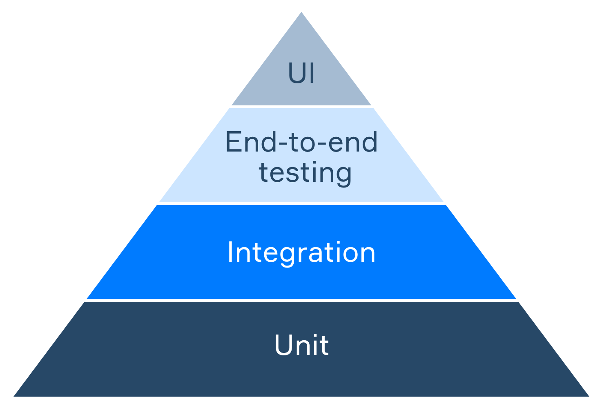
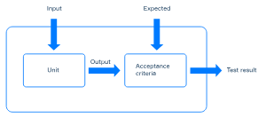

# Avoid bugs

It is almost impossible to avoid all bugs in a large program, but it is possible to reduce their number. 

1. **Make sure you know what to do**. As a programmer, you need to understand the requirements of a program that you are going to work on. If you have doubts, you can always find some help on the Internet or among fellow developers.

2. **Decompose a program** into small units that are easy to look through and understand. A good architecture reduces software complexity, and, as a consequence, the number of errors.

3. **Write easy-to-read-code** and follow all the standards of the language. It will also allow you to make fewer errors.

4. **Write automated tests** that will check the program at the build time.

## Functional testing

Functional testing checks if the output satisfies some specific requirements or not. Its main task is to confirm that the functionality of an application or system behaves as expected.

There should be something that defines what is acceptable and what is not. Usually, it's written in a specification. It is a document that describes the expected behavior of a program.

## Test pyramid

The key concept that represents different kinds of tests is the test pyramid. This is a great visual aid that shows different test levels. It also shows the extent of the tests at each level.

At the lower levels, there are more tests and they go faster, as they are small and aimed at testing individual functions or features.

## Unit testing

It requires writing tests for every non-trivial function or method. With it, you can quickly check whether the latest change in the code has led to some new errors in the already tested parts of the program.

It also facilitates the detection and elimination of such errors. **The goal of unit testing is to isolate individual parts of a program and show that each of these parts work.**

## Integration testing

They take the already tested units as input, group them into larger sets, run the tests defined in the test plan for these sets, and present them as outputs and inputs for subsequent system testing. **The goal is to check the integration of the application with all the outside components.**

## End-to-end testing

**End-to-end testing** is a software testing methodology to entirely test an application flow. **The purpose of end-to-end testing is to simulate the real user scenario and validate the system that is being tested, as well as its components, for integration and data integrity.**

It is performed under real-world scenarios like communication of the application with hardware, network, database, and other applications.

## UI testing

UI testing stands for User Interface testing. The idea is that the QA engineers simulate user actions. clicks on buttons and links, and other actions of a similar type. The point is to check the interactions between the components.

UI testing can be performed not only by the developers but also by the users. This functional testing type is called **Beta testing**.

**Beta** or **Acceptance testing** is carried out at the very end when the raw or beta version of the product is ready. 

## Smoke and Regression

**Smoke testing** is a testing technique that is inspired by hardware testing, which checks for the smoke from the hardware components once the hardware's power is switched on.

Smoke Testing means a minimal set of tests to find some obvious errors.

It makes no sense to send a program that has not passed this test for deeper testing.

**Regression testing** is often done after a smoke test and some code changes. Its goal is to confirm that these changes have not negatively impacted the existing functionality/feature set

## Unit Test

We will consider one that is performed by developers: unit testing. 
This is probably the most popular methodology: it implies testing the behavior of a unit of an application.
A unit is a portion of code that does exactly one task, so it's the smallest testable part of an application.

### Steps to test a unit

The main idea of unit testing is to isolate a specific unit and check that it works properly.

The test goes through the following stages:

- We create two datasets: the input and the expected output;
- We define acceptance criteria: some conditions determining if the unit works as expected 
(usually, the acceptance criterion is a comparison of the actual output with the expected one);
- We pass the created input dataset to the tested unit;
- The input invokes code of the tested unit;
- The code produces an output;
- The produced output is checked by the acceptance criteria, 
which compares the actual output with the expected one;
- Acceptance criteria return the result: pass or fail.

## Manual Vs Automated

All these steps can be carried out manually or automated. 
It is in fact very uncommon to opt for manual unit testing, and there are a couple of sound reasons for that. 

- First, testing is a really repetitive process: every time you make a small change in your code, you have to retest it. 
Doing this manually would be daunting. 
Second, unit testing can be easily automated, so there is simply no reason to do it manually. Automated test cases are reusable. 
Suppose you add a new feature to your program; you can execute existing test cases to check whether the new feature has affected the application.

- Secondly, unit testing protects your code from further incorrect changes.

- Finally, unit testing makes the integration process easier.

Unit testing is an essential part of a developer's daily work. Even though it is quite time-consuming, it protects your code from bugs and saves you a lot of energy at the end of the day.