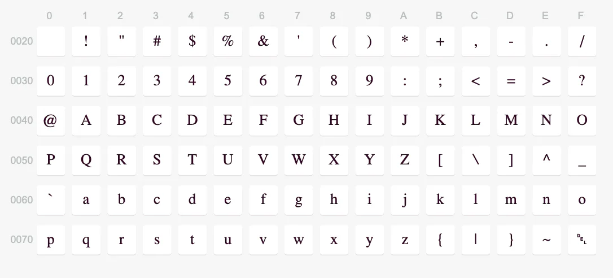
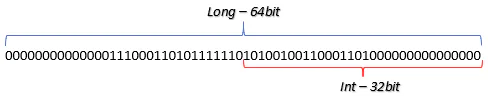
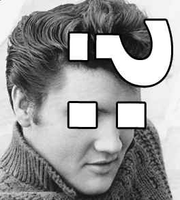

# Datatype

## Variable types

A variable's type is set when the variable is declared:

```kotlin
val text = "Hello, I am studying Kotlin now."
val n = 1
```

In this case, Kotlin knows that text is a string and n is a number. Kotlin determines the types of both variables automatically. This mechanism is called type inference.

You can also specify the type of a variable when declaring it:


```kotlin
val text: String = "Hello, I am studying Kotlin now."
val n: Int = 1
```

## Boolean

Boolean is a special data type that has only two possible values — true and false

### Logical operators

Boolean type variables construct logical statements with the help of logical operators. Kotlin has four logical operators: `NOT`, `AND`, `OR`, and `XOR`:

- NOT is a unary operator that reverses the Boolean value. It can be denoted with `!`.

- AND is a binary operator that returns true if both operands are true. Otherwise, it returns false. It can be denoted with `&&`

- OR is a binary operator that returns true if at least one operand is true. Otherwise, it returns false. It can be denoted with `||`.

- XOR (exclusive OR) is a binary operator that returns true if the Boolean operands have different values. Otherwise, it is `false`.


## Numbers

Kotlin provides several types for **integers** and **fractional** numbers.

If an integer value contains a lot of digits, we can add underscores to divide the digits into blocks to make this number more readable: for example, `1_000_000` is much easier to read than `1000000`.

**Integer numbers** (0, 1, 2, ...) are represented by the following four types: `Long`, `Int`, `Short`, `Byte` (from the largest to the smallest). The integer type range can be calculated as −(2n−1) to (2n−1)−1, where n is the number of bits. The range includes 0, that's why we subtract 1 from the upper bound.

- **Byte**: 8 bits (1 byte), range varies from -128 to 127;
- **Short**: 16 bits (2 bytes), range varies from -32768 to 32767;
- **Int**: 32 bits (4 bytes), range varies from -(2^31) to (2^31) - 1;
- **Long**: 64 bits (8 bytes), range varies from -(2^63) to (2^63) - 1.

The size cannot be changed. It does not depend on the operating system or hardware.

**Floating-point** types represent numbers with fractional parts. Kotlin has two such types: `Double` (64 bits) and `Float` (32 bits). These types can store only a limited number of decimal digits (~6-7 for `Float` and ~14-16 for `Double`).

## String 

To write strings, we wrap characters in double quotes instead of single ones. Here are some valid examples: "text", "I want to learn Kotlin", "123456", "e-mail@gmail.com". So, strings can include letters, digits, whitespaces, and other characters.


### Unicode

<details>
  <summary>
    The solution to all these problems had to be a unified system and that is when Unicode comes in.
  </summary>
    As you know, computers operate in binary code so, naturally, different kinds of symbols that we use need to be transformed into numbers. For this purpose, different encodings were created and implemented over the years.

    One of the earliest was the ASCII encoding. It's a 7-bit encoding that contains 128(2^7) symbols based on the English alphabet. It wasn't perfect for everyone for several reasons.

    - First, computers started to use 8-bit sequences, bytes, for storing information and ASCII strings had extra memory that wasn't being used.
    - Second and most important, 128 symbols just wasn't enough for everyone, not even for the English script itself

    There was a clear need for new, improved encodings and many of them started to appear after ASCII. There were extensions of ASCII (like ISO 8859-1) or encodings for specific scripts (for example, Windows-1251 for Cyrillic). However, in different encodings, the same number could represent different symbols and that would complicate communications. 
</details>

Unicode is a standard for encoding and representing text. It is not an encoding per se since it doesn't determine how symbols are converted to bytes. **It is simply a specification that defines the mapping between symbols and numbers.**

Unicode can also be viewed as an extension of the `ASCII` table: in fact, the first 128 numbers in the Unicode represent ASCII symbols. All in all, Unicode can accommodate 1,112,064 code points, but as of May 2019, only 137,994 are occupied. The fact that most code points aren't designated yet is also one of Unicode's advantages. It means that for years and years to come, we can add new letters, scripts, punctuation marks, and pictograms to the standard without running out of space.

Unicode consists of two parts: **Universal character set**(UCS), and **Universal transformation format** (UTF).

UCS is essentially an index of all symbols supported by the Unicode and codes for those symbols.This is a part of Basic Latin, the symbols that have traveled from ASCII:

In Unicode, every symbol corresponds to a number—**code point**. A code point is usually presented with U+ followed by its hexadecimal value. 
The hexadecimal number in the code has from 4 to 6 digits depending on its place in the standard. For example, the code for the Latin Capital Letter Q is `U+0051`.


Unicode code points are divided into 17 planes with numbers from 0 to 16. Each plane is a continuous group of 65 536 (2^16) code points. The plane with the number 0 is called **Basic Multilingual Plane** (BMP) and it contains characters for most modern writing systems and languages as well as many symbols. The ASCII part of the BMP includes the first 128 characters, from `U+0000` to `U+007F`.

The rest of the planes (1 through 16) are called "supplementary planes". Most of the supplementary planes are unassigned and empty which leaves room for additions.

The **Supplementary Multilingual Plane** (SMP) (codes from `U+10000` to `U+1FFFF`) is the next plane after BMP. It includes many historic scripts and, what is quite interesting, special characters and symbols. SMP has musical notations, alchemical symbols, geometric shapes, and even emojis! If your favorite programming language supports Unicode strings, chances are you can put emojis or other interesting characters in your strings!

### Unicode Implementation

We've already mentioned that along with UCS, Unicode has **UTF — Universal Transformation Format**.
UTF is a set of encodings that support Unicode. Encodings describe how symbols (or, rather, their code points) are transformed into bytes according to a particular character set and vice versa.

UTF-8 is the most commonly used encoding in the world as around 94% of the Internet is encoded in UTF-8. UTF-8 uses from 1 to 4 bytes per code point and is capable of representing all code points of the Unicode. UTF-8 is also backward compatible with ASCII.

## Char type

A character can also be represented by its hexadecimal code in the Unicode table. The code starts with `\u`:

```kotlin
val ch = '\u0040' // it represents '@'
println(ch) // @
```

Although we use a sequence of characters to represent such code, the code itself represents exactly one character.

### Escape sequences

There are some special characters starting with a backslash `\`, which are known as **escape** or **control sequences**.

- `'\n'` is the newline character;
- `'\t'` is the tab character;

- `'\r'` is the carriage return character;

- `'\\'` is the backslash character itself;

- `'\''` is the single quote mark;

- `'\"'` is the double quote mark.

### Relational operations with characters

You can compare characters using relational operations (`==,` `<`, `>`, `<=`, `>=`, and `!=`) according to their position in the Unicode table.


Using relational operations and codes, we can check whether a Char is a digit: all ten digits have codes from '\u0030' to '\u0039'.

```kotlin
fun main() {
    val ch = readln().first()
    val isDigit = ch >= '\u0030' && ch <= '\u0039'

    println(isDigit)
}
```


## Type Conversion

Type conversion, or type casting, involves switching a value from one data type to another.
This is notably critical in Kotlin because it is a statically typed language, which signifies that types are identified and strictly applied at compile time.

### Conversion between numeric types

The three most common numeric types are: `Int`, `Long`, and `Double`. Sometimes, you may need to assign a value of one numeric type to a variable of another numeric type. In this case, you need to carry out **type conversion** by invoking a special function, for example, `toInt()`, `toLong()`, `toDouble()`, and so on.

>![!CAUTION]
> Keep in mind that you need to perform these operations when the target type is larger than the source type

### Conversion to Short and Byte types

As you know, the Short and Byte types are really small. These types are rarely used, and if you need to store an integer number, you should use Int. To convert something to these type You need to convert `Double` or `Float` to `Int` and then convert the result to `Short` or `Byte`:

```kotlin
val floatNumber = 10f
val doubleNumber = 1.0

val shortNumber = floatNumber.toShort() // avoid this
val byteNumber = doubleNumber.toByte()  // avoid this

val shortNumber = floatNumber.toInt().toShort() // correct way
val byteNumber = doubleNumber.toInt().toByte()  // correct way
```

### String conversion

Sometimes you need to get a string representation of a value of another type. Kotlin provides the toString() function for that.
A string can be converted to a number or even to a boolean value **but not to a single character.**

However, if you convert a string to a boolean value, no errors will occur. If the string is `"true"` (case insensitive), it will produce a true `boolean` value, otherwise a `false` one.

### Problems with type conversion

If you have a value of a floating type, a Double value, for example, you may convert it to a value of an integer type, such as Int or Long the fractional part is simply dropped. Be careful with this conversion!

```kotlin
val d: Double = 12.5
val n: Long = d.toLong() // 12
```

Another problem may occur when you want to convert a number from a larger type to a smaller type ( `Long` or `Double` to `Int`) using the functions mentioned above:

```kotlin
// If the values are quite small, it works fine
val d: Double = 10.2
val n: Long = 15

val res1: Int = d.toInt() // 10
val res2: Int = n.toInt() // 15
// However, this conversion may truncate the value, as Long and Double can store numbers larger than the truncated Int number.
// The same problem may occur if you try to convert Int to Short or Byte. 
val bigNum: Long = 1_000_000_000_000_000

val n: Int = bigNum.toInt() // -1530494976
```

**This problem is known as type overflow.**


In this example, we tried to put the Long variable in Int. A cut occurred, the lower bits of the number remained and the higher bits were lost, the result is again unpredictable. Look at how this happens:



**It is important to remember the following points:**
- Data type overflow errors are programmer errors.
- Program behavior in the case of data type overflow is unpredictable.
- The compiler will not warn you for type overflows, so you need to correctly select data types for variables, as well as carefully monitor the transformation of data types.

So, if you want to convert a larger type value into a smaller one, make sure that the truncation is not going to mess up your program.


### When different types meet: type coercion

What happens if we calculate the sum of Int and Long variables? 

In such cases, **the compiler automatically sets all components (it's called type coercion) and the result type to the widest type in the expression**
Ex:
```kotlin
val num: Int = 100
val longNum: Long = 1000
val result = num + longNum // 1100, Long
```

However, the Byte and Short types are unusual in this respect. If you need to do some calculations with these types, the result of the calculation is Int The picture below illustrates the direction of this casting:


`Byte` and `Byte`, `Short` and `Short`, `Short` and `Byte`.

So what should we do if we want to sum two `Byte` variables and get a `Byte` result? Well, in this case, you must manually perform type conversion:

```kotlin
val one: Byte = 1
val five: Byte = 5
val six = (one + five).toByte() // 6, Byte
```


## Nullable and non-nullable types

### Nullability


we just added a `?` sign right after the type of our variable. We marked our name variable as nullable.

```kotlin
var age: Int? = null
```
without a `?` sign in the type you can't assign null to a variable.
### Accessing nullable variables

we can access the length this way:

```kotlin
print(name?.length)
```

This `?`. pair of symbols is called a **safe call** in Kotlin. 

So, Kotlin introduces **nullable types** that differ from **non-nullable** ones

- In Kotlin, a nullable type is a variable that can hold a null value, in contrast to a non-nullable type, which cannot.

- In Kotlin, a non-nullable is a type that cannot hold a null value.

### Avoiding NPEs. Null safety

Null safety is a crucial feature in Kotlin's design. Kotlin's type system aims to get rid of null references, which commonly lead to bugs and crashes in software development.

### Save calls
If you need to have access to properties or call methods of a nullable object, you must check if it's null first.

```kotlin
val name: String? = "Kotlin"
val length = if (name != null) name.length else null 
```

But it's quite a long expression! You can get the same result if you use the safe call operator `?`. that allows you to access properties or call methods on nullable variables without risking a `NullPointerException`

```kotlin
val name: String? = "Kotlin"
val length = name?.length // length is null if name is null
```

### Elvis Operator

we can simplify the code with the **Elvis operator**:

```kotlin
var name: String? = "Kotlin"
val length: Int? = name?.length
print(length ?: 0)
```

You may ask, but why is it called Elvis? Look: there he is!



### The Not-Null Assertion Operator

The not-null assertion operator`!!`. **The code won't crash only if you're 100% sure that your variable won't be** `null`


This operator is used to stop the program when `null` is encountered.

Why `!!` overuse is problematic:

1. **Defeats Null Safety**: Kotlin's type system is designed to handle nulls gracefully. Overusing !! bypasses these safety measures.

2. **Code Smell**:  Regular use often indicates a disregard for proper null checks and can lead to code that's less stable and more challenging to maintain.

3. **Unexpected Crashes**: It can cause your application to crash unexpectedly if proper null checks are not done before using `!!`.


### Best Practices for Null Safety in Kotlin

1. **Use Nullable Types Wisely**: Only use nullable types (`Type?`) when a variable can indeed be `null`. If a variable should not be `null`, use a non-nullable type.

2. **Safe Calls (?.)**: Use the safe call operator when accessing properties or methods on a nullable object. This will return `null` if the object is `null` instead of throwing a `NullPointerException`.

3. **Elvis Operator (?:)**: The Elvis operator lets you offer an alternative value if an expression evaluates to null.

4. **Non-Null Assertion (!!)**: Use this operator only when you are certain that the value is not `null`. It will throw a `NullPointerException` if the value is `null`.