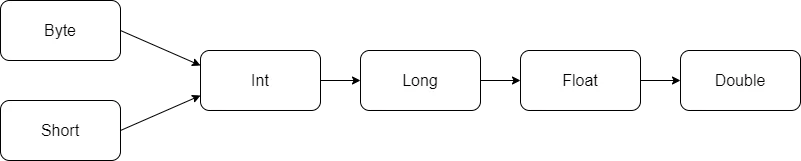

# Datatype

## Variable types

A variable's type is set when the variable is declared:

```kotlin
val text = "Hello, I am studying Kotlin now."
val n = 1
```

In this case, Kotlin knows that text is a string and n is a number. Kotlin determines the types of both variables automatically. This mechanism is called type inference.

You can also specify the type of a variable when declaring it:


```kotlin
val text: String = "Hello, I am studying Kotlin now."
val n: Int = 1
```

## Boolean

Boolean is a special data type that has only two possible values — true and false

### Logical operators

Boolean type variables construct logical statements with the help of logical operators. Kotlin has four logical operators: `NOT`, `AND`, `OR`, and `XOR`:

- NOT is a unary operator that reverses the Boolean value. It can be denoted with `!`.

- AND is a binary operator that returns true if both operands are true. Otherwise, it returns false. It can be denoted with `&&`

- OR is a binary operator that returns true if at least one operand is true. Otherwise, it returns false. It can be denoted with `||`.

- XOR (exclusive OR) is a binary operator that returns true if the Boolean operands have different values. Otherwise, it is `false`.


## Numbers

Kotlin provides several types for **integers** and **fractional** numbers.

If an integer value contains a lot of digits, we can add underscores to divide the digits into blocks to make this number more readable: for example, `1_000_000` is much easier to read than `1000000`.

**Integer numbers** (0, 1, 2, ...) are represented by the following four types: `Long`, `Int`, `Short`, `Byte` (from the largest to the smallest). The integer type range can be calculated as −(2n−1) to (2n−1)−1, where n is the number of bits. The range includes 0, that's why we subtract 1 from the upper bound.

- **Byte**: 8 bits (1 byte), range varies from -128 to 127;
- **Short**: 16 bits (2 bytes), range varies from -32768 to 32767;
- **Int**: 32 bits (4 bytes), range varies from -(2^31) to (2^31) - 1;
- **Long**: 64 bits (8 bytes), range varies from -(2^63) to (2^63) - 1.

The size cannot be changed. It does not depend on the operating system or hardware.

**Floating-point** types represent numbers with fractional parts. Kotlin has two such types: `Double` (64 bits) and `Float` (32 bits). These types can store only a limited number of decimal digits (~6-7 for `Float` and ~14-16 for `Double`).

## String 

To write strings, we wrap characters in double quotes instead of single ones. Here are some valid examples: "text", "I want to learn Kotlin", "123456", "e-mail@gmail.com". So, strings can include letters, digits, whitespaces, and other characters.


## Type Conversion

Type conversion, or type casting, involves switching a value from one data type to another.
This is notably critical in Kotlin because it is a statically typed language, which signifies that types are identified and strictly applied at compile time.

### Conversion between numeric types

The three most common numeric types are: `Int`, `Long`, and `Double`. Sometimes, you may need to assign a value of one numeric type to a variable of another numeric type. In this case, you need to carry out **type conversion** by invoking a special function, for example, `toInt()`, `toLong()`, `toDouble()`, and so on.

>![!CAUTION]
> Keep in mind that you need to perform these operations when the target type is larger than the source type

### Conversion to Short and Byte types

As you know, the Short and Byte types are really small. These types are rarely used, and if you need to store an integer number, you should use Int. To convert something to these type You need to convert `Double` or `Float` to `Int` and then convert the result to `Short` or `Byte`:

```kotlin
val floatNumber = 10f
val doubleNumber = 1.0

val shortNumber = floatNumber.toShort() // avoid this
val byteNumber = doubleNumber.toByte()  // avoid this

val shortNumber = floatNumber.toInt().toShort() // correct way
val byteNumber = doubleNumber.toInt().toByte()  // correct way
```

### String conversion

Sometimes you need to get a string representation of a value of another type. Kotlin provides the toString() function for that.
A string can be converted to a number or even to a boolean value **but not to a single character.**

However, if you convert a string to a boolean value, no errors will occur. If the string is `"true"` (case insensitive), it will produce a true `boolean` value, otherwise a `false` one.

### Problems with type conversion

If you have a value of a floating type, a Double value, for example, you may convert it to a value of an integer type, such as Int or Long the fractional part is simply dropped. Be careful with this conversion!

```kotlin
val d: Double = 12.5
val n: Long = d.toLong() // 12
```

Another problem may occur when you want to convert a number from a larger type to a smaller type ( `Long` or `Double` to `Int`) using the functions mentioned above:

```kotlin
// If the values are quite small, it works fine
val d: Double = 10.2
val n: Long = 15

val res1: Int = d.toInt() // 10
val res2: Int = n.toInt() // 15
// However, this conversion may truncate the value, as Long and Double can store numbers larger than the truncated Int number.
// The same problem may occur if you try to convert Int to Short or Byte. 
val bigNum: Long = 1_000_000_000_000_000

val n: Int = bigNum.toInt() // -1530494976
```

**This problem is known as type overflow.**


In this example, we tried to put the Long variable in Int. A cut occurred, the lower bits of the number remained and the higher bits were lost, the result is again unpredictable. Look at how this happens:


**It is important to remember the following points:**
- Data type overflow errors are programmer errors.
- Program behavior in the case of data type overflow is unpredictable.
- The compiler will not warn you for type overflows, so you need to correctly select data types for variables, as well as carefully monitor the transformation of data types.

So, if you want to convert a larger type value into a smaller one, make sure that the truncation is not going to mess up your program.


### When different types meet: type coercion

What happens if we calculate the sum of Int and Long variables? 

In such cases, **the compiler automatically sets all components (it's called type coercion) and the result type to the widest type in the expression**
Ex:
```kotlin
val num: Int = 100
val longNum: Long = 1000
val result = num + longNum // 1100, Long
```

However, the Byte and Short types are unusual in this respect. If you need to do some calculations with these types, the result of the calculation is Int The picture below illustrates the direction of this casting:



`Byte` and `Byte`, `Short` and `Short`, `Short` and `Byte`.

So what should we do if we want to sum two `Byte` variables and get a `Byte` result? Well, in this case, you must manually perform type conversion:

```kotlin
val one: Byte = 1
val five: Byte = 5
val six = (one + five).toByte() // 6, Byte
```