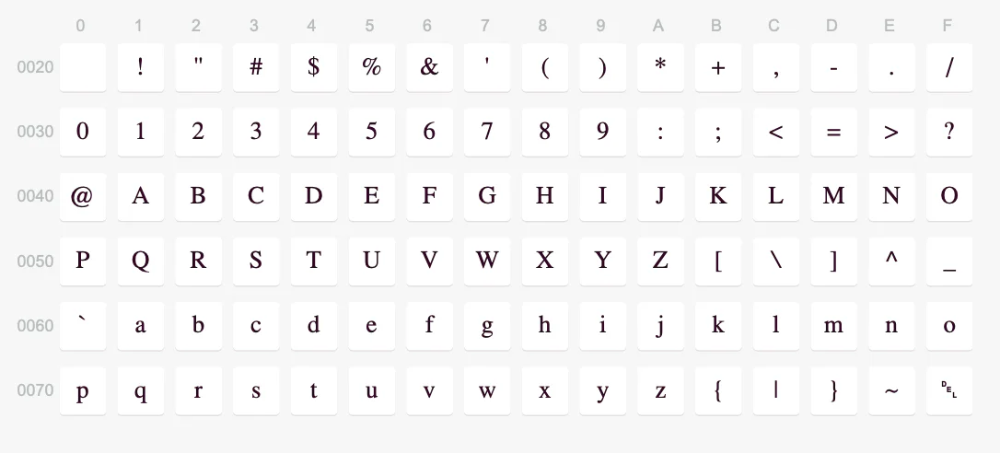

## String 

To write strings, we wrap characters in double quotes instead of single ones. Here are some valid examples: "text", "I want to learn Kotlin", "123456", "e-mail@gmail.com". So, strings can include letters, digits, whitespaces, and other characters.

### Unicode

<details>
  <summary>
    The solution to all these problems had to be a unified system and that is when Unicode comes in.
  </summary>
    As you know, computers operate in binary code so, naturally, different kinds of symbols that we use need to be transformed into numbers. For this purpose, different encodings were created and implemented over the years.

    One of the earliest was the ASCII encoding. It's a 7-bit encoding that contains 128(2^7) symbols based on the English alphabet. It wasn't perfect for everyone for several reasons.

    - First, computers started to use 8-bit sequences, bytes, for storing information and ASCII strings had extra memory that wasn't being used.
    - Second and most important, 128 symbols just wasn't enough for everyone, not even for the English script itself

    There was a clear need for new, improved encodings and many of them started to appear after ASCII. There were extensions of ASCII (like ISO 8859-1) or encodings for specific scripts (for example, Windows-1251 for Cyrillic). However, in different encodings, the same number could represent different symbols and that would complicate communications. 
</details>

Unicode is a standard for encoding and representing text. It is not an encoding per se since it doesn't determine how symbols are converted to bytes. **It is simply a specification that defines the mapping between symbols and numbers.**

Unicode can also be viewed as an extension of the `ASCII` table: in fact, the first 128 numbers in the Unicode represent ASCII symbols. All in all, Unicode can accommodate 1,112,064 code points, but as of May 2019, only 137,994 are occupied. The fact that most code points aren't designated yet is also one of Unicode's advantages. It means that for years and years to come, we can add new letters, scripts, punctuation marks, and pictograms to the standard without running out of space.

Unicode consists of two parts: **Universal character set**(UCS), and **Universal transformation format** (UTF).

UCS is essentially an index of all symbols supported by the Unicode and codes for those symbols.This is a part of Basic Latin, the symbols that have traveled from ASCII:

In Unicode, every symbol corresponds to a number—**code point**. A code point is usually presented with U+ followed by its hexadecimal value. 
The hexadecimal number in the code has from 4 to 6 digits depending on its place in the standard. For example, the code for the Latin Capital Letter Q is `U+0051`.


Unicode code points are divided into 17 planes with numbers from 0 to 16. Each plane is a continuous group of 65 536 (2^16) code points. The plane with the number 0 is called **Basic Multilingual Plane** (BMP) and it contains characters for most modern writing systems and languages as well as many symbols. The ASCII part of the BMP includes the first 128 characters, from `U+0000` to `U+007F`.

The rest of the planes (1 through 16) are called "supplementary planes". Most of the supplementary planes are unassigned and empty which leaves room for additions.

The **Supplementary Multilingual Plane** (SMP) (codes from `U+10000` to `U+1FFFF`) is the next plane after BMP. It includes many historic scripts and, what is quite interesting, special characters and symbols. SMP has musical notations, alchemical symbols, geometric shapes, and even emojis! If your favorite programming language supports Unicode strings, chances are you can put emojis or other interesting characters in your strings!

### Unicode Implementation

We've already mentioned that along with UCS, Unicode has **UTF — Universal Transformation Format**.
UTF is a set of encodings that support Unicode. Encodings describe how symbols (or, rather, their code points) are transformed into bytes according to a particular character set and vice versa.

UTF-8 is the most commonly used encoding in the world as around 94% of the Internet is encoded in UTF-8. UTF-8 uses from 1 to 4 bytes per code point and is capable of representing all code points of the Unicode. UTF-8 is also backward compatible with ASCII.

## Getting substrings

> [!NOTE]
> Don't forget that strings are immutable, therefore, functions that change a string return a new string.

Oftentimes, you need to get only a certain part of a string. Kotlin provides the `substring` function for this.

The `substring` function accepts `startIndex` and `lastIndex` as arguments and returns a string that starts at the `startIndex` and ends right **before** the `lastIndex`.

The parameter `lastIndex` can be omitted; then you will get a `substring` from the `startIndex` element to the end of the original string.

```kotlin
val greeting = "Hello"
println(greeting.substring(0, 3)) // "Hel"
println(greeting.substring(1, 3)) // "el"
println(greeting.substring(2))    // "llo"
println(greeting.substring(4, 5)) // "o"
```
The `substring` method is not the only way to get part of a string. You can also use the `substringAfter` and `substringBefore` functions:

>[!NOTE]
> Most of the functions in this topic accept not only characters but also strings as arguments.
The function accept the second argument. 
Just keep it in mind that as a second argument, you can specify the message to be returned if the `delimiter` argument is not present in the string. 
For example, .`substringBefore('z', "can't find a character")`.

The functions `substringBeforeLast` and `substringAfterLast` have a logic similar to `substringBefore` and `substringAfter` but return a string before or after the last occurrence of the `delimiter`.

## Replacing parts of a string

The `replace` function **replaces all** occurrences of the first argument in the string with the second argument.
If you need to replace only the **first occurrence** of an argument, use `replaceFirst`.

## Changing the case

in Kotlin you can use the `lowercase` function:

```kotlin
val example = "UPPERCASE String"
println(example.lowercase()) // uppercase string
```
If you need to do the opposite, then use the `uppercase` function:

```kotlin
val example = "Lowercase String"
println(example.uppercase()) // LOWERCASE STRING
```

## Splitting the string

A string can be separated by delimiters to a list of strings. To perform this, call the method split() , it divides a string into substrings by a **separator**.
The method returns a `List` of all the substrings. 

```kotlin
val sentence = "a long text"
val wordsList: List<String> = sentence.split(" ") // ["a", "long", "text"]
```
