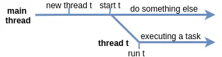

# Thread as Object

## Threads in Kotlin

Kotlin was originally designed with built-in multithreading support. Threads are supported on the level of the JVM, the level of the language (special keywords), and the level of the standard library. Every Kotlin program has at least one thread, which is called **main**; it is created automatically by the JVM process to execute statements inside the `main()` function.

## A class for threads

A thread is a sequence of instructions that a program can execute when it runs. Each thread is represented by an object – an instance of the `java.lang.Thread` class (or its subclass).


The `Thread` class has a static method named `currentThread` to obtain a reference to the currently executing thread object

## The information on the main thread

The `Thread` class stores basic information about the thread: its name, identifier (`long`), priority, and some other characteristics that can be obtained through its functions. 

The example below demonstrates how to obtain the characteristics of the main thread by making references to it through an object of the `Thread` class.

```kotlin
fun main() {
    val t: Thread = Thread.currentThread() // main thread

    println("Name: ${t.name}")
    println("ID: ${t.id}")
    println("Alive: ${t.isAlive}")
    println("Priority: ${t.priority}")
    println("Daemon: ${t.isDaemon}")
}
```


- `t.name` returns the thread's name;

- `t.id` returns the thread's unique identifier;

- `t.isAlive` tells us whether the thread has been started and hasn't died yet;

- `t.priority` returns the priority of the given thread.

- `t.isDaemon` checks whether the thread is a **daemon**. A daemon thread (comes from UNIX terminology) is a low priority thread that runs in the background to perform tasks such as garbage collection and so on. The JVM does not wait for daemon threads to stop before exiting, while it does so for non-daemon threads.

Each characteristic can be changed by setting a new value

## Create custom threads with inheritance

Two primary ways to create a new thread that performs a task you need are the following:

- extending the `Thread` class and overriding its `run` method;
  
```kotlin
class HelloThread : Thread() {
    override fun run() {
        val helloMsg = "Hello, i'm $name"
        println(helloMsg)
    }
}
```

- implementing the `Runnable` interface and passing the implementation to the constructor of the `Thread` class.

```kotlin
class HelloRunnable : Runnable {
    override fun run() {
        val threadName = Thread.currentThread().name
        val helloMsg = "Hello, i'm $threadName"
        println(helloMsg)
    }
}
```
the Thread class has a lot of constructors. You may find a full list [here](https://docs.oracle.com/javase/7/docs/api/java/lang/Thread.html#constructor_summary).

## Easy way to create a thread

You may create a thread with the function `thread(...): Thread`. In this case, the executing code is passed in the `block` argument:

```kotlin
import kotlin.concurrent.thread


val t4 = thread(start = false, name = "Thread 4", block = {
        println("Hello, I'm ${Thread.currentThread().name}")
    })
```

This function may have a lot of parameters that will describe your custom thread:

- `start` – if `true`, the thread is immediately started (then the thread will be created);

- `isDaemon` – if `true`, the thread is created as a daemon thread (we will talk about them later);

- `contextClassLoader` – a class loader for loading classes and resources in this thread (you will learn more about this later);

- `name` – the name of the thread;

- `priority` – the priority of the thread;

- `block` – thread's execution code.

## Starting threads

The class Thread has a method called `start()`, which is used to start a thread

At some point, after you invoke this method, the method run will be invoked automatically, but it won't happen immediately.

Also, if you set the value of the `start` parameter to true (it's the default value), you can start the thread without invoking the method `start()`

## Thread working

Here's a picture that explains how a thread actually starts and why it is not happening immediately.



As you may see, there is some delay between starting a thread and the moment when it really starts working (running).

> [!CAUTION]
> You must invoke start if you'd like to execute your code inside run in another thread. If you invoke run directly, the code will be executed in the same thread.
>
> If you try to start a thread more than once, start throws IllegalThreadStateException.

## Thread management

we will consider two commonly used methods in multithreading programming: `sleep()` and `join()`. Both methods may throw an `InterruptedException`.

### Sleeping

The method `Thread.sleep()` causes the currently executing thread to suspend execution for the specified number of milliseconds.

Another way to make the current thread sleep is to use the special class `TimeUnit` from the package `java.util.concurrent`, example:

`TimeUnit.MILLISECONDS.sleep(2000)` performs `Thread.sleep` for 2000 milliseconds;

There are more existing periods: `NANOSECONDS`, `MICROSECONDS`, `MILLISECONDS`, `SECONDS`, `MINUTES`, `HOURS`, and `DAYS`. 

### Joining

The `join` method forces the current thread to wait for the completion of another thread on which the method was called.

The overloaded version of the `join` method takes the waiting time in milliseconds:

```kotlin
thread.join(2000)
```

