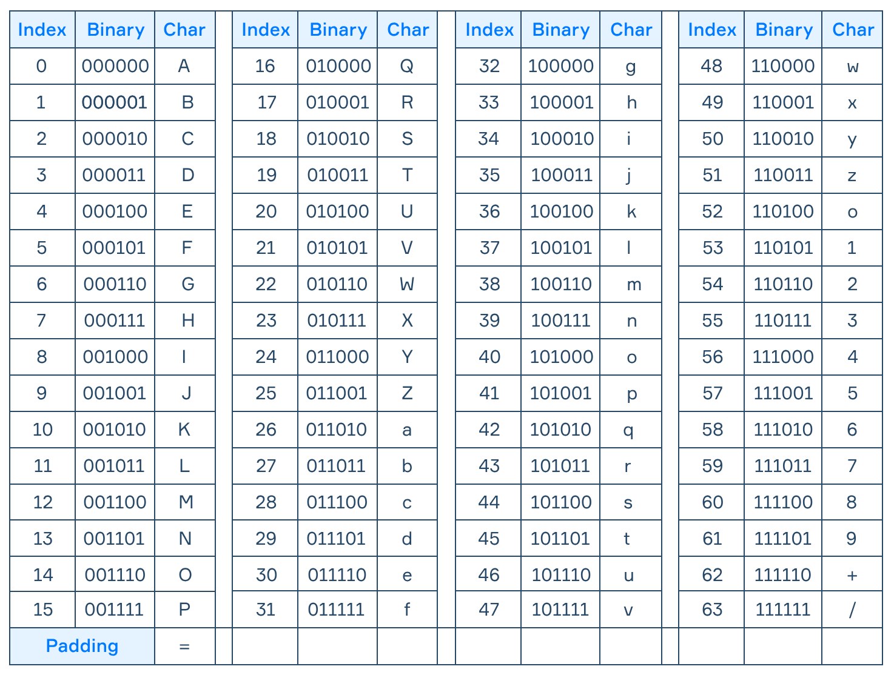
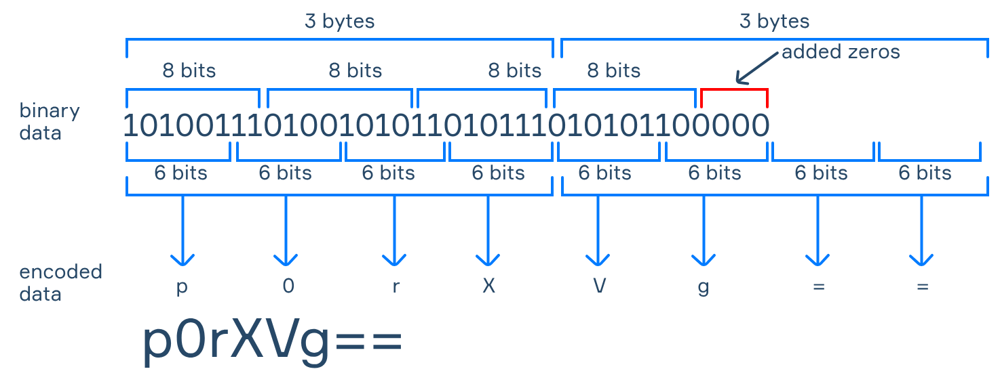

# Base64 và các căn cứ khác

Một số hệ thống truyền dữ liệu dưới dạng văn bản thay vì nhị phân vì lý do tương thích hoặc bảo mật. Để giải quyết vấn đề này, các sơ đồ mã hóa chuyển đổi dữ liệu nhị phân thành văn bản

##Base64

Nói một cách đơn giản, Base64 là một sơ đồ mã hóa để dịch dữ liệu nhị phân sang văn bản bằng cách sử dụng 64 ký hiệu ASCII.

Trong Base64, chúng tôi sử dụng 64 ký hiệu ASCII để thể hiện tất cả các kết hợp có thể có của 0 và 1 trong 6 bit dữ liệu nhị phân. Đây là bảng chỉ mục có 64 ký hiệu ASCII.

Khi nào bạn cần sơ đồ mã hóa này? 
Chủ yếu khi bạn muốn truyền dữ liệu nhị phân 8 bit bằng các protocol được thiết kế để mang dữ liệu văn bản.
Các ứng dụng chính là:

- truyền dữ liệu nhị phân, như tệp đính kèm trong email;
- chèn dữ liệu nhị phân như hình ảnh vào các tệp văn bản như HTML, CSS, XML hoặc tập lệnh;
- một phần của chương trình encryption theo OpenPGP protocol;
- chuyển đổi dữ liệu nhị phân để đưa nó vào URL.

## Nó hoạt động như thế nào?

Chúng ta hãy xem process mã hóa nhị phân bằng base64.

1. Đầu tiên, chia dữ liệu nhị phân 8 bit thành các nhóm, mỗi nhóm chứa 6 bit.
2. Tuy nhiên, bạn có thể thấy rằng cứ 3 byte (24 bit) được mã hóa thành 4 nhóm 6 bit. Nếu phần cuối của chuỗi nhỏ hơn 3 byte (như trong hình), hãy điền vào tất cả các vị trí trống cho nhóm 6 bit có một số bit dữ liệu nhị phân có số 0 (nhóm thứ hai có thêm số 0) và điền vào 6 bit trống còn lại bằng ký hiệu đệm `=`.

## Cơ sở khác*

Các sơ đồ mã hóa cơ sở nhị phân thành văn bản khác chủ yếu khác nhau ở số bit
trong các nhóm sau khi chia dữ liệu nhị phân. Họ có ưu và nhược điểm riêng. Dưới đây là một số sơ đồ mã hóa khác:

- **Base16** chia dữ liệu thành các nhóm 4 bit và sử dụng 16 ký hiệu để mã hóa chúng. Thuận tiện, điều này mã hóa một byte thành 2 ký hiệu cùng một lúc. Do đó, phải mất hai byte để mã hóa một byte, do đó hiệu suất không gian chỉ là 50%.
- **Base32** chia dữ liệu thành các nhóm 5 bit và sử dụng 32 ký hiệu để mã hóa chúng. Ưu điểm của sơ đồ này là sử dụng các ký hiệu của một thanh ghi và loại bỏ các số trông giống nhau như `1` và `0` trông giống với các chữ cái `I` và `O`. Mặc dù nó tiết kiệm không gian hơn base16 nhưng nó vẫn sử dụng nhiều không gian hơn cho dữ liệu được mã hóa so với base64.
- **Base85** mã hóa 4 byte với 5 ký hiệu. Nó coi 4 byte này là toàn bộ số 32 bit (4 byte * 8 bit).
Sơ đồ mã hóa này tiết kiệm không gian hơn base64. Nhưng nó cũng chứa các ký hiệu như `"` `'` `/` `<` có ý nghĩa đặc biệt trong nhiều ngôn ngữ lập trình.

