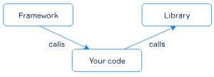

#Framework

framework là một phần mềm phổ quát, có thể tái sử dụng, tạo điều kiện thuận lợi cho việc phát triển các ứng dụng điển hình hoặc các bộ phận của chúng. Nó bao gồm các mẫu mã có cấu trúc và cung cấp chức năng chung có thể dễ dàng mở rộng cho nhu cầu của một ứng dụng cụ thể. Để từ bỏ quyền kiểm soát các nhiệm vụ cấp thấp và tập trung vào các vấn đề cấp cao, bạn nên sử dụng API do framework cung cấp. Nó có thể làm giảm đáng kể tổng thời gian phát triển.

## Framework so với thư viện

Các ứng dụng sử dụng khung được xây dựng dựa trên chúng và mở rộng mã của chúng để có được chức năng cụ thể. Theo một nghĩa nào đó, framework đóng vai trò là bộ xương của một ứng dụng hoặc các bộ phận của nó và đặt ra "luật chơi". Mặt khác, thư viện chỉ cung cấp một số hoạt động cụ thể mà không có ảnh hưởng toàn cầu như vậy. Tuy nhiên, các thư viện có thể được cung cấp như một phần của khung công tác.

Nguyên tắc phổ biến nhất đi kèm với các khung là Đảo ngược điều khiển (IoC).

Trong framework, không giống như trong thư viện hoặc ứng dụng người dùng tiêu chuẩn, luồng điều khiển tổng thể của chương trình không phải do người gọi mà do framework quyết định. Điều đó có nghĩa là framework gọi mã của bạn chứ không phải ngược lại:

