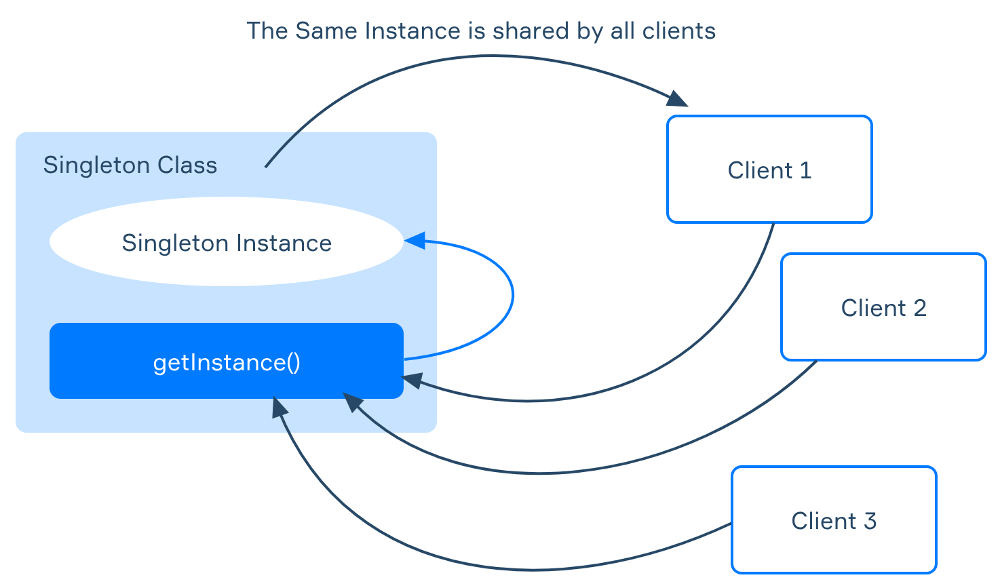

# Mẫu Singleton

Singleton là design pattern sáng tạo cho phép bạn chỉ giữ một phiên bản của một đối tượng và cung cấp quyền truy cập toàn cầu vào nó. 

nó giải quyết được hai vấn đề:

- **Chỉ giữ một phiên bản của một đối tượng** rất hữu ích khi bạn muốn kiểm soát quyền truy cập vào một số tài nguyên được chia sẻ. Khi bạn tạo một đối tượng của một lớp, nếu bạn sử dụng mẫu đơn, bạn sẽ luôn có cùng một đối tượng đó. Trong trường hợp bạn cố gắng tạo một đối tượng khác, mã sẽ trả về đối tượng được khởi tạo đầu tiên mỗi lần.

- **Cung cấp điểm truy cập toàn cầu** để cho phép tất cả client sử dụng các phiên bản đã khởi tạo. Khi giải quyết vấn đề này, bạn cũng nên nén tất cả mã liên quan đến vấn đề đầu tiên trong một lớp, để tránh nó bị phân tán khắp mã của bạn.

## Kết cấu

- **Lớp Singleton** khai báo phương thức tĩnh `getInstance` trả về cùng một phiên bản của lớp riêng của nó.
Hàm tạo của Singleton phải được ẩn khỏi mã client. Gọi phương thức `getInstance` phải là cách duy nhất để nhận đối tượng Singleton.

## Triển vọng

- Bạn có thể chắc chắn rằng một lớp chỉ có một thể hiện duy nhất.
- Bạn có được một điểm truy cập toàn cầu vào phiên bản đó.
- Đối tượng singleton chỉ được khởi tạo khi được yêu cầu lần đầu tiên.

## Hậu quả

- Vi phạm Nguyên tắc Single Responsibility. Mẫu này giải quyết được hai vấn đề vào thời điểm đó.
- Ví dụ, mẫu Singleton có thể che giấu thiết kế xấu khi các thành phần của chương trình biết quá nhiều về nhau.
- Mẫu yêu cầu xử lý đặc biệt trong môi trường đa thread để nhiều luồng không tạo ra một đối tượng đơn lẻ nhiều lần.
- Singleton khó có thể sử dụng unit test do các hàm tạo riêng và các phương thức tĩnh, khiến việc mô phỏng trở nên khó khăn. Các giải pháp là chế giễu sáng tạo, bỏ qua các bài kiểm tra hoặc tránh hoàn toàn Singleton.

## Thẩm quyền giải quyết

- https://refactoring.guru/design-patterns/singleton