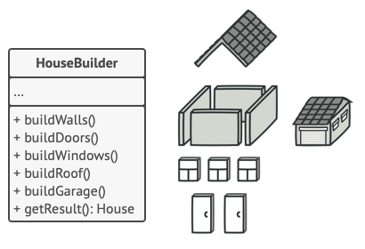
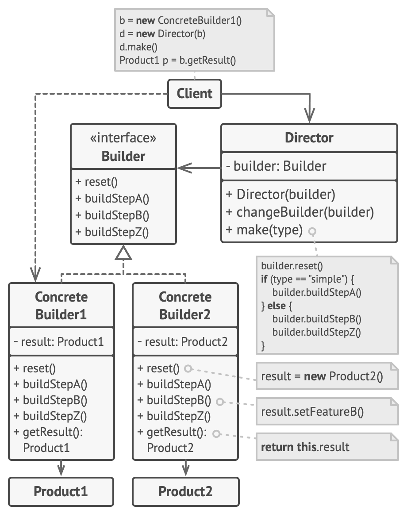
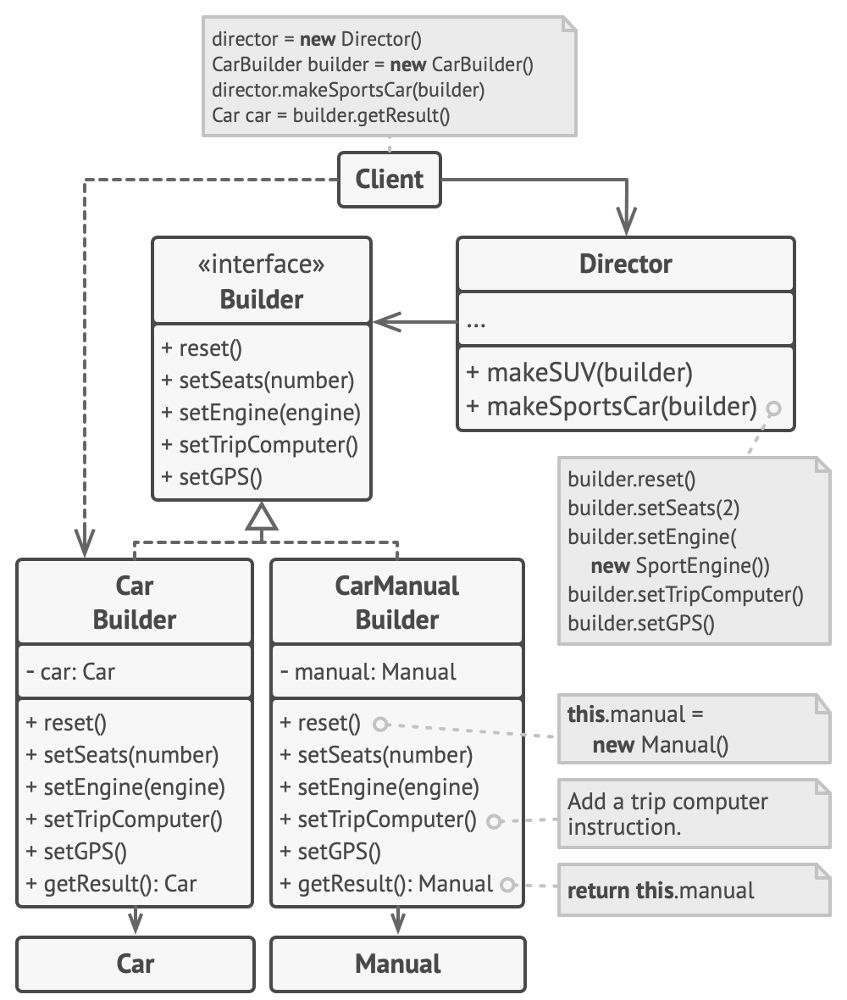

#Builder Pattern

## Vấn đề

Hãy tưởng tượng một đối tượng phức tạp đòi hỏi việc khởi tạo tốn nhiều công sức, từng bước của nhiều trường và đối tượng lồng nhau.
Mã khởi tạo như vậy thường được chôn bên trong một hàm tạo khổng lồ với rất nhiều tham số. 

## Giải pháp

**Builder pattern** đề xuất bạn trích xuất mã xây dựng đối tượng ra khỏi lớp của chính nó và di chuyển nó sang các đối tượng riêng biệt được gọi là **builders**.

Mẫu này tổ chức việc xây dựng đối tượng thành một tập hợp các bước (`buildWalls`, `buildDoor`, v.v.).
Để tạo một đối tượng, bạn thực hiện một loạt các bước này trên đối tượng trình tạo.

Phần quan trọng là bạn không cần phải gọi tất cả các bước.

## Kết cấu

- **Giao diện Builder**:
tuyên bố các bước xây dựng sản phẩm chung cho tất cả các loại nhà xây dựng.

- **Thợ xây dựng bê tông**
cung cấp các cách thực hiện khác nhau của các bước xây dựng.

- **Giám đốc** (Tùy chọn):
xác định thứ tự gọi các bước xây dựng để bạn có thể tạo và sử dụng lại các cấu hình cụ thể của sản phẩm.

- **Khách hàng**:
gán một đối tượng `Builder` cho `Director`, thường thông qua hàm tạo. Giám đốc sau đó sử dụng công cụ xây dựng này cho tất cả các nhiệm vụ xây dựng. Ngoài ra, khách hàng có thể chuyển một trình tạo khác sang phương thức sản xuất, cho phép linh hoạt chuyển đổi trình tạo cho từng sản phẩm.

## Giám đốc

Lớp đạo diễn xác định thứ tự thực hiện các bước xây dựng,
trong khi trình xây dựng cung cấp việc triển khai cho các bước đó.

Việc có một lớp đạo diễn trong chương trình của bạn là không thực sự cần thiết.

Bạn luôn có thể gọi các bước xây dựng theo thứ tự cụ thể trực tiếp từ mã máy khách.
Tuy nhiên, lớp giám đốc có thể là nơi thích hợp để đặt các quy trình xây dựng khác nhau để bạn có thể sử dụng lại chúng trong chương trình của mình.

## Mã giả

## Triển vọng
- **Nguyên tắc Single Responsibility**. Bạn có thể tách mã xây dựng phức tạp khỏi logic nghiệp vụ của sản phẩm.
- Bạn có thể xây dựng đối tượng theo từng bước, trì hoãn các bước xây dựng hoặc chạy các bước theo cách đệ quy.
- Bạn có thể sử dụng lại cùng một mã xây dựng khi xây dựng các cách trình bày sản phẩm khác nhau.

## Hậu quả

- Độ phức tạp tổng thể của mã tăng lên do mẫu yêu cầu tạo nhiều lớp mới.

## thẩm quyền giải quyết:

[mẫu thiết kế xây dựng](https://refactoring.guru/design-patterns/builder)

