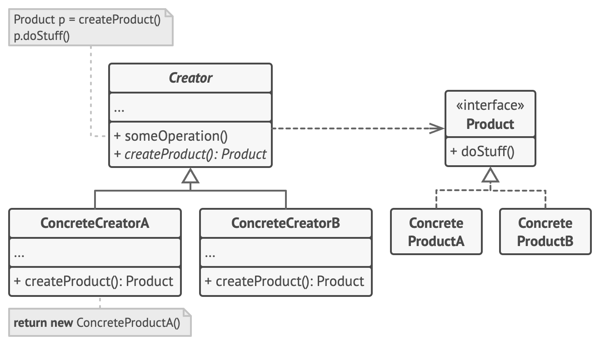
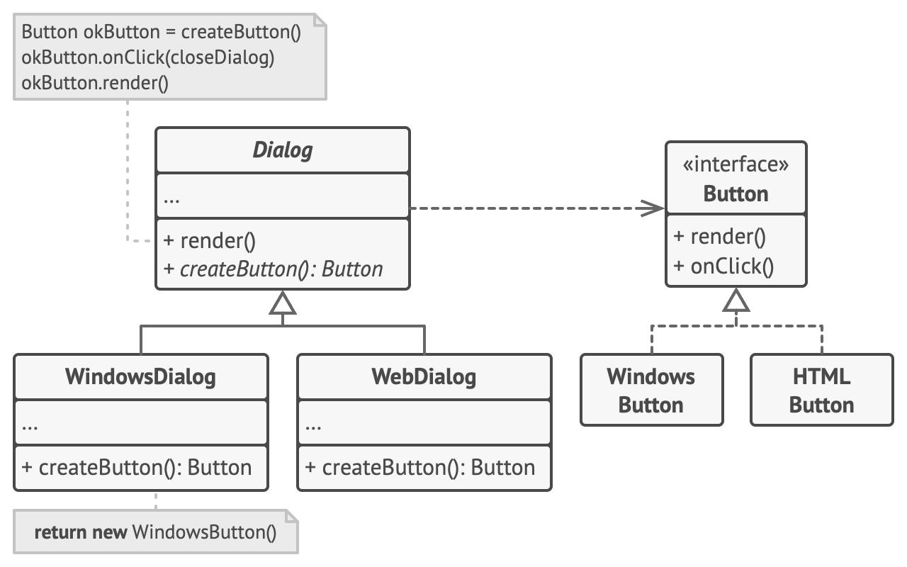

#Factory Method

## Vấn đề

Trong ứng dụng quản lý hậu cần, mã được liên kết chặt chẽ với lớp Xe tải.
Khi thêm Vận tải đường biển (Tàu), cơ sở mã cần được sửa đổi rộng rãi.
Việc bổ sung các loại phương tiện giao thông mới trong tương lai cũng sẽ yêu cầu những thay đổi tương tự, dẫn đến mã lộn xộn với nhiều điều kiện và khả năng bảo trì kém.

## Giải pháp

Mẫu Factory Method thay thế **tạo đối tượng trực tiếp** bằng **factory method**.
Điều này cho phép các lớp con ghi đè factory method và tạo ra các sản phẩm khác nhau mà không cần sửa đổi mã hiện có.

## Kết cấu

- **Sản phẩm**:
khai báo giao diện, giao diện chung cho tất cả các đối tượng có thể được tạo ra bởi người tạo và các lớp con của nó.

- **Sản phẩm bê tông**:
là những cách triển khai khác nhau của giao diện sản phẩm.

- **Người sáng tạo**:
lớp khai báo factory method trả về các đối tượng sản phẩm mới. Điều quan trọng là kiểu trả về của phương thức này phù hợp với giao diện sản phẩm.

- **Người sáng tạo cụ thể**:
ghi đè cơ sở factory method để nó trả về một loại sản phẩm khác.
Lưu ý rằng factory method không phải lúc nào cũng tạo phiên bản mới. Nó cũng có thể trả về các đối tượng hiện có từ bộ đệm, nhóm đối tượng hoặc nguồn khác.

## Mã giả

## Triển vọng

- **Nguyên tắc Single Responsibility**. Bạn có thể di chuyển mã tạo sản phẩm vào một nơi trong chương trình, giúp mã dễ hỗ trợ hơn.
- **Nguyên tắc đóng/mở**. Bạn có thể giới thiệu các loại sản phẩm mới vào chương trình mà không vi phạm mã khách hàng hiện có.
- Tránh sự liên kết chặt chẽ giữa người sáng tạo và sản phẩm cụ thể.

## Hậu quả

- Mã có thể trở nên phức tạp hơn vì bạn cần giới thiệu nhiều lớp con mới để triển khai mẫu.

## Tài liệu tham khảo

- https://refactoring.guru/design-patterns/factory-method

