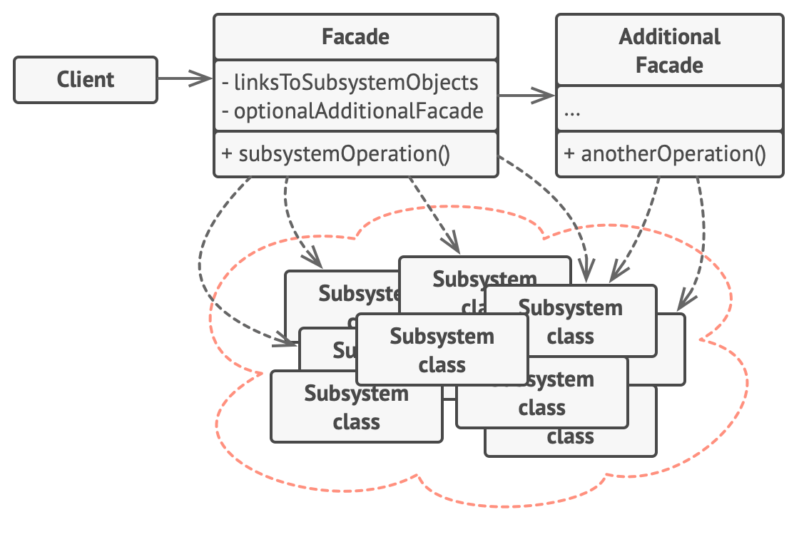
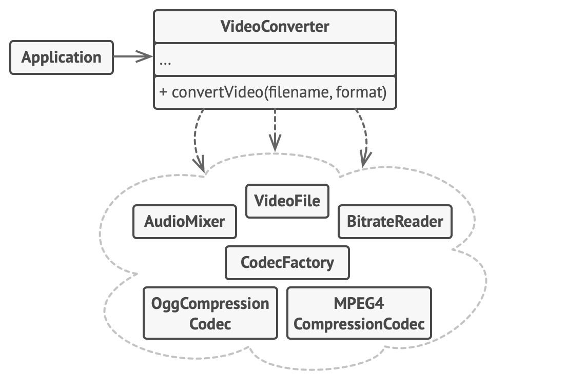

#Facade

## Vấn đề

Hãy tưởng tượng rằng bạn phải làm cho mã của mình hoạt động với một tập hợp lớn các đối tượng thuộc một thư viện phức tạp hoặc framework.
Thông thường, bạn cần khởi tạo tất cả các đối tượng đó, theo dõi các phần phụ thuộc, thực thi các phương thức theo đúng thứ tự, v.v.

Do đó, logic nghiệp vụ của các lớp của bạn sẽ được kết hợp chặt chẽ với các chi tiết triển khai của các lớp bên thứ 3, khiến cho việc hiểu và duy trì trở nên khó khăn.

## Giải pháp

Facade là lớp cung cấp giao diện đơn giản hóa cho một hệ thống phức tạp. Nó ẩn những chi tiết không cần thiết và chỉ hiển thị những chức năng thiết yếu mà khách hàng cần.

## Kết cấu

- **Facade** cung cấp quyền truy cập thuận tiện vào một phần cụ thể của chức năng của hệ thống con.
Nó biết nơi gửi yêu cầu của khách hàng và cách vận hành tất cả các bộ phận chuyển động.

- **Một lớp Facade** (Tùy chọn) bổ sung có thể được tạo để ngăn ngừa ô nhiễm một mặt tiền duy nhất với các tính năng không liên quan có thể biến nó thành một cấu trúc phức tạp khác. Mặt tiền bổ sung có thể được sử dụng bởi cả khách hàng và các mặt tiền khác.

- **Máy khách** sử dụng mặt tiền thay vì gọi trực tiếp các đối tượng hệ thống con.

## Mã giả

## Triển vọng

Bạn có thể tách mã của mình khỏi sự phức tạp của hệ thống con.

## Hậu quả

Một mặt tiền có thể trở thành một đối tượng thần thánh được kết hợp với tất cả các lớp của ứng dụng.

## Thẩm quyền giải quyết

- https://refactoring.guru/design-patterns/facade

