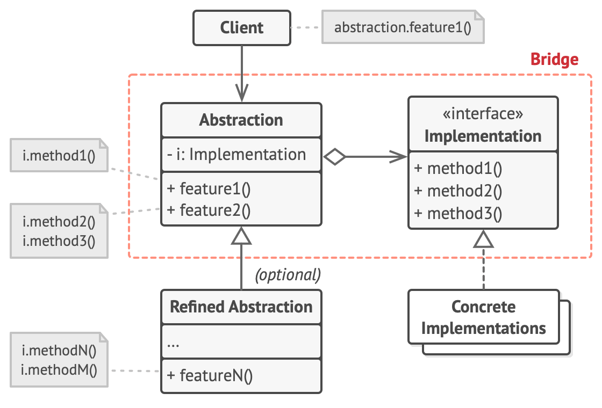
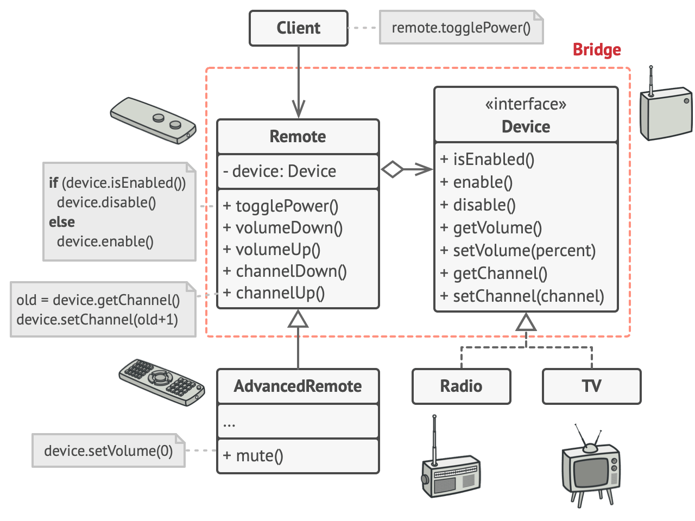

# Cầu

## Vấn đề

Ví dụ: Khi cố gắng mở rộng hệ phân cấp `Shape` (ví dụ: `Circle` và `Square`) bằng màu sắc (ví dụ: `Red` và `Blue`), số lượng lớp con tăng theo cấp số nhân.

Ví dụ: việc thêm `RedCircle` và `BlueSquare` có thể quản lý được nhưng việc giới thiệu các hình dạng hoặc màu sắc mới sẽ dẫn đến bùng nổ lớp, khiến mã trở nên phức tạp và khó bảo trì.

## Giải pháp

Thay vì tạo các lớp con cho mỗi kết hợp `Shape`-`Color`, mã `Color` được trích xuất thành một hệ thống phân cấp riêng biệt (ví dụ: Đỏ và Xanh lam). Lớp `Shape` giữ tham chiếu đến đối tượng `Color`, đóng vai trò là cầu nối giữa hai hệ thống phân cấp.

Bằng cách này, việc thêm hình dạng hoặc màu sắc mới trở nên độc lập, tránh sự tăng trưởng theo cấp số nhân trong hệ thống phân cấp lớp.

## Kết cấu

- **Sự trừu tượng**:
cung cấp logic điều khiển cấp cao. Nó dựa vào đối tượng triển khai để thực hiện công việc cấp thấp thực tế.

- **Việc thực hiện**:
khai báo giao diện chung cho tất cả các triển khai cụ thể.
Một sự trừu tượng chỉ có thể giao tiếp với một đối tượng triển khai thông qua các phương thức được khai báo ở đây.

- **Triển khai cụ thể**: chứa mã dành riêng cho nền tảng.

- **Trừu tượng tinh tế**(Tùy chọn): cung cấp các biến thể của logic điều khiển. Giống như cha mẹ, chúng làm việc với các cách triển khai khác nhau thông qua giao diện triển khai chung.

- Thông thường, **Client** chỉ quan tâm đến việc làm việc với phần trừu tượng. Tuy nhiên, công việc của khách hàng là liên kết đối tượng trừu tượng với một trong các đối tượng triển khai.

## Mã giả

## Triển vọng

- **Nguyên tắc Single Responsibility.**
Bạn có thể tập trung vào logic cấp cao trong phần trừu tượng hóa và vào chi tiết nền tảng khi triển khai.
- **Nguyên tắc đóng/mở**.
Bạn có thể giới thiệu các phần trừu tượng và triển khai mới một cách độc lập với nhau.
- Bạn có thể tạo các lớp và ứng dụng độc lập với nền tảng.
- Mã máy khách hoạt động với sự trừu tượng hóa cấp cao.
Nó không được tiếp xúc với các chi tiết nền tảng.

## Hậu quả

- Bạn có thể làm cho mã phức tạp hơn bằng cách áp dụng mẫu cho một lớp có tính gắn kết cao.

## Sự khác biệt giữa `Bridge` và `Factory Method`
- Mẫu Factory Method là mẫu sáng tạo. Nó chịu trách nhiệm tạo các thể hiện của các đối tượng khác.
- Cầu là một mô hình kết cấu. Nó giải quyết một vấn đề liên quan đến cấu trúc mã của bạn.
Bridge chịu trách nhiệm tách sự trừu tượng khỏi quá trình triển khai. 

## Tham khảo
- https://refactoring.guru/design-patterns/bridge

